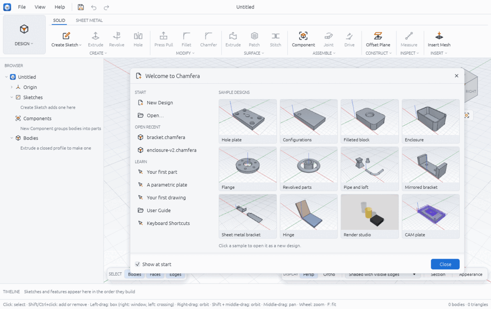
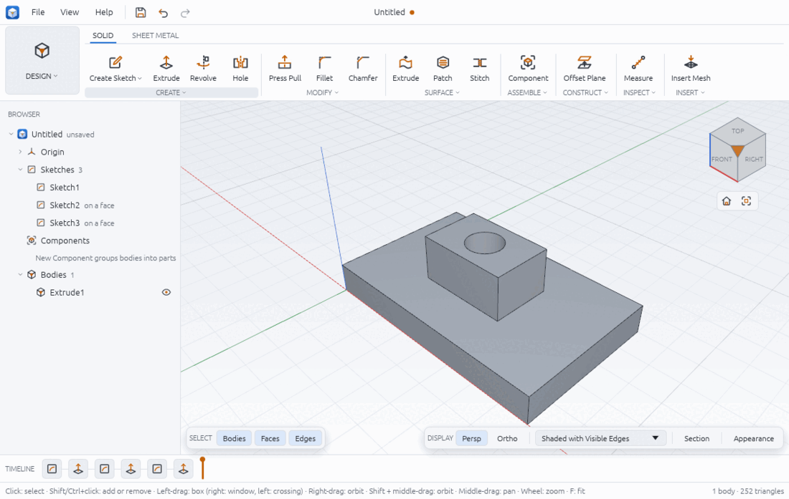
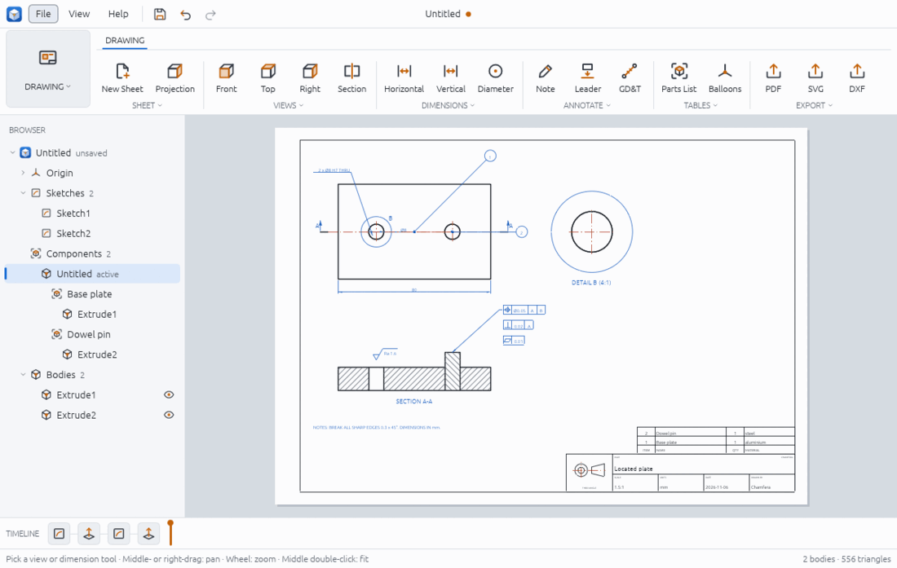
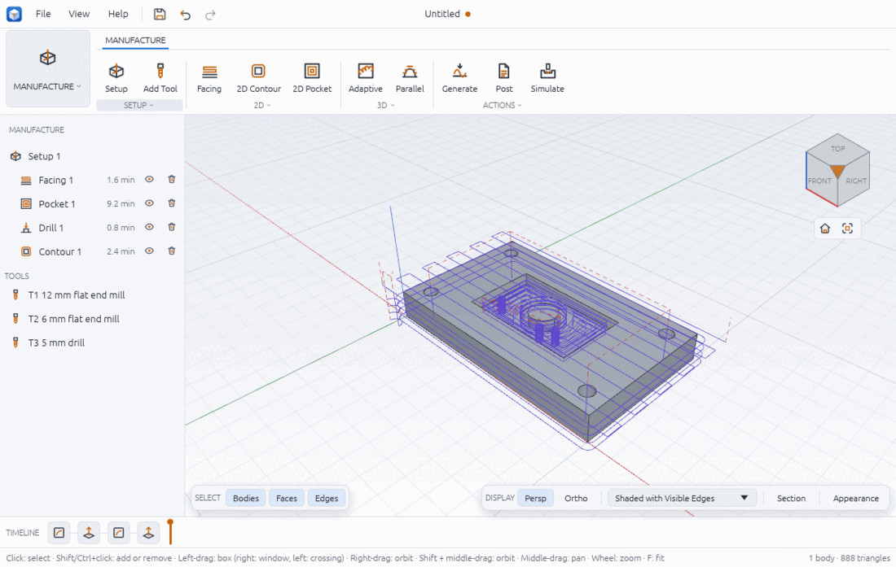

# Chamfera

An open-source parametric 3D CAD application, written from scratch in Rust: our own sketch
constraint solver, feature timeline and B-rep kernel, with a workflow familiar to Fusion
users. Sketch, model, assemble, draw, machine and render in one program that runs on Linux,
Windows, macOS and (as a build) in the browser, with a command line and an MCP server for
AI agents.

**Status:** early and moving fast. Everything below works on `dev` and is covered by tests
against hand-derived values, but Chamfera is not yet a production tool: see
[what is experimental](#what-is-experimental-or-approximate).



## Try it

```sh
cargo run --release -p chamfera                     # opens on the welcome screen
```

1. Pick a sample from the gallery (the hinge, the flange, the sheet metal bracket, ...), or
   choose **Your first part** under LEARN for a six-step guided tour: sketch a rectangle,
   extrude it, fillet an edge and drill a hole.
2. Orbit with the right mouse button, pan with the middle one, zoom with the wheel, press F
   to fit. Ctrl+Space then F searches every tool and command.
3. Read the [user guide](docs/user-guide/README.md) for the rest.

Packages: `packaging/linux/build-appimage.sh` (AppImage), `pwsh
packaging/windows/build-windows.ps1` (zip, plus an installer with NSIS),
`packaging/macos/build-macos.sh` (universal dmg).

## Features

| Area | What you can do | Guide |
|---|---|---|
| Sketching | Lines, rectangles, circles, arcs, polygons, slots, ellipses, splines; snaps, typed lengths and angles; 18 geometric constraints and dimensions driven by expressions; trim, extend, offset, mirror, patterns; project model edges; DXF in and out | [Sketching](docs/user-guide/sketching.md) |
| Solids | Extrude (taper, two sides, to a face), revolve, hole (counterbore, countersink), sweep, loft, patterns, mirror, fillet, chamfer, shell, press pull, offset and delete faces, combine, split, thicken, move | [Solid modelling](docs/user-guide/solid-modelling.md) |
| Construction | Offset, angled, midplane, three-point and tangent planes; axes; points | [Construction geometry](docs/user-guide/construction-geometry.md) |
| Surfaces | Surface extrude, revolve and sweep; patch, stitch, trim; thicken into solids | [Surfaces](docs/user-guide/surfaces.md) |
| Sheet metal | Rules (thickness, bend radius, K-factor, reliefs), base flange, flanges, flat pattern, DXF of the flat | [Sheet metal](docs/user-guide/sheet-metal.md) |
| Assemblies | Components, linked copies, rigid, revolute, slider, cylindrical and planar joints with limits; motion studies; interference; exploded views | [Assemblies and motion](docs/user-guide/assemblies-and-motion.md) |
| Inspect | Measure distances and angles exactly, mass properties, section views, visual styles | [Inspect](docs/user-guide/inspect.md) |
| Parameters | Named parameters with units and expressions, every feature value a parameter, CSV, configurations | [Parameters and configurations](docs/user-guide/parameters-and-configurations.md) |
| Timeline | Edit, suppress, reorder and roll back features; errors shown per feature; undo and redo | [The timeline](docs/user-guide/timeline.md) |
| Drawings | Sheets with projected, section and detail views; associative dimensions; notes, leaders, GD&T, parts lists, balloons; PDF, SVG and DXF | [Drawings](docs/user-guide/drawings.md) |
| Manufacture | Setups and stock, a tool library, facing, contour, pocket, drilling, 3D parallel, waterline and adaptive; stock simulation with gouge check; G-code for LinuxCNC and GRBL | [Manufacture](docs/user-guide/manufacture.md) |
| Render | Material library, environments, realistic viewport style, path-traced PNG images | [Render](docs/user-guide/render.md) |
| Files | `.chamfera` designs with version history and crash recovery; STEP in and out; STL, OBJ and 3MF in; mesh exports | [File formats](docs/user-guide/file-formats.md), [Version history](docs/user-guide/version-history-and-recovery.md) |
| Assistant | Build and change designs by asking Claude in a side panel (your own API key; file commands off and destructive commands confirmed by default) | [The Assistant](docs/user-guide/assistant.md) |
| Agents and scripts | Every action is a command: `chamfera-cli exec`, JSON scripts, and an MCP server | [MCP](docs/mcp.md) |

| Sketching and solids | Drawings | Manufacture |
|---|---|---|
|  |  |  |

## What is experimental or approximate

- **The kernel is young.** It is exact for planes, cylinders, cones, spheres, tori and
  extruded splines, and refuses (with a message naming the faces) what it cannot do
  exactly yet: crossing cylinders of different radii, fillets on curved or spline faces,
  revolved splines, tapered splines and ellipses, general NURBS surfaces and lofts between
  skew edges. STEP import takes analytic B-reps only. Progress: [kernel ladder](docs/kernel-ladder.md).
- **CAM** output is checked by tests and a simulation, not yet by many real cuts. Always
  check posted G-code in a simulator and with an air cut before running a machine.
- **Mesh volumes** (as shown by `design_summary` over MCP and `body.list`) are within about
  0.01 % of the exact ones; `inspect.mass` and the feature replies give the exact values.
- **Rendering** is a CPU path tracer: correct, but slow at high sample counts.
- **The browser build** compiles and runs, without file dialogs or screenshots to disk.
- Known bugs and their status: [QA report](docs/qa-report.md).

## Develop

```sh
cargo run -p chamfera-cli -- commands               # every command
cargo run -p chamfera-cli -- run examples/hole-plate.json
cargo run -p chamfera-cli -- snapshot --sample --out shot.png
cargo xtask ci        # fmt, clippy, tests, layers, skills, licences, wasm
```

`cargo xtask licences` needs `cargo install --locked cargo-deny`. Status and the next
milestone: [PLAN.md](PLAN.md); architecture: [docs/architecture.md](docs/architecture.md).

## Working with AI agents
Agents start at [AGENTS.md](AGENTS.md) (Claude Code reads it through `CLAUDE.md`).

## Licence
MIT OR Apache-2.0, at your option.

Chamfera is independent and not affiliated with Autodesk or any other CAD vendor. Fusion is a
trademark of Autodesk, named only to describe the workflow.
