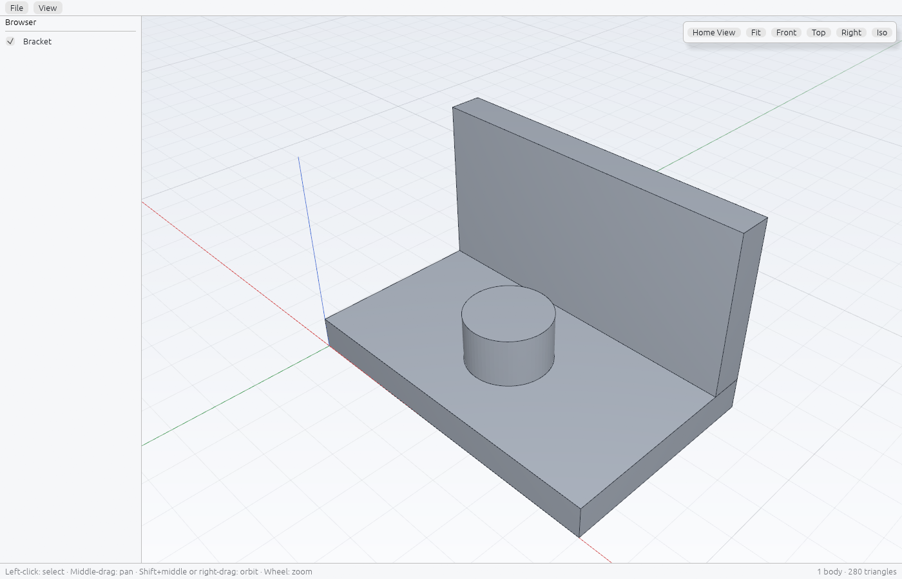

# Chamfera

An open-source parametric 3D CAD application, written from scratch in Rust: our own sketch
constraint solver, feature timeline and B-rep kernel, with a workflow familiar to Fusion users.
CAM (toolpaths and G-code) comes after the CAD core.

**Status:** M1, the viewport: a 3D view of mesh bodies (STL) with orbit, pan, zoom, standard views, picking and light/dark themes, on the desktop and in the browser. No sketches or solids yet; see [PLAN.md](PLAN.md).



## Build and try

```sh
cargo run --release -p chamfera -- --sample          # the desktop app with a sample part
cargo run -p chamfera-cli -- snapshot --sample --out shot.png
packaging/linux/build-appimage.sh                    # Linux: target/appimage/Chamfera-*.AppImage
pwsh packaging/windows/build-windows.ps1             # Windows: target/windows/ zip (+ setup.exe with NSIS)
packaging/macos/build-macos.sh                       # macOS: target/macos/Chamfera-*-macos-universal.dmg
cargo run -p chamfera-cli -- commands
cargo run -p chamfera-cli -- exec param.set '{"name":"width","value":50}'
cargo run -p chamfera-cli -- run examples/parameters.json
cargo xtask ci        # fmt, clippy, tests, layers, skills, licences, wasm
```

`cargo xtask licences` needs `cargo install --locked cargo-deny`.

## Working with AI agents
Agents start at [AGENTS.md](AGENTS.md) (Claude Code reads it through `CLAUDE.md`).

## Licence
MIT OR Apache-2.0, at your option.

Chamfera is independent and not affiliated with Autodesk or any other CAD vendor. Fusion is a
trademark of Autodesk, named only to describe the workflow.
