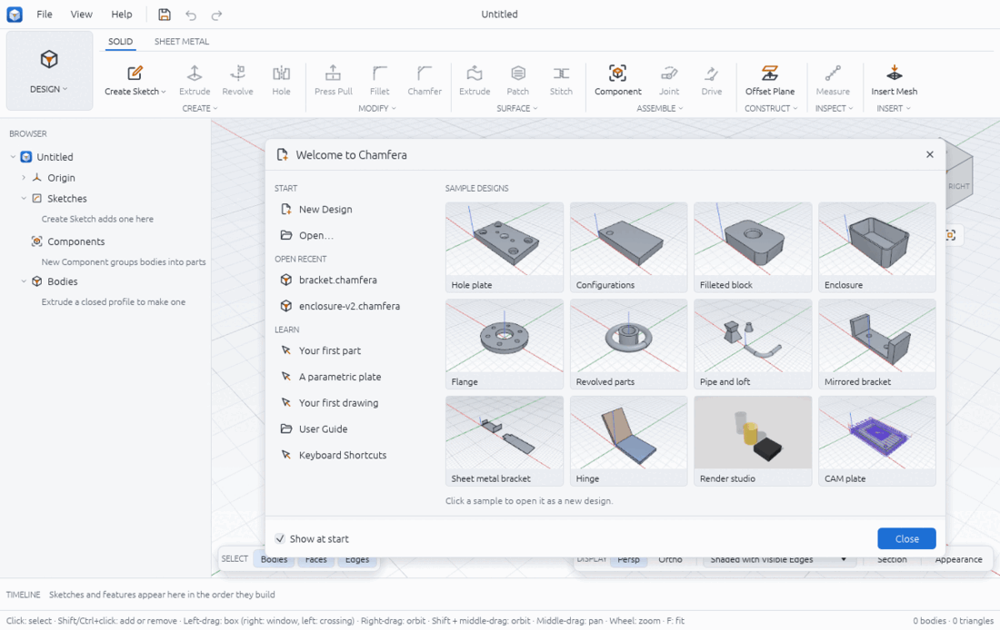

# Chamfera user guide

Chamfera is a parametric 3D CAD application: you draw constrained sketches, turn them into
solids with features that are kept in a timeline, and change any value later to have the
model rebuild. Around that core sit workspaces for sheet metal, assemblies, 2D drawings,
machining toolpaths (CAM) and rendering. The workflow will feel familiar to Fusion users;
the program, its kernel and this guide are Chamfera's own.

This guide is organised by workspace and by task. Each page gives concrete steps with the
names you see on screen, and a short "From a script" part with the matching commands, since
everything the interface does is a command you can also run from `chamfera-cli`, a script
or an AI agent.

## Start here
- [Getting started](getting-started.md): install and run, the window, navigation and mouse
  presets, the ribbon, the search palette (Ctrl+Space then F), shortcuts, the welcome screen
  and the three guided tours.

## Design
- [Sketching](sketching.md): planes, drawing tools, snaps, typed values, constraints and
  dimensions.
- [Solid modelling](solid-modelling.md): extrude, revolve, holes, sweeps, lofts, patterns,
  fillets, shells and the body tools.
- [Construction geometry](construction-geometry.md): planes, axes and points to sketch and
  build on.
- [Surfaces](surfaces.md): open surface bodies, patching, stitching, trimming and
  thickening.
- [Sheet metal](sheet-metal.md): rules, base flanges, flanges and flat patterns.
- [Assemblies and motion](assemblies-and-motion.md): components, joints, motion studies,
  interference and exploded views.
- [Inspect](inspect.md): measuring, mass properties, section views and display styles.
- [Parameters and configurations](parameters-and-configurations.md): named values,
  expressions, and several variants of one design.
- [The timeline](timeline.md): editing, suppressing, reordering and rolling back
  features.

## Other workspaces
- [Drawings](drawings.md): sheets, views, dimensions, annotations and export.
- [Manufacture](manufacture.md): setups, tools, 2.5D and 3D toolpaths, simulation and
  G-code.
- [Render](render.md): materials, lighting and path-traced images.

## Files and the app
- [Version history and recovery](version-history-and-recovery.md): saving, versions,
  comparing and getting work back after a crash.
- [File formats](file-formats.md): what Chamfera reads and writes.
- [The Assistant](assistant.md): building with Claude inside the app, the API key and
  safety.
- [Preferences](preferences.md): every setting and where it is stored.
- [Troubleshooting](troubleshooting.md): a blank viewport, refused features, slow
  rebuilds and how to report a bug.

## How honest is the software?
Chamfera is young. Everything in this guide was checked against the app on the `dev`
branch, but some features are experimental or approximate, and each page has a "Limits"
section. Model decisions use exact geometry; meshes are only for display and export. When
the kernel cannot do something exactly it refuses with a message that names the faces or
values involved instead of producing a broken body. Known problems are listed in
[docs/qa-report.md](../qa-report.md), and the kernel's progress in
[docs/kernel-ladder.md](../kernel-ladder.md).

Units inside Chamfera are millimetres and radians, and Z points up.
