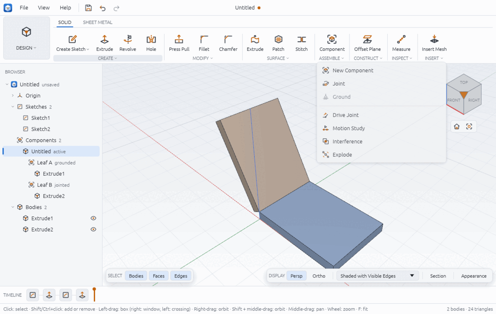
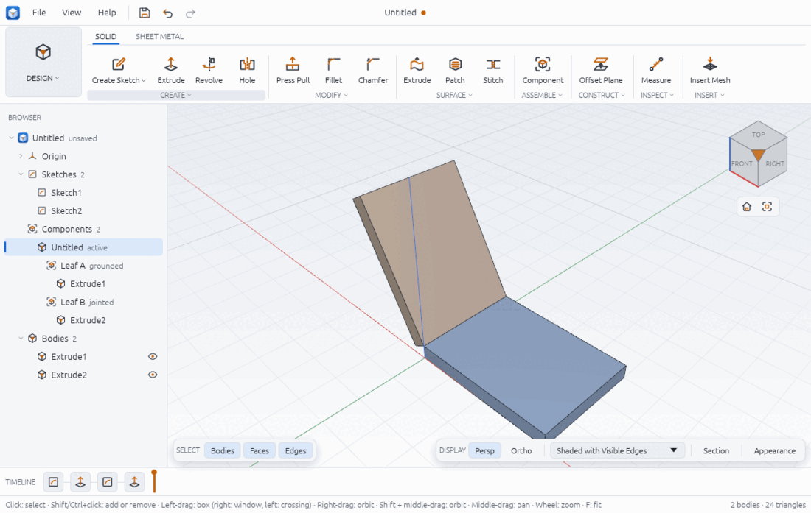
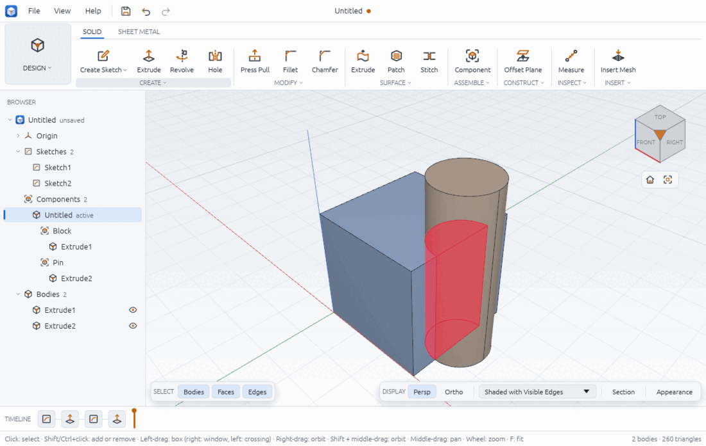
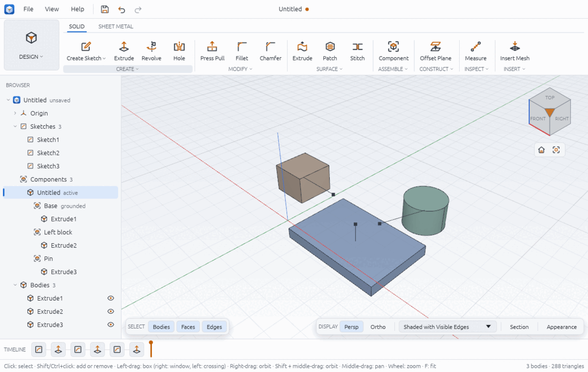

# Assemblies and motion

A Chamfera design can hold several parts. You group bodies into **components**, connect
components with **joints** that say how one can move against another, and then turn the
joints by hand or play them over time in a **motion study**. Two checks help before you make
anything: **Interference** finds parts that overlap, and **Explode** pulls the parts apart on
screen so you can see how they go together.

Everything on this page lives in **SOLID > ASSEMBLE**. The group shows Component, Joint and
Drive as big buttons; the arrow under ASSEMBLE opens the full list.



The workflow will be familiar to Fusion users: one design file, components inside it, joints
between them. Chamfera has no separate assembly file yet.

## Components

A component is a named group of bodies with its own placement. The Browser lists them under
**Components**, below the design itself, with each component's bodies indented under it.
Notes after a name tell you its state: `active`, `grounded`, `copy` (a linked copy) and
`jointed` (a joint moves it).

### Make a component from a body you already have

1. Click the body in the viewport (or in the Browser under **Bodies**).
2. Click **SOLID > ASSEMBLE > Component** (New Component in the list).
3. The status bar says `Component1: the selected body is in it`. The Browser shows
   `Component1` under Components with the body under it.

The bodies made by the same feature move together: the command moves a feature's bodies, not
single bodies.

### Start an empty component and model into it

1. With nothing selected, click **SOLID > ASSEMBLE > Component**.
2. The status bar says `Component1 is active: new features go into it`. The new component is
   marked `active` in the Browser.
3. Sketch and extrude as usual (see sketching.md and solid-modelling.md). The new bodies
   belong to the active component.
4. To go back to the top level, double-click the design's own row (the first row under
   Components, named after the design). Double-clicking a component's row, or
   right-clicking it and picking **Activate Component**, makes that component active
   again.

### The component menu in the Browser

Right-click a component row for:

- **Activate Component**: new features go into it. A linked copy cannot be activated.
- **Ground** / **Unground**: a grounded component stays where it is; joints move the other
  part.
- **Tint** / **Plain Colour**: draws the component's bodies in a colour of their own, so the
  parts are easy to tell apart. The colours come from the theme.
- **Copy Component**: a linked copy, see below.
- **Delete Component**: its bodies and child components move up to its parent; its linked
  copies and joints are removed.

You can also ground the component of the selected body with **SOLID > ASSEMBLE > Ground**.
The button is greyed out until a body of a component is selected (or a component is
active); its tooltip says so.

### Linked copies

**Copy Component** makes a second occurrence of the same component: it shows the same bodies,
so a change to the original's features shows in every copy. The copy is called
`Leaf B:2` and so on, and is marked `copy` in the Browser. From the menu the copy lands where
the original is shown, so it sits inside the original until you move it: right-click it in
the Browser and choose **Move Component…** (below), or give it a place from a script with
`component.copy {component, transform}`. A copy is not driven by the original's joints. Its
bodies are named after it, such as `Extrude1 (Leaf B:2)`, so each body name means one body.

### Moving and renaming a component

Right-click a component in the Browser's Components section:

- **Move Component…** opens a dialog with **Move X**, **Move Y** and **Move Z** (in the
  design's length unit; `1 in` and other units work too), a **Turn about** axis (X, Y or Z
  through the origin) with an **Angle** in degrees, and **From**: off moves the component
  from where it is now, on places it from the origin. The turn comes first, then the move.
  A component a joint places cannot be moved this way (the item is greyed out): drive or
  delete the joint.
- **Rename Component…** changes its name.

Each runs one command (`component.move`, `component.rename`), so Undo takes it back.

## Joints

A joint connects two components at a point and an axis (its **origin** on each part) and
says how the second part may move against the first:

| Type | Moves | Value |
|---|---|---|
| Rigid | nothing: the parts are locked together | none |
| Revolute | turns about the axis | an angle |
| Slider | slides along the axis | a distance |
| Cylindrical | turns about the axis and slides along it | an angle, and a slide distance |
| Planar | slides in the plane across the axis and turns about the axis | an angle, and an offset in the plane |

### Make a joint

1. Build the parts as separate components (above). Ground the one that should stay put.
2. Click **SOLID > ASSEMBLE > Joint**. The Joint dialog opens and the status bar says
   `Joint: click a face or edge on the part that moves, then where it goes`.
3. Hover over the parts: a marker shows the origin under the pointer, a point with a line
   along its axis. Near an edge it takes the edge (a circle's or arc's centre and axis, or a
   straight edge's midpoint and direction); otherwise it takes the flat face under the
   pointer (its centre and normal).
4. Click the origin on the part that **moves**. The dialog's **Moves** row names it, for
   example `Leaf B · face 4:top`.
5. Click the origin it should go **to** on the other part. The **To** row names it.
6. Pick the **Type**. For a revolute, slider, cylindrical or planar joint type the starting
   **Angle** or **Distance** (a plain number is degrees or millimetres; an expression such as
   `width / 2` also works).
7. Tick **Flip** if the moving part lands the wrong way round (it turns the moving part over
   so the two origins face each other).
8. Click **OK**. The moving part jumps so its origin meets the target's, and the status bar
   says `Joint1 created`. The moving component is marked `jointed` in the Browser.

Clicking a third time starts the picks again from **Moves**. **Cancel** or Esc closes the
dialog without a joint.

For round parts, click the **circular edge** rather than the round face: the edge gives the
circle's true centre, while a round face's origin is currently placed off-centre (see
Limits).



### Limits

A joint can have a lower and an upper limit on its value, for example 0° to 180° for a hinge
that should not fold through itself. Driving the joint outside them is refused with a message
such as `200° is outside the limits of "Hinge": 0° to 180°`, and the Drive Joint panel shows
the limits.

The Browser lists the joints under the components, each with its type, value and limits.
Double-click one (or right-click it and choose **Edit Joint**) to change its **Name** and
its limits: tick **Limits** and type a **Minimum** and **Maximum** (degrees for revolute and
cylindrical joints, the design's length unit for sliders; `10 mm` or `45 deg` work too).
A value outside new limits moves to the nearer limit. Untick **Limits** to remove them.
**Delete Joint** in the same menu removes a joint; its part stays where the joint left it.
From a script: `joint.edit {joint, name?, min?, max?, limits?: false}` and `min` and `max`
on `joint.create`.

## Driving a joint

1. Click **SOLID > ASSEMBLE > Drive** (Drive Joint). The panel opens with the first joint
   that can move picked; the status bar says
   `Drive Joint: drag a jointed part to turn or slide it, or type a value`.
2. Either drag a jointed part in the viewport with the left button: it turns about its axis
   or slides along it as you drag, held inside its limits. When you let go the new value is
   kept.
3. Or pick the **Joint**, type an **Angle** or **Distance** and press Enter or click **Set**.
4. Click **Close** when you are done.

Each kept value is one undo step (Ctrl+Z puts the part back). Rigid joints do not appear in
the list, since they have nothing to drive. Drive and Motion Study are greyed out until the
design has a joint.

## Motion studies

A motion study is a list of keys: a joint's value at a time in seconds. Between keys the
value changes evenly, so a key of 0 mm at 0 s and 80 mm at 2 s puts a slider at 40 mm at 1 s.

1. Click **ASSEMBLE > Motion Study** (in the list under ASSEMBLE). The panel opens and shows
   the study at 0 s.
2. Under the key list, pick the **Joint**, type the **Time** in seconds and the **Value**
   (leave it empty to use the value the joint shows now), then click **Add Key**. A key at the
   same joint and time replaces the old one.
3. Repeat for each position. Each key is listed with its time and value and a **Remove**
   button.
4. Click **Play** to run the motion (it becomes **Pause**); untick **Loop** to stop at the
   end. Drag the time slider to scrub to any moment.
5. **Check at Keys** runs the interference check at every key time and lists each time as
   `no interference` or `N overlapping pair(s)`.
6. **Close** leaves the study; the joints go back to their own values.

Playing and scrubbing only change what is shown: they add no undo steps. Adding and removing
keys are saved with the design.

## Interference

1. Click **ASSEMBLE > Interference**. The check runs at once on every body where it is
   placed.
2. The panel lists each overlapping pair (`Extrude1 and Extrude2`) with the overlap volume,
   and the overlaps are drawn highlighted in the viewport. With none it says
   `No bodies overlap`.
3. Tick **Also check at each motion keyframe** and click **Check** to repeat the check at each
   key of the motion study (`At 2.00 s: 1 pair(s)`).
4. **Close** removes the highlight.

The volumes come from the exact intersection of the solids, not from the display mesh. A
30 mm cube with an 8 mm radius pin whose axis lies on one face, 45 mm long, overlaps by half
the pin's section times the cube's height: π · 8² / 2 · 30 = 960π = 3015.93 mm³, which is
what Chamfera reports.



Bodies that only touch (a face on a face) do not count as interference.

## Exploded views

1. Click **ASSEMBLE > Explode**. The parts move apart at once and the Explode panel opens.
2. Drag **Factor** (1 to 5; 1 is assembled). Each component moves away from the centre of
   the assembly along the axis (X, Y or Z) it is furthest along: at factor 2.5 a part whose
   centre is 16 mm from the assembly's centre along X moves 1.5 × 16 = 24 mm further out.
3. To move one part by hand, select one of its bodies: the panel's **Move** row names its
   component. Type or drag the **Offset** in X, Y and Z (mm); it is added to the automatic
   move.
4. Lines (trails) join each part to where it sits in the assembly.
5. **Collapse** puts everything back.

An exploded view is a view only: the model, measurements and exports do not change, and it
adds no undo steps. Explode is greyed out until the design has components.



## From a script

The hinge in the picture (`examples/hinge-assembly.json`): two 40 × 30 × 4 leaves in their own
components, Leaf A grounded, a revolute joint on the shared edge at Z 4 with limits 0° to 180°,
driven to 60°.

```json
[
  { "command": "component.new", "params": { "name": "Leaf A" }, "as": "a" },
  { "command": "sketch.create", "params": { "plane": "xy" }, "as": "sa" },
  { "command": "sketch.rectangle", "params": { "x1": 0, "y1": 0, "x2": 40, "y2": 30 } },
  { "command": "sketch.finish" },
  { "command": "solid.extrude", "params": { "sketch": "$sa.sketch", "profiles": [{ "x": 20, "y": 15 }], "distance": 4 } },
  { "command": "component.activate", "params": { "component": 0 } },
  { "command": "component.new", "params": { "name": "Leaf B" }, "as": "b" },
  { "command": "sketch.create", "params": { "plane": "xy" }, "as": "sb" },
  { "command": "sketch.rectangle", "params": { "x1": -40, "y1": 0, "x2": 0, "y2": 30 } },
  { "command": "sketch.finish" },
  { "command": "solid.extrude", "params": { "sketch": "$sb.sketch", "profiles": [{ "x": -20, "y": 15 }], "distance": 4 } },
  { "command": "component.activate", "params": { "component": 0 } },
  { "command": "component.ground", "params": { "component": "$a.component" } },
  { "command": "component.tint", "params": { "component": "$a.component", "tint": true } },
  { "command": "component.tint", "params": { "component": "$b.component", "tint": true } },
  { "command": "joint.create", "params": {
      "type": "revolute", "name": "Hinge",
      "a": { "component": "$a.component", "point": { "x": 0, "y": 0, "z": 4 }, "axis": { "x": 0, "y": 1, "z": 0 } },
      "b": { "component": "$b.component", "point": { "x": 0, "y": 0, "z": 4 }, "axis": { "x": 0, "y": 1, "z": 0 } },
      "value": 0, "min": 0, "max": 180 }, "as": "hinge" },
  { "command": "joint.set_value", "params": { "joint": "$hinge.joint", "value": 60 } },
  { "command": "component.list" }
]
```

Check it: Leaf B turns 60° about the Y axis through (0, 0, 4). Its far top corner
(-40, y, 4) goes to (-40 cos 60°, y, 4 + 40 sin 60°) = (-20, y, 38.64), and its near bottom
corner (0, y, 0) to (-4 sin 60°, y, 4 - 4 cos 60°) = (-3.46, y, 2). `component.list` reports
Leaf B's bounds as X -23.46 to 0 and Z 2 to 38.64, which is those corners together.

The other commands:

- `component.new {name?, from_bodies?: [feature], parent?}`, `component.activate {component}`
  (0 is the design itself), `component.rename {component, name}`,
  `component.move {component, transform: {translate?: {x, y, z}, rotate?: {axis, angle,
  origin?}, absolute?}}`, `component.copy {component, transform?}`,
  `component.ground {component, grounded?}`, `component.tint {component, tint}`,
  `component.delete {component}`, `component.list`.
- `joint.create {type, a, b, value?, distance?, offset?, min?, max?, flip?, name?}`. An origin
  is `{component?, face: "2:top"}`, `{component?, edge: "4:bottom 0"}`, `{component?, edge,
  end: "start"|"end"}` (a vertex), `{component, point: {x, y, z}, axis: {x, y, z}}` (in that
  component's coordinates) or `{pick: {x, y, width, height}}`. B moves to A unless B is
  grounded.
- `joint.edit {joint, name?, min?, max?, limits?}` (`limits: false` removes them; a value
  outside new limits moves to the nearer one).
- `joint.set_value {joint, value?, distance?, offset?}`, `joint.delete {joint}` (the part
  stays where the joint left it), `joint.drag {joint, from, to, width, height, start?}` (shows
  a drag without changing the design).
- `motion.add_key {joint, time, value?}`, `motion.remove_key {joint, time}`, `motion.list`,
  `motion.set_time {t}` (`null` leaves the study).
- `inspect.interference {components?, bodies?, at_keys?, clear?}` replies with `pairs` (each
  `a`, `b`, `bounds` and `volume` in mm³) and, with `at_keys`, a `keys` list per key time.
- `view.explode {factor}` (1 to 20 from a script) or `{component, offset: {x, y, z}}`, and
  `view.explode_clear`.

`examples/assembly-explode.json` and `examples/assembly-interference.json` build the other two
pictures.

## Limits

- **A round face's joint origin is off-centre.** A face origin is the average of the face's
  vertices, and a circular face has a single vertex on its rim, so a joint on a round face
  lands one radius away from the centre. Click the circular edge instead; it uses the
  circle's centre.
- **Loops of joints are refused**: a joint between two parts that other joints (or grounding)
  already hold together fails with `... would close a loop ... Loops of joints are not
  supported yet`. Each component is moved by at most one joint.
- Joints and components are not timeline items; they are kept with the design and undone
  with Ctrl+Z, but they do not show in the timeline (see timeline.md).
- A linked copy keeps the same body names as the original (both show `Extrude2`), so scripts
  that name bodies cannot tell them apart. A copy's transform is applied to the original's
  own placement, not to where a joint has moved the original.
- The Explode panel's slider goes to 5; a script can go to 20. Opening the panel again starts
  from factor 2.
- Interference checks bodies as placed (or at the motion study's keys); it does not sweep the
  motion between keys.

See also: inspect.md for measuring between parts, drawings.md for a parts list and balloons,
render.md for materials per part.
