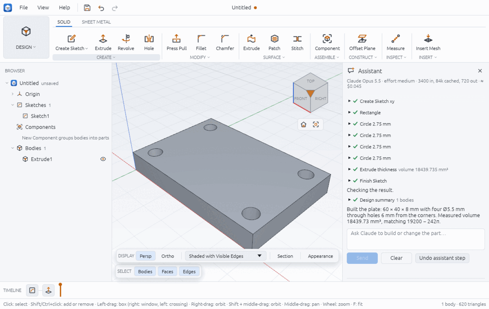

# The Assistant

The Assistant panel lets you describe a part in words and watch Claude build it in the open design. Claude works through the same commands the ribbon and scripts use (sketches, extrudes, holes, parameters, measurements), so everything it makes is ordinary timeline features that you can edit afterwards. It needs your own Anthropic API key and an internet connection; you pay for what it uses.

## Set up your API key

1. Get an API key from your Anthropic account (it starts with `sk-ant-`).
2. Open **File > Preferences…** (Ctrl+,) and pick the **Assistant** page.
3. Paste the key in **New key** (it is hidden as you type) and click **Save**. The page says "Key saved, readable by you only." and **Key** shows "Saved on this computer (…abcd)", the last four characters.

Instead, you can set the `ANTHROPIC_API_KEY` environment variable before starting Chamfera; the page then says "From ANTHROPIC_API_KEY (…abcd)". A saved key is used first.

**Where the key is kept:** in a file of its own called `assistant-key`, next to the preferences file (see preferences.md for the folder on each system), readable only by you (permissions 0600 on Linux and macOS). It is never written into a design, the preferences file, a log or a version.

**Remove the key:** Preferences > Assistant > **Remove** deletes the key file ("Saved key removed."). A key in `ANTHROPIC_API_KEY` stays in use until you unset the variable.

## Open the panel and ask

1. Choose **View > Assistant**, or press **Ctrl+Shift+A**. Without a key, the panel explains how to add one and offers **Open Preferences**.
2. Type a request in **Ask Claude to build or change the part…**, for example "a 60×40×8 mm plate with four 5.5 mm holes 6 mm from the corners".
3. Press **Enter** or click **Send** (Shift+Enter starts a new line).
4. Watch the transcript: Claude's messages, and one row per command with a tick when it worked ("Extrude thickness volume 18439.735 mm³"). Click a row's arrow to see its input and reply. The viewport, browser and timeline update after each step.
5. Click **Stop** to cancel; it stops between steps.

The line under the title shows the model, the effort, the tokens used (in, cached, out) and an estimate of the cost so far in US dollars.

- **Undo assistant step** undoes everything the last request changed, as one step. (Ctrl+Z does the same while you have not changed anything since.)
- **Clear** starts a new conversation; the design keeps what was built.

Check the result as you would your own work: in the demo, Claude reports 18 439.73 mm³, which matches 60 × 40 × 8 − 4 × π × 2.75² × 8 = 19 200 − 242π by hand.

## Models and effort

On Preferences > Assistant:

- **Model**: Claude Opus 5.5 (the default, best on hard parts), Claude Sonnet 5.5, or Claude Haiku 5.5 (fastest and cheapest).
- **Effort**: low, medium (default), high, xhigh or max. More effort thinks longer: slower and costlier, better on hard parts.

Changes apply to the next conversation: click **Clear** in the panel.

## What it can do

Claude can run almost every Chamfera command: sketch and constrain, extrude, revolve, fillet, shell, holes and patterns, set parameters and configurations, measure and inspect, set up CAM operations and generate toolpaths, make drawings. It can also ask for a **design summary** (parameters, sketches with their degrees of freedom, bodies with volumes, the timeline) and, when allowed, a **screenshot** of the viewport to look at what it built.

## Safety settings

Preferences > Assistant > SAFETY has three switches:

- **Ask before Claude deletes features or bodies or starts a new design** (on by default). Commands that replace or delete much of the design (New Design, Open Design, Delete Feature, Delete Sketch, Remove Body, Remove, Delete Component, Delete from Drawing, Roll Timeline To) wait in the panel: "Claude wants to run: …" with **Allow** and **Deny**.
- **Let Claude open, save, import and export files (asks each time)** (off by default). While it is off, Claude does not even see the commands that read or write files. When it is on, every such call still asks, showing the path.
- **Let Claude look at the viewport (screenshots)** (on by default). The screenshot is 960 × 640 pixels of the viewport only, and it is sent to the API with the conversation.

What is sent to Anthropic: your messages, the command list, the commands' replies (for example volumes and parameter values), the design summary, and screenshots if allowed. Do not use the Assistant on designs you may not share with a third-party service.

## The offline demo

`chamfera --assistant-demo` opens the panel and plays a recorded conversation that builds the plate above. It needs no key and no network, and it runs the real commands on a new design, so you can see how the panel works before adding a key.

## Limits

- Desktop only: the browser build shows a note instead, because calling the API from a web page would expose your key to the page.
- Claude can make mistakes: read the transcript, check sizes with Inspect (see inspect.md) and use **Undo assistant step** when it goes wrong.
- A reply that hits the output limit is cut off and its commands do not run ("The reply reached the output limit and was cut off").
- Settings changes need a new conversation (Clear).
- The cost shown is an estimate from published prices; your Anthropic account is the authority.

Related: preferences.md, getting-started.md, troubleshooting.md. Agents outside the app can drive Chamfera over MCP instead (`chamfera-cli mcp`, see the project's `docs/mcp.md`).
