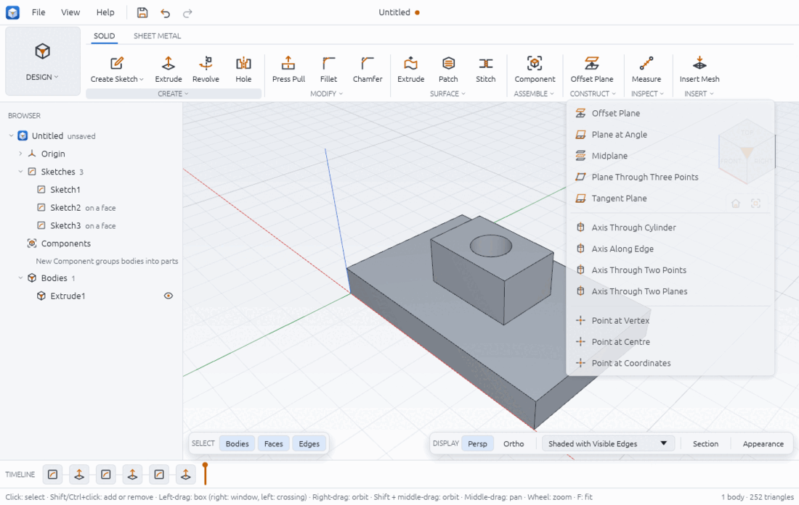
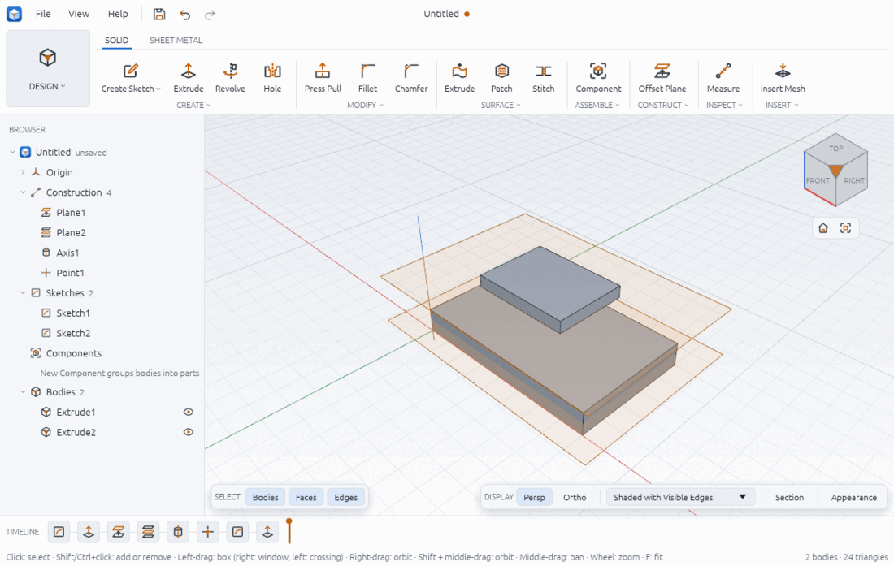

# Construction geometry

Construction planes, axes and points are reference geometry: they are not part of any
body, but you can sketch on a plane, split a body with it, or turn a feature about an
axis. Each one is a feature in the timeline and follows what it was made from: an offset
plane on a plate's top face moves when the plate gets thicker. They are listed in the
Browser under **Construction** and drawn in orange (planes as a see-through sheet).

All the tools are in **SOLID > CONSTRUCT**. Offset Plane is the big button; the caption
dropdown lists all twelve:



## Using a construction tool

1. Click the tool in SOLID > CONSTRUCT. A dialog opens on the right of the viewport and the
   status bar says what to click first ("Click a flat face", "Click near a straight edge",
   "Click near a corner", "Click a cylindrical face", "Click near a circular edge").
2. Fill each input, either by clicking in the viewport or from the input's list. The lists
   offer what already exists:
   - planes: Top plane (XY), Front plane (XZ), Right plane (YZ) and your construction
     planes;
   - axes: X axis, Y axis, Z axis and your construction axes;
   - points: Origin and your construction points.
   After each click the dialog moves on to the next empty input; when all are filled the
   status bar says "Press OK to create it".
3. Type any value (Distance, Angle, X/Y/Z). A plain number takes the design's unit (or
   degrees); a parameter or formula (`gap * 2`) makes the feature follow it.
4. Press **OK**. The status bar says "Plane1 created".

To change one later, double-click it in the timeline or Browser: the edit dialog changes
its distance or angle, or turns **Build this feature** off (suppress).

## Planes

| Tool | Inputs | Makes |
|---|---|---|
| Offset Plane | **Plane** (starts on Top plane (XY)), **Distance** (10 mm) | A plane parallel to a plane or flat face, a distance away along its normal |
| Plane at Angle | **Axis** (starts on X axis), **Angle** (45 deg) | A plane through a line, turned by the angle (from XY, or XZ when the axis is Z) |
| Midplane | **First**, **Second** | A plane halfway between two parallel planes or flat faces |
| Plane Through Three Points | **Point 1**, **Point 2**, **Point 3** | A plane through three points (not on one line) |
| Tangent Plane | **Face** (cylindrical), **Near** (a point) | A plane touching the cylinder on the line nearest the point |



## Axes

| Tool | Inputs | Makes |
|---|---|---|
| Axis Through Cylinder | **Face** (cylindrical or conical) | The face's axis |
| Axis Along Edge | **Edge** (straight) | An axis along the edge |
| Axis Through Two Points | **From**, **To** | An axis from the first point to the second |
| Axis Through Two Planes | **First**, **Second** (not parallel) | The line where the planes cross |

## Points

| Tool | Inputs | Makes |
|---|---|---|
| Point at Vertex | **Vertex** (a corner of a solid) | A point at the corner |
| Point at Centre | **Edge** (circular) | A point at the circle's centre |
| Point at Coordinates | **X**, **Y**, **Z** | A point at those coordinates (values or expressions) |

Tangent Plane, the axes through a cylinder or along an edge, and the points at a vertex or
centre need a solid to pick from; the others work in an empty design.

## Checked by hand

A plate 80 × 50 × 10 with a cylinder of radius 10 at (60, 25) joined on top, 20 high:

| Feature | Expected | Reply |
|---|---|---|
| Offset Plane from the top face, 15 | z = 10 + 15 = 25 | origin z 25, normal +Z |
| Midplane of bottom and top | z = 5 | origin z 5 |
| Axis Through Two Planes, XZ and YZ | the Z axis | direction (0, 0, 1) through the origin |
| Axis Through Cylinder | through (60, 25), along Z | origin (60, 25, 10), direction (0, 0, 1) |
| Tangent Plane, near the origin | touches at (60, 25) − 10 · (60, 25)/65 = (50.77, 21.15) | origin (50.77, 21.15, 0), normal (−0.923, −0.385, 0) |
| Point at Centre of the cylinder's top rim | (60, 25, 30) | (60, 25, 30) |
| Point at Vertex, top / front / right | (80, 0, 10) | (80, 0, 10) |
| Plane at Angle, X axis, 30° | normal (0, −sin 30°, cos 30°) | (0, −0.5, 0.866) |
| Plane Through Three Points: origin, (80, 0, 10), (0, 50, 0) | normal ∝ (80, 0, 10) × (0, 50, 0) = (−500, 0, 4000) | (−0.124, 0, 0.992) |

## Sketching on a construction plane

- **SOLID > CREATE > Create Sketch**: construction planes are listed under the origin
  planes. Pick one; the view turns to face it and the Line tool is ready ("Sketching on
  Plane1").
- The sketch follows the plane: change the plane's distance and the sketch, and what was
  made from it, moves.

In `examples/construction-planes.json` a 40 × 30 rectangle sketched on the offset plane
(z = 25) and extruded 5 makes a second body of 6000 mm³ floating 15 mm above the plate.

## Revolving and patterning about an axis

A construction axis can be the axis of a revolve or a circular pattern. In this version
the dialogs do not offer it (Revolve lists only the lines of the profile's sketch, Circular
Pattern only X, Y and Z through the origin), so use a script or the Assistant
([assistant.md](assistant.md)) with `axis_feature`:

```json
{ "command": "solid.revolve", "params": { "sketch": 1, "profiles": [{ "x": 12, "y": 10 }], "axis_feature": 5, "angle": 360 } }
{ "command": "solid.pattern_circular", "params": { "feature": 4, "count": 6, "origin": { "x": 0, "y": 0, "z": 0 }, "axis_feature": 5 } }
```

For the revolve the axis must lie in the sketch's plane. Checked: the 5 × 20 rectangle of
`examples/revolved-parts.json` on the Front plane, revolved about Axis Through Two Planes
(XZ and YZ, the Z axis), gives the same 7853.98 mm³ tube as about a sketch line. In the interface, draw a
construction line in the sketch instead and pick it as the Revolve axis
([solid-modelling.md](solid-modelling.md)).

Construction planes also work as the **Splitting plane** of Split Body and Split Face, and
as the base of another Offset Plane.

## From a script

```json
[
  { "command": "param.set", "params": { "name": "gap", "expression": "15 mm" } },
  { "command": "sketch.create", "params": { "plane": "xy" }, "as": "base" },
  { "command": "sketch.rectangle", "params": { "x1": 0, "y1": 0, "x2": 80, "y2": 50 } },
  { "command": "sketch.finish" },
  { "command": "solid.extrude", "params": { "sketch": "$base.sketch", "profiles": [{ "x": 5, "y": 5 }], "distance": "10 mm" }, "as": "plate" },
  { "command": "construct.plane_offset", "params": { "base": { "feature": "$plate.feature", "face": "top" }, "distance": "gap" }, "as": "plane" },
  { "command": "construct.axis_two_planes", "params": { "planes": ["xz", "yz"] } },
  { "command": "construct.point_coordinates", "params": { "x": 40, "y": 25, "z": "10 mm + gap" } },
  { "command": "sketch.create", "params": { "plane": "$plane.feature" } }
]
```

How each kind of input is written:

- a plane: `"xy"`, `"xz"`, `"yz"`, a construction plane's feature id, or a flat face
  `{"feature": 2, "face": "top"}`;
- an axis: `"x"`, `"y"`, `"z"`, a construction axis id, or a straight edge
  `{"faces": [face, face]}` (the two faces that meet there);
- a point: `"origin"`, a construction point id, or a vertex `{"vertex": [face, face, face]}`;
- a cylindrical face: `{"feature": 4, "face": "side 0"}`.

| Command | Parameters |
|---|---|
| `construct.plane_offset` | `base`, `distance` |
| `construct.plane_angle` | `axis`, `angle`, `base?` |
| `construct.plane_midplane` | `planes: [a, b]` |
| `construct.plane_three_points` | `points: [a, b, c]` |
| `construct.plane_tangent` | `face`, `point` |
| `construct.axis_cylinder` | `face` |
| `construct.axis_edge` | `edge: {faces}` |
| `construct.axis_two_points` | `points: [from, to]` |
| `construct.axis_two_planes` | `planes: [a, b]` |
| `construct.point_vertex` | `faces: [2 to 8 faces]` |
| `construct.point_centre` | `edge: {faces}` |
| `construct.point_coordinates` | `x`, `y`, `z` |

Each reply has `geometry` (origin and normal, origin and direction, or the point) to check
against values you worked out. `construct.pick {x, y, width, height}` names the face,
nearest edge and vertex under a viewport pixel in the form these commands take.

## Limits

- Revolve and Circular Pattern cannot pick a construction axis in their dialogs (scripts
  can, with `axis_feature`); Mirror and Move do not offer construction planes or axes
  either.
- Construction planes are drawn as a large orange sheet through the model, which can get in
  the way. They have no eye toggle in the Browser; suppressing the feature (right-click its
  timeline tile > Suppress) hides it, but also whatever is built on it.
- Tangent Plane takes cylinders only (not cones); Axis Through Cylinder takes cylinders and
  cones.
- A construction feature whose face or edge disappears after an edit fails and is marked
  in the timeline ([timeline.md](timeline.md)).
