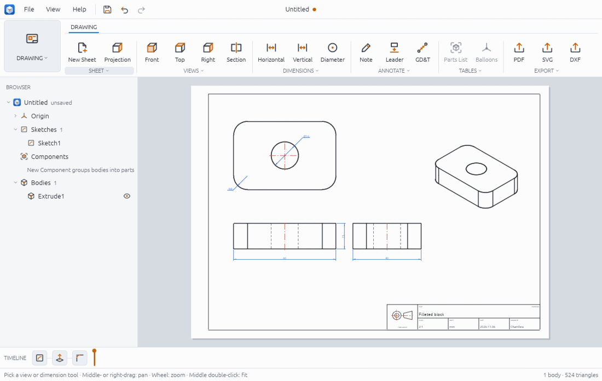
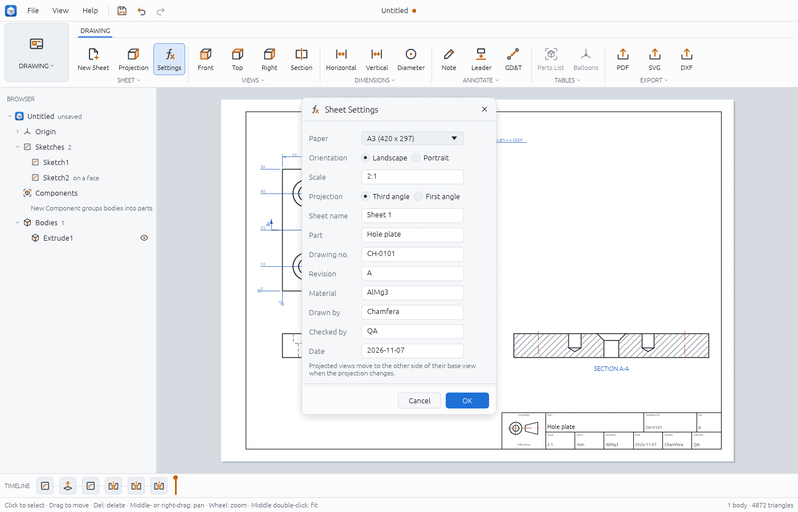
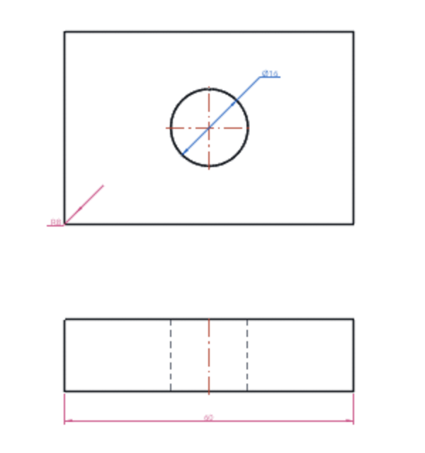
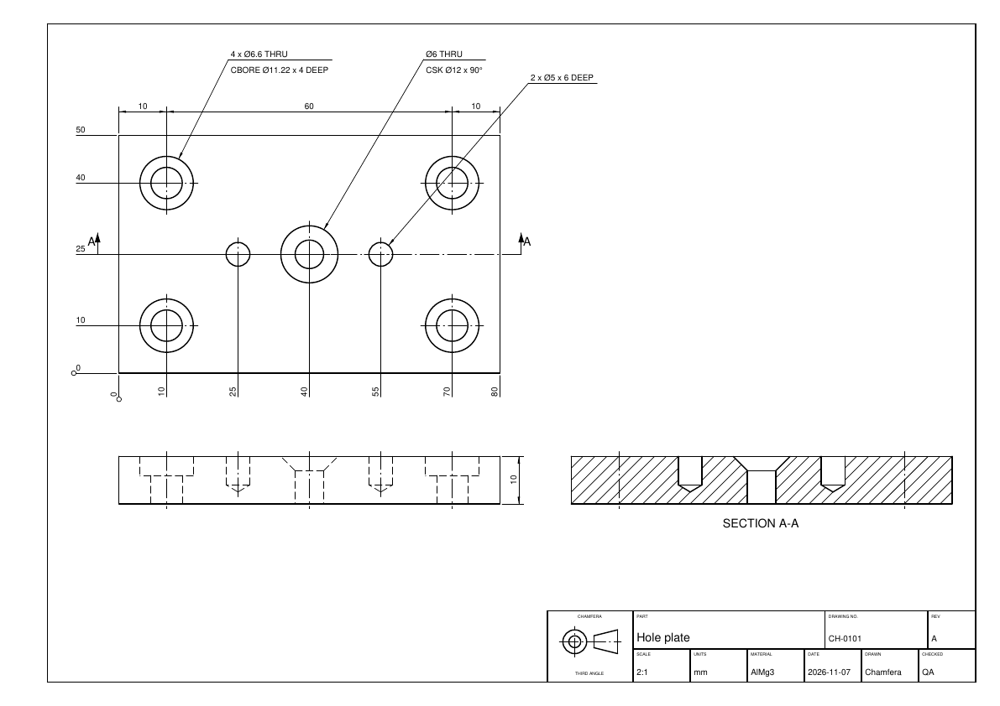
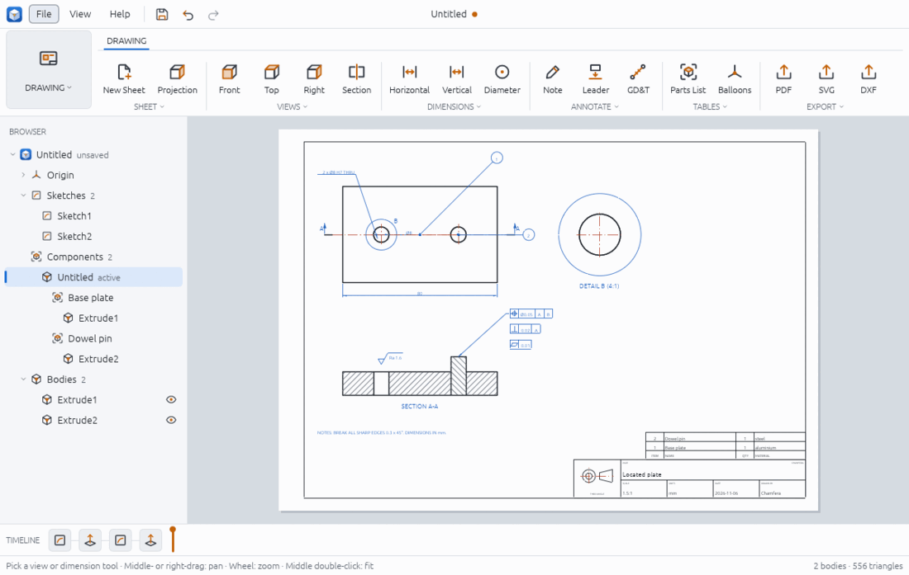

# Drawings

The Drawing workspace turns the model into 2D sheets you can print or send to a
workshop: a paper sheet with a border and title block, orthographic and isometric views
projected from the exact model, section and detail views, dimensions that stay attached
to the model (linear, aligned, angular, radius, diameter, ordinate, baseline and chain),
hole callouts written from the Hole features, and annotations (notes, leaders, feature
control frames, surface texture symbols, centre lines, a parts list and balloons). A sheet
is exported as PDF, SVG or DXF, exactly as it is shown.

Drawings are saved inside the `.chamfera` design, so there is no separate drawing file to
keep in step with the model: when the model changes, the views and dimensions redraw.



## Open the Drawing workspace

1. Build at least one solid first (see solid-modelling.md). The view tools are disabled
   until there is one, and their tooltip says "build a solid first".
2. Click the workspace switcher at the left of the ribbon (it reads **DESIGN**) and pick
   **Drawing**. The ribbon now has one tab, **DRAWING**, and the viewport becomes the sheet.
3. To go back to the model, pick **Design** in the same switcher. You cannot switch
   workspace while a sketch is being edited: finish the sketch first.

On the sheet, middle-drag or right-drag pans, the wheel zooms and a middle double-click
fits the sheet in the window. The status bar tells you what the current tool expects next,
and **Esc** drops the tool.

## Start a sheet

1. Click **DRAWING > SHEET > New Sheet**. You get an A3 landscape sheet at 1:1, third-angle
   projection, with a title block.
2. Click **SHEET > Settings** to open the Sheet Settings dialog:
   - **Paper**: A4, A3, A2, ANSI A or ANSI B, **Landscape** or **Portrait**.
   - **Scale**: type `1:2`, `2:1` or a plain factor such as `0.5`. Views that have no
     scale of their own follow it.
   - **Projection**: third or first angle. The projection symbol in the title block
     changes with it, and projected views move to the other side of their base view
     (see Limits).
   - **Sheet name**, and the title block's fields: **Part**, **Drawing no.**,
     **Revision**, **Material**, **Drawn by**, **Checked by** and **Date** (each up to 64
     characters; the date starts as today's).
3. Click **OK**. All the changes are one step: one **Undo** (Ctrl+Z) takes them all back.
   If a value is refused (a scale that does not read, a field that is too long), the
   dialog stays open and says why.

**SHEET > Projection** switches between third- and first-angle projection in one click.
If you place a view before making a sheet, a sheet is made for you. With more than one
sheet, a list at the top left of the sheet picks the one shown.

The title block is Chamfera's own: the projection symbol on the left, then the part name,
drawing number and revision across the top, and the scale, units, material, date, who drew
it and who checked it below. Empty fields stay blank.



## Place views

1. Click **VIEWS > Front** (or **Top**, **Right**; **Isometric** is in the VIEWS list under
   the group's caption).
2. Click on the sheet where the centre of the model should go. The view is drawn with
   visible edges as solid lines, hidden edges dashed and the axes of holes as centre lines.
3. Place the other views the same way. The first view you place is the base view; the
   views placed after it are projected from it and line up with it: a top view keeps only
   its distance above or below the base view, a right view only its distance beside it.
   The isometric view is placed exactly where you click.

Each view shows every solid of the design. A view's own scale, or one body only, can be
set from a script (`scale`, `body`).

## Section and detail views

**Section view** (**VIEWS > Section**):

1. Click two points on a plain view to draw the cutting line.
2. Click where the section view goes. The cut faces are hatched and the view is labelled
   `SECTION A-A`; the next one is B-B, and so on.
3. Before the clicks, the tool's options box has **Look the other way** to flip the
   direction of view. By default you look to the right of the line from your first click
   to your second.

**Detail view** (**VIEWS > Detail**, in the VIEWS list):

1. Click the centre of the area to enlarge on a view, then a point on the circle around it.
2. Click where the detail goes. It is drawn at twice the view's scale unless you type a
   scale such as `4`, `4:1` or `1:2` in the options box first; it is labelled
   `DETAIL B (4:1)`.

## Dimensions

1. Pick a dimension tool in **DRAWING > DIMENSIONS**: **Horizontal**, **Vertical** and
   **Diameter** are buttons; **Aligned**, **Radius** and **Angle** are in the group's list.
2. Click what to measure:
   - Horizontal, Vertical and Aligned: two vertices or edges of one view.
   - Diameter: a circle. Radius: a circle or an arc.
   - Angle: two straight edges.
3. The dimension is placed on the side of the view you clicked on, and the status bar
   shows its value (for example `Dimension 60`). The tool stays on for the next one.

The value is measured on the model, not on the paper, so a dimension on a 2:1 view still
reads the model size.

### Ordinate, baseline and chain dimensions

These are in the DIMENSIONS list (under the group's caption). Before the clicks, the tool's
options box says what to measure: **Across (x)** for distances along the view's width, or
**Up (y)** for its height.

- **Ordinate Dimensions**: click the origin (a vertex, an edge or a hole's centre); it gets
  a `0` and the origin's small circle. Then click each point to measure: each one gets its
  distance from the origin, written along a line that ends 10 mm beyond the origin (below
  it for x, left of it for y). A point on the other side of the origin reads negative.
  Press **Esc** when you are done.
- **Baseline Dimensions**: click the baseline point first, then the points to measure from
  it, and press **Enter** (or **Place** in the options box). Each point gets a dimension
  from the baseline; the shortest is nearest the part and the others are stacked 7 mm
  apart.
- **Chain Dimensions**: click the points in any order and press **Enter**. Each pair of
  neighbours along the axis gets one dimension, all on one line.

A set is made with one command, so one Undo removes it; afterwards each dimension is an
ordinary one that follows the model, can be dragged and can be deleted on its own.
Snapping works as for the other dimensions: vertices, points on edges and the centres of
circles.

### Associative and dangling dimensions

A dimension remembers which model vertices and edges it measures, by their persistent
names. Change the model (a parameter, an extrude distance, a feature edit) and the
dimension moves with the view and shows the new value.

If what it measured is gone, for example because you suppressed or deleted the fillet whose
edge it was attached to, the dimension stays at its old place with its old value and is
drawn in the warning colour. That tells you to check it. `drawing.list` reports
it as `dangling`, with the reason.



In the picture above, the 60 mm width was picked on the corner vertices of the filleted
block. Those vertices belong to the fillet, so the width dimension goes dangling with it,
even though the block is still 60 mm wide. Pick edges of the base feature when a dimension
should survive the fillets being switched off.

## Annotations

All annotation tools are in **DRAWING > ANNOTATE**. While Note, Leader, GD&T or Surface
Texture is in use, a small options box sits at the top right of the sheet; fill it in
first, then click. These tools, and Centre Line, stay on for the next one until you press
**Esc**.

- **Note**: type the text in the options box, then click where the text starts.
  The text is needed: a click with an empty box is refused.
- **Leader**: type the text, click where the arrow points, then where the text goes.
- **GD&T** (Feature Control Frame): pick the characteristic (straightness, flatness,
  circularity, parallelism, perpendicularity or position), type the value, tick
  **Cylindrical (Ø)** for a cylindrical zone, and give datum letters such as `A B` (the
  datum field is shown only for characteristics that take datums; parallelism and
  perpendicularity need at least one). Click the feature (the leader's end), then where the
  frame goes.
- **Surface Texture** (in the ANNOTATE list): type the requirement (default `Ra 1.6`),
  untick **Material removal required** if needed, then click the surface the symbol sits on.
- **Centre Line** (in the ANNOTATE list): click two circles of one view. The line joins
  their centres and follows the model.
- **Hole Callout** (in the ANNOTATE list): click the rim of a hole made by the Hole feature
  (see solid-modelling.md), then where the text goes. The callout says how many holes the
  feature drills, their size and their depth, and the counterbore or countersink:
  `4 x Ø6.6 THRU` over `CBORE Ø11.22 x 4 DEEP`, `Ø6 THRU` over `CSK Ø12 x 90°`, or
  `2 x Ø5 x 6 DEEP`. The text is worked out from the feature every time the sheet is
  drawn, so it changes when you change the hole's sizes, and the leader follows the hole.
  A hole that is suppressed or deleted leaves its callout in the warning colour.

Notes, leaders, frames and texture symbols are placed on the paper: they do not move when
the model changes. Centre lines, dimensions, hole callouts and balloons do.



The picture above is `examples/drawing-holes.json`, exported as PDF.



## Parts list and balloons

These need components (see assemblies-and-motion.md); the buttons are disabled until the
design has some.

1. Click **TABLES > Parts List**. A table appears on top of the title block with one row
   per component: item number, name, quantity and material. Linked copies of a component
   count in its quantity. The material is the library material given to the component's
   body (see render.md); it is empty when there is none. Clicking again replaces the list.
2. Click **TABLES > Balloons**, then click a view. Each component in the view gets a
   numbered balloon matching its item number in the parts list.

## Export

Click **DRAWING > EXPORT > PDF**, **SVG** or **DXF** (also in the File menu while the
Drawing workspace is open) and pick a file name. The shown sheet is written at its paper
size: the PDF as one vector page, the SVG in millimetres, the DXF with its lines on layers
(`VISIBLE`, `HIDDEN`, `CENTER`, `DIM`, `BORDER` and so on). The export buttons are enabled once the sheet has a
view.

## From a script

Views, dimensions and annotations take positions in sheet millimetres from the
lower-left corner of the paper. `drawing.add_dimension` snaps its picks to the nearest
projected vertex or edge. This builds the sheet in the first picture (after a 60 x 40 x 15
block with a Ø16 hole and 8 mm fillets, as in `examples/drawing-sheet.json`):

```json
[
  { "command": "drawing.new_sheet", "params": { "paper": "a3", "scale": 2, "part_name": "Filleted block", "drawn_by": "Chamfera" } },
  { "command": "drawing.add_view", "params": { "view": "front", "x": 110, "y": 120 }, "as": "front" },
  { "command": "drawing.add_view", "params": { "view": "top", "x": 110, "y": 215 }, "as": "top" },
  { "command": "drawing.add_view", "params": { "view": "right", "x": 230, "y": 120 } },
  { "command": "drawing.add_view", "params": { "view": "iso", "x": 335, "y": 190, "scale": 1.5 } },
  { "command": "drawing.add_dimension", "params": { "view": "$front.view", "kind": "horizontal", "x1": 50, "y1": 105, "x2": 170, "y2": 105, "offset": -12 } },
  { "command": "drawing.add_dimension", "params": { "view": "$top.view", "kind": "diameter", "x1": 121.3, "y1": 226.3, "offset": 14 } },
  { "command": "drawing.export", "params": { "path": "block.pdf" } }
]
```

The dimension replies give `"text": "60"` and `"text": "Ø16"` with `"associative": true`.
Other commands:

- `drawing.new_sheet {paper: a4|a3|a2|ansi_a|ansi_b, orientation, scale, projection: third|first, name, part_name, drawing_number, revision, material, drawn_by, checked_by, date}`
  and `drawing.edit_sheet {sheet, ...the same}` (it replies with all the settings).
- `drawing.add_dimension {view, kind: horizontal|vertical|aligned|diameter|radius|angular|ordinate_x|ordinate_y, x1, y1, x2, y2, offset}`;
  for an ordinate, point 1 is the origin and `offset` is where its line ends, sheet mm from
  the origin.
- `drawing.add_ordinate {view, axis: x|y, x0, y0, points: [{x, y}], offset}` (the origin's
  0 and one per point), `drawing.add_baseline {view, kind: horizontal|vertical, points, offset, spacing}`
  (from the first point) and `drawing.add_chain {view, kind, points, offset}`; each replies
  with the `dimensions` it made and their values.
- `drawing.add_hole_callout {view, x1, y1, x, y, feature}`: `x1, y1` near a hole's circle,
  `x, y` the text; replies with the `text` lines. `drawing.list` gives each callout's text.
- `drawing.add_section {view, x1, y1, x2, y2, x, y, flip, scale, label}` replies with the
  `hatched_area` in model mm²; `drawing.add_detail {view, cx, cy, radius, x, y, scale, label}`.
- `drawing.add_note {x, y, text, height}`, `drawing.add_leader {points: [{x, y}, ...], text}`,
  `drawing.add_gdt {characteristic, tolerance, diameter, datums, x, y, leader_x, leader_y}`,
  `drawing.add_surface_finish {x, y, text, removal}`, `drawing.add_centre_line {view, x1, y1, x2, y2}`,
  `drawing.add_parts_list {x, y}`, `drawing.add_balloons {view}`.
- `drawing.list` gives every sheet, each view's place, bounds and line counts, and each
  dimension's value, `associative` flag and `dangling` reason.
- `drawing.delete {sheet | view | dimension | annotation}` removes one thing (a view takes
  its dimensions, annotations and the views made from it along).
- `drawing.export {path, format: svg|dxf|pdf}`; `drawing.export_bytes {format}` replies
  with the file as base64.

`examples/drawing-annotated.json` uses every annotation. Its section through both holes
of an 80 x 50 x 12 plate with a Ø8 x 20 pin replies `hatched_area` 928: 80 x 12 less two
8 x 12 holes is 768, plus the pin's 8 x 20 = 160. `examples/drawing-holes.json` adds the
title block fields, ordinate and chain dimensions and hole callouts.

## Limits

- With no tool, a click on the sheet selects a view, dimension or annotation, a drag moves
  it and **Delete** removes it. A view's scale and body, and a dimension's text, cannot be
  edited in place yet: delete and place it again, or use a script.
- **Switching to first-angle projection can push views off the paper.** The projected
  views swap sides about the base view; if the base view is near an edge they land outside
  the sheet. Place the base view near the middle, or switch projection before placing views.
- Sections are straight cuts through plain orthographic views (not through a section,
  detail or isometric view); there are no stepped, aligned or broken-out sections.
- Notes, leaders, feature control frames and surface texture symbols are fixed on the
  paper and do not follow the model.
- Dimensions have no tolerances or styles yet, and there are no hole or revision tables.
  Hole callouts cover the Hole feature only: a hole cut by an extrude has none, and there
  are no thread callouts until the model has cosmetic threads.
- The browser app leaves the title block date empty (the desktop app fills in today's
  local date).
- Export PDF, SVG and DXF only; the sheet is exported at its paper size, not scaled to fit.

See also: file-formats.md (other export formats), parameters-and-configurations.md
(changing the model that the drawing follows), timeline.md (suppressing features).
