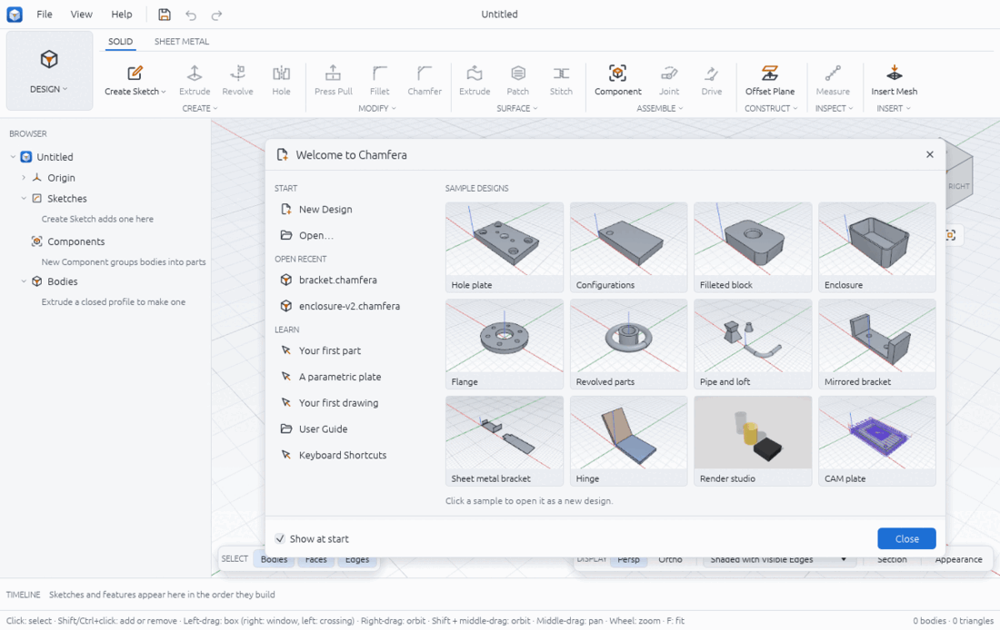
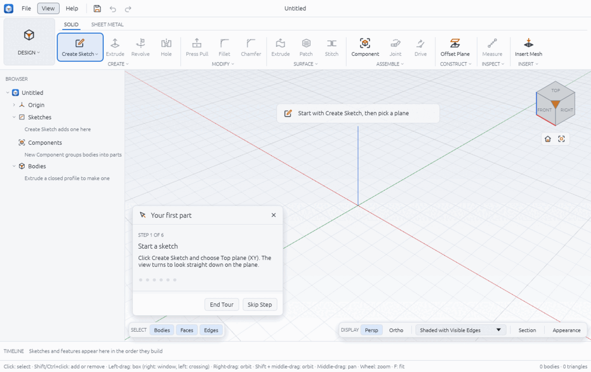
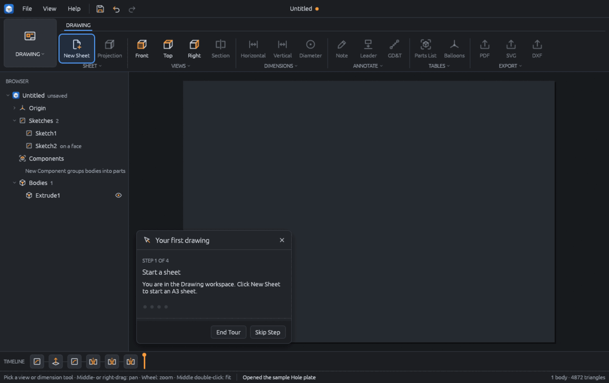
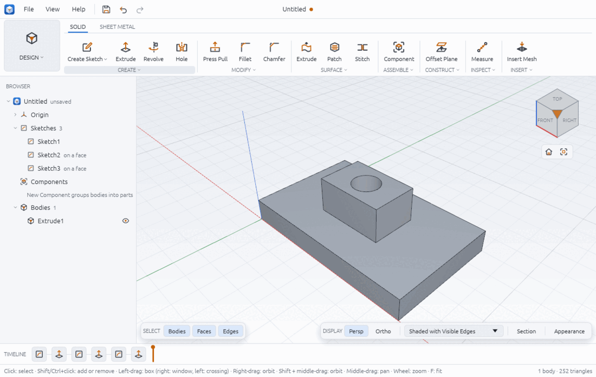
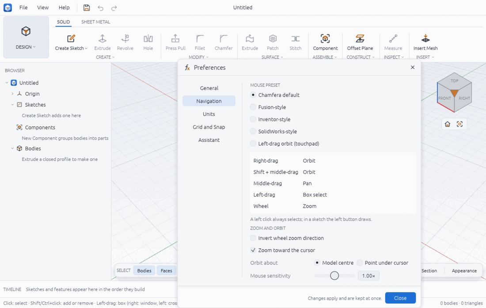
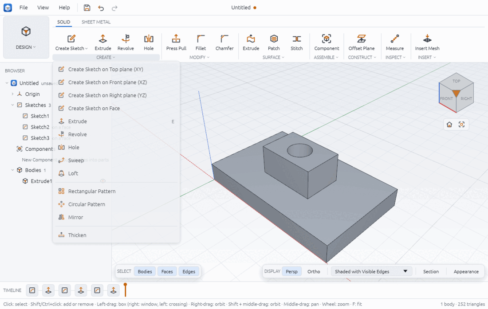
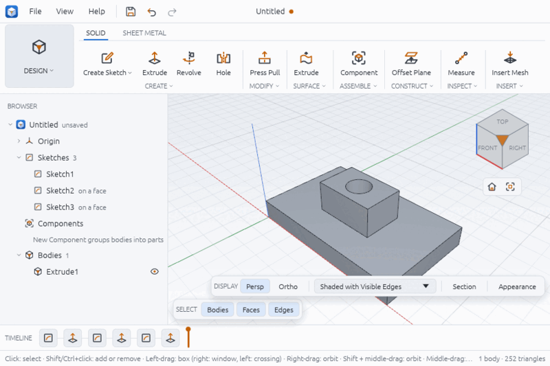
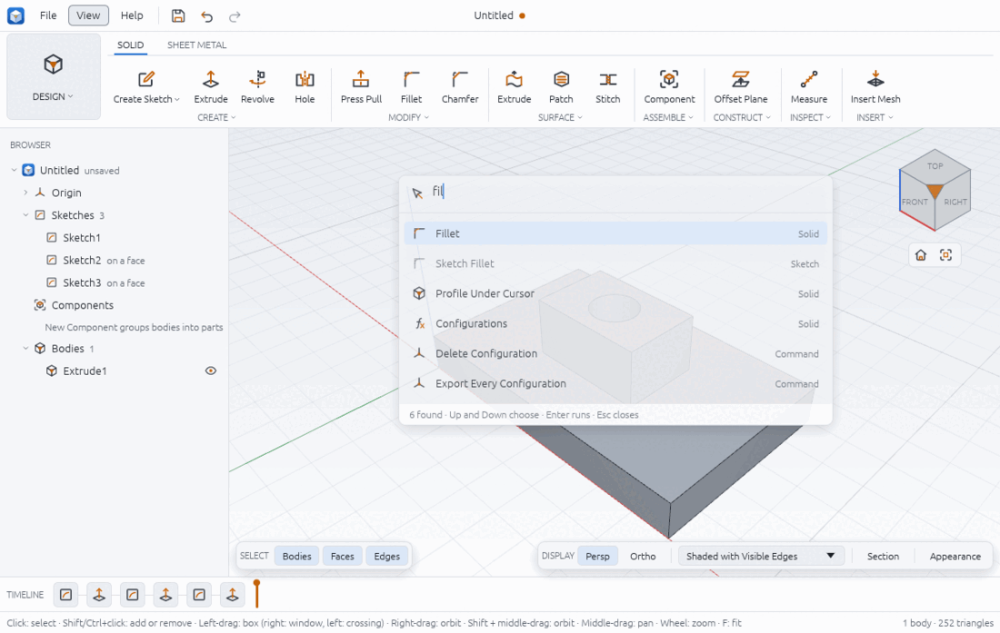
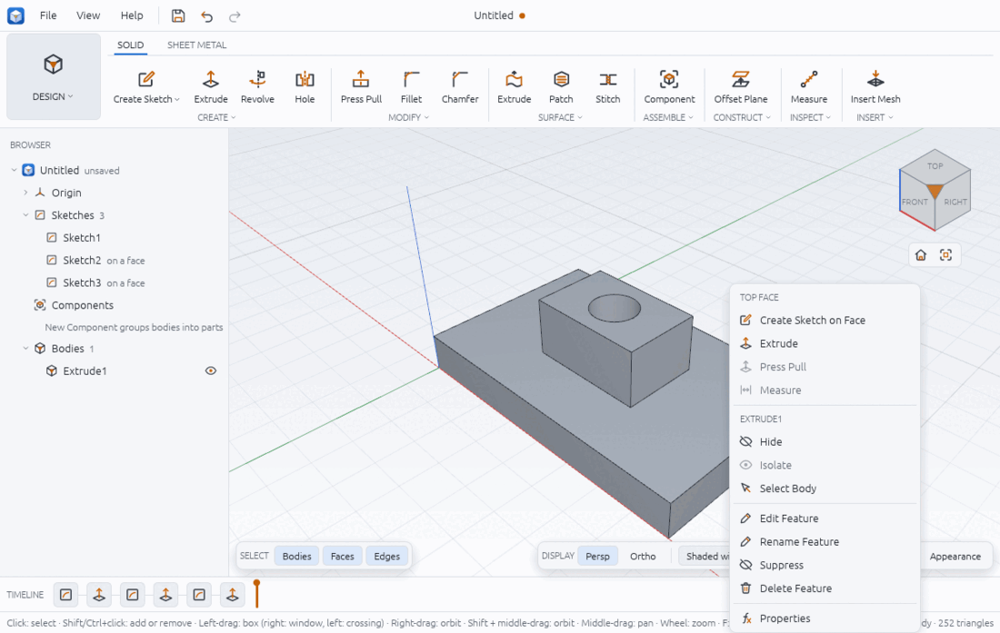

# Getting started

Chamfera is an open-source parametric 3D CAD application. You draw 2D sketches, turn them
into solids with features (extrude, revolve, fillet, ...), and every step is kept in a
timeline you can go back and change. The workflow is familiar to Fusion users: workspaces,
a ribbon of tool groups, a Browser, a timeline and a view cube. Internally everything is in
millimetres and degrees are shown for angles; Z points up.

This page covers installing and starting Chamfera, the parts of the window, moving around
the model, and finding tools. Then go on to [sketching.md](sketching.md) and
[solid-modelling.md](solid-modelling.md).

## Install and run

### Packages

The scripts in `packaging/` build one package per desktop system; tagged releases carry them:

| System | File | How to start it |
|---|---|---|
| Linux | `Chamfera-<version>-x86_64.AppImage` | Make it executable (`chmod +x`), then run it. `Chamfera.AppImage cli <args>` runs the command-line tool from the same file. |
| Windows | `Chamfera-<version>-windows-x86_64.zip` | Portable: unzip anywhere and run `chamfera.exe`. `chamfera-cli.exe` is beside it. |
| Windows | `Chamfera-<version>-windows-x86_64-setup.exe` | A per-user installer (no administrator rights) into `%LOCALAPPDATA%\Programs\Chamfera`, with a Start menu shortcut and an uninstaller. Silent install: `setup.exe /S /D=C:\path`. |
| macOS | `Chamfera-<version>-macos-universal.dmg` | Drag `Chamfera.app` to Applications. The command-line tool is `/Applications/Chamfera.app/Contents/MacOS/chamfera-cli`. |

The packages are not signed yet:

- Windows SmartScreen warns the first time you run Chamfera; choose to run it anyway.
- On macOS, right-click the app and choose Open the first time (or run
  `xattr -dr com.apple.quarantine /Applications/Chamfera.app`).

### From source

With a Rust toolchain installed, from the repository root:

```sh
cargo run --release -p chamfera              # the desktop app
cargo run --release -p chamfera -- --sample  # the same, with a small sample part loaded
cargo run --release -p chamfera-cli -- commands   # list every command
```

The package scripts are `packaging/linux/build-appimage.sh`,
`packaging/windows/build-windows.ps1` (PowerShell on Windows) and
`packaging/macos/build-macos.sh` (on a Mac).

### In the browser

The same interface also runs in a web browser (WebGPU where the browser has it, else
WebGL 2). Builds of the development branch are published to
<https://open-physical-systems.github.io/Chamfera/>. To build it yourself:
`cargo install --locked trunk`, then `trunk build --release` in `apps/chamfera-web`, which
writes `dist/`. In the browser, Open and Insert use the browser's file picker, Save and
Export download the file, and the current design is kept in the browser's local storage
until File > New. Some tools need the desktop app (Save As, Insert STEP, exporting STEP or
STL from the File menu); they say so in the status bar.

## The welcome screen and tutorials

When Chamfera starts with nothing to open (no design file, no script, no sample), a
welcome panel sits in the middle of the viewport.



- **START**: **New Design** starts an empty design; **Open…** picks a `.chamfera` file.
- **OPEN RECENT**: the last five designs you opened or saved. Hover one to see its full
  path. (The list is empty until you have saved a design.)
- **SAMPLE DESIGNS**: twelve ready-made designs, from a hole plate to a hinge assembly, a
  sheet metal bracket, a render scene and a plate with toolpaths. Click a card to open it
  as a new, unsaved design; hover it for a one-line description. The thumbnails are drawn
  the first time the panel is shown and kept in your cache folder
  (`~/.cache/chamfera/samples` on Linux), so later starts show them at once.
- **LEARN**: the three guided tours (below), **User Guide** (opens this guide's folder when
  Chamfera runs from a source checkout, otherwise the guide on GitHub) and **Keyboard
  Shortcuts**.

The panel closes by itself when the design gets its first sketch or body, for example when
you click **Create Sketch** straight away. Close it with **Close** or the cross. Untick
**Show at start** to stop it appearing; the same setting is in **Preferences > General >
START** (see [preferences.md](preferences.md)). **Help > Welcome Screen** shows it again on
an empty design.

A sample opens only when the current design has no unsaved changes; otherwise the status
bar asks you to save or choose **File > New** first.

### Guided tours

A tour shows a card at the bottom-left of the viewport with the step to do, and outlines
the tool to use in the ribbon in the accent colour. When the tool is inside a group's list
(such as Parameters in **MODIFY**), the group is outlined instead. A step is done when
Chamfera runs the command the step expects, so you can use the button, its key or the
search palette. The card has **Skip Step**, **Back** and **End Tour**.

Start a tour from the welcome panel's LEARN list or from **Help > Tutorial: …**:

| Tour | Steps | What you make |
|---|---|---|
| Your first part | 6 | Create Sketch on the top plane, a rectangle (R), Finish Sketch, Extrude, Fillet an edge, a Hole on the top face |
| A parametric plate | 6 | A `thickness` parameter in the Parameters window, a rectangle, an extrude whose distance is `thickness`, then `thickness` changed from 6 mm to 12 mm |
| Your first drawing | 4 | New Sheet, a front view, a top view and a horizontal dimension; on an empty design it opens the hole plate sample first and switches to the Drawing workspace |





The tours are plain JSON files in `assets/tutorials/` of the source tree. Each step names a
ribbon tool and the commands that finish it, so a new tour needs no code beyond one line in
`crates/ui/src/tutorial_ui.rs`.

From the command line, `chamfera --tutorial first-part` (or `parametric-plate`,
`first-drawing`) starts with a tour running.

## The window



From top to bottom:

- **App bar.** The File, View and Help menus, then Save, Undo and Redo buttons. The design's
  name is in the middle, with an orange dot while there are unsaved changes.
- **Ribbon.** At the far left is the **workspace switcher** (DESIGN in the picture). Click it
  to change between Design, Drawing, Manufacture and Render. Beside it are the workspace's
  **tabs**: Design has SOLID and SHEET METAL, plus SKETCH while you are editing a sketch.
  Under the tabs are the tab's **groups** of tools (SOLID: CREATE, MODIFY, SURFACE,
  ASSEMBLE, CONSTRUCT, INSPECT, INSERT).
- **Browser** (left). The design as a tree: Origin (folded at first, with the three origin
  planes), Construction (once you have planes, axes or points), Sketches, Components and
  Bodies. Each body has an eye button to hide or show it. Double-click a plane to start a
  sketch on it, or a sketch to edit it.
- **Viewport** (middle). The model. The **view cube** sits at the top right: click a labelled
  face (TOP, FRONT, RIGHT, ...) to look straight at it, or the orange corner for the
  isometric view. Under the cube are **Home** (the starting view) and **Fit** (zoom to show
  everything). At the bottom are the **selection filter** (SELECT) and the **display bar**
  (DISPLAY: perspective or orthographic, the visual style, Section and Appearance).
- **Timeline** (bottom). One tile per sketch and feature, in the order they build, ending in
  an orange marker. Hover a tile for its name, double-click it to edit, right-click it for
  Edit, Suppress and Delete. See [timeline.md](timeline.md).
- **Status bar.** On the left, the hint for what you are doing (while sketching, a coloured
  dot and the sketch's degrees of freedom come first), then messages; errors are red. On the
  right, the number of bodies and triangles.

## Moving around the model

Navigation never changes the design; it only moves the camera. The default mouse layout
(**Chamfera default**):

| Gesture | Does |
|---|---|
| Left click | Select (Shift or Ctrl+click adds or removes) |
| Left-drag | Box select: dragging to the right picks what is fully inside (window), to the left what the box touches (crossing) |
| Right-drag | Orbit |
| Shift + middle-drag | Orbit |
| Middle-drag | Pan |
| Wheel | Zoom (toward the cursor) |
| F | Fit everything in view |
| H | Home view |

A right click without dragging opens a menu (see below), so a right-drag still orbits.

### Mouse presets

Open **File > Preferences…** (Ctrl+,) and choose **Navigation**:



| Preset | Orbit | Pan | Box select |
|---|---|---|---|
| Chamfera default | Right-drag, or Shift + middle-drag | Middle-drag | Left-drag |
| Fusion-style | Shift + middle-drag | Middle-drag | Left-drag |
| Inventor-style | F4 + left-drag, or Shift + middle-drag | Middle-drag | Left-drag |
| SolidWorks-style | Middle-drag | Ctrl + middle-drag | Left-drag |
| Left-drag orbit (touchpad) | Left-drag | Ctrl + left-drag, right- or middle-drag | Shift + left-drag |

The wheel zooms in every preset (pinch too, with the touchpad preset). The table under the
presets shows the gestures of the one you pick, and the status bar hint follows it. Below
that, **Zoom and orbit** has:

- **Invert wheel zoom direction**;
- **Zoom toward the cursor** (on by default; off zooms toward the middle of the view);
- **Orbit about**: **Model centre** (the default) or **Point under cursor**;
- **Mouse sensitivity**, from 0.25× to 4×.

Changes apply and are kept at once; **Close** closes the window. The other pages of the
Preferences window are described in [preferences.md](preferences.md).

The **View** menu has the same moves as menu items: Home (H), Fit (F), the standard views
(Front, Back, Left, Right, Top, Bottom, Isometric) and an **Orthographic** check box.

## The ribbon

Each group shows its most used tools as **big buttons** (an icon over a label). The group's
**caption** under them (for example CREATE with a small chevron) is a dropdown that lists
every tool of the group, with its shortcut on the right:



In this guide a tool is named by tab, group and tool, for example **SOLID > CREATE >
Extrude**. Tools that are only in the dropdown, such as SOLID > CREATE > Sweep, are found by
opening the caption.

- **Tooltips.** Hover a tool: the first line is its name and shortcut ("Extrude (E)"), the
  second says what it does. A greyed-out tool adds a line saying what to do first ("Draw a
  closed profile in a sketch first").
- **Create Sketch** is a button with its own list: the three origin planes, any
  construction planes, and "A flat face…".
- **Narrow windows.** When the window is too narrow for every group, groups collapse from
  the right to their first tool plus the caption dropdown, so nothing is cut off (CREATE is
  the last to collapse):



## The search palette

Press **Ctrl+Space, then F** (keep Ctrl held, or press F within about a second), or choose
**Help > Search Tools and Commands**. A box opens over the viewport; type part of a name:



- **Up** and **Down** choose a row, **Enter** runs it, **Esc** closes the palette.
- Each row shows where it belongs (Solid, Sketch, File, Command, ...) and its shortcut.
- Matching ignores case and also finds words out of order and letters with gaps ("fil"
  finds Fillet and Profile Under Cursor). Tools that can run now, tools of the tab you are
  in, and the ones you used recently come first.
- A greyed row cannot run now; running it puts the reason in the status bar (for example
  that Sketch Fillet works in a sketch).
- Running a row does what its button does: Extrude opens the Extrude tool. Commands that
  have no button and take no values run at once; the others open the tool they belong to.

## Right-click menus

A right click in the viewport opens a menu for what is under the cursor:



- **On a face**: the face's name as a caption (TOP FACE), Create Sketch on Face and Extrude,
  then the body's items.
- **On a body**: Hide, Isolate, Select Body; then its feature: Edit Feature, Rename
  Feature, Suppress, Delete Feature; and Properties (feature, kind, volume, area and size).
- **On an edge**: Fillet and Chamfer, which open those tools with the edge picked.
- **On empty space**: Home View, Fit, Undo, Redo and Show All Bodies (after you have used a
  tool, a "Repeat" item for it comes first).
- **In a sketch**: Finish Sketch, Dimension, Construction and Delete, and the constraints
  that fit what is selected (or "SELECT GEOMETRY TO CONSTRAIN").

Items that cannot run now are greyed. In this build **Press Pull** and **Measure** are
always greyed in these menus (their tooltip says "is planned"); use the ribbon instead
(SOLID > MODIFY > Press Pull, key Q; SOLID > INSPECT > Measure).

The Browser's rows have right-click menus too (the body items, rename, ...).

## The selection filter

The SELECT bar at the bottom left of the viewport says what a click may pick. Click a
button to turn it off or on:

- In the solid tabs: **Bodies**, **Faces**, **Edges**.
- In a sketch: **Points**, **Curves**, **Construction** (construction curves).

Turning off Bodies, for example, lets you click a face without selecting the whole body.
Hover highlights what a click would pick.

## Keyboard shortcuts

Every default shortcut (also listed in **Help > Keyboard Shortcuts**, Ctrl+/). Single keys
never fire while you are typing in a text box.

| Keys | Action | Where |
|---|---|---|
| Ctrl+Space, F | Search commands | Anywhere |
| L | Line | Sketch |
| R | Rectangle | Sketch |
| C | Circle | Sketch |
| A | Arc | Sketch |
| T | Trim | Sketch |
| O | Offset | Sketch |
| D | Dimension the selection | Sketch |
| X | Construction on or off for the selection | Sketch |
| E | Extrude | Solid |
| Q | Press Pull | Solid |
| Del | Delete the selected sketch geometry | Sketch |
| Esc | Cancel the tool or close the dialog | Anywhere |
| F | Fit | Viewport |
| H | Home view | Viewport |
| Ctrl+Z | Undo | Anywhere |
| Ctrl+Y | Redo | Anywhere |
| Ctrl+Shift+Z | Redo | Anywhere |
| Ctrl+N | New design | Anywhere |
| Ctrl+O | Open | Anywhere |
| Ctrl+S | Save | Anywhere |
| Ctrl+Shift+S | Save As | Anywhere |
| Ctrl+Alt+S | Save a version (with a note) | Anywhere |
| F2 | Rename the selected item | Timeline, Browser |
| Ctrl+/ | Keyboard Shortcuts | Anywhere |
| Ctrl+, | Preferences | Anywhere |
| Ctrl+Shift+A | Show or hide the Assistant | Anywhere |

On a Mac, Cmd takes the place of Ctrl.

## From a script

Everything the interface does is a command, which you can also run from the command-line
tool or the Assistant ([assistant.md](assistant.md)). For example:

```sh
chamfera-cli commands                                   # every command id
chamfera-cli exec view.standard '{"view": "top"}'
chamfera-cli run examples/boss-on-plate.json            # a list of steps, one reply per line
chamfera --script examples/boss-on-plate.json           # open the app after running the steps
```

The camera commands are `view.home`, `view.fit`, `view.standard {view}`,
`view.projection {mode: perspective|orthographic}`, `view.orbit`, `view.pan` and
`view.zoom {factor}`.

## Limits

- The packages are unsigned (warnings on first start on Windows and macOS).
- In the right-click menus, Press Pull and Measure are always disabled ("is planned")
  although both tools work from the ribbon.
- The browser build cannot read STEP files or save to a path of your choosing; Save
  downloads the file.
- Shortcuts cannot be changed yet.

If something goes wrong, see [troubleshooting.md](troubleshooting.md).
