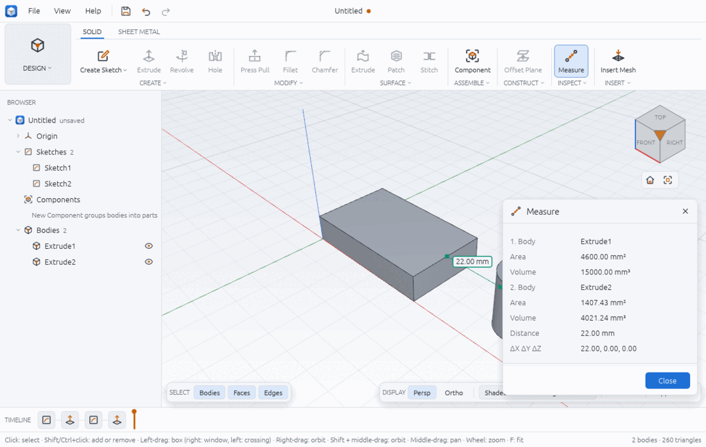
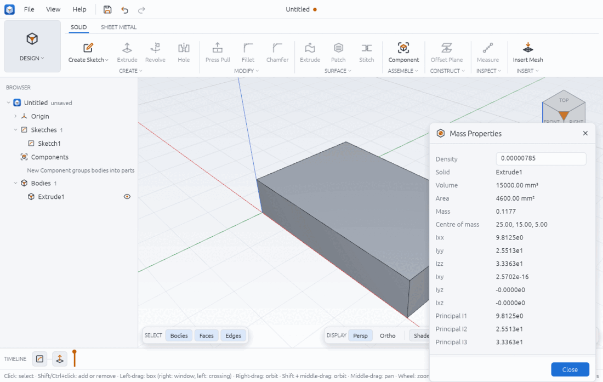
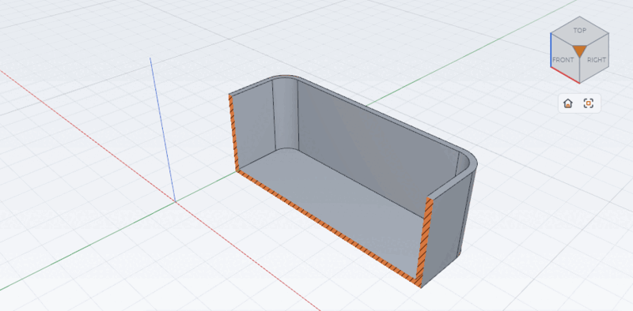

# Inspecting a model

This page covers the tools that tell you about a model without changing it: **Measure** and
**Mass Properties** in SOLID > INSPECT, the **section view**, the **visual styles** and the
**display bar** at the bottom right of the viewport, and the **Appearance** panel for colour
and opacity.

Every number these tools show comes from the exact B-rep geometry, not from the triangles
drawn on screen. A cylinder's area is 2πrh, not the sum of its facets.

## Measure

1. Click **SOLID > INSPECT > Measure**. The Measure panel opens and the status bar says
   `Click a vertex, an edge or a face to measure`. While the panel is open the other tools
   are greyed out.
2. Click a vertex, an edge or a face. The panel describes it, and the edge is drawn
   highlighted. The status bar now says `Click a second entity to measure between them`.
3. Click a second entity. The panel adds the distance between the two and, when both have a
   direction (flat faces, straight edges), the angle between them. A line joins the two
   closest points in the viewport, with a label showing the distance (and angle).
4. Click again to start a new measure. **Close** or Esc closes the panel.

What the panel shows, for each entity (numbered 1. and 2. when there are two):

| Picked | Rows |
|---|---|
| Face | `Face (plane)`, `Face (cylinder)`, ... with its name (`2:top`), Area; Radius and Diameter for a cylindrical face |
| Edge | `Edge (line)`, `Edge (arc)`, ... with its name, Length; Radius and Diameter for a circle or arc |
| Vertex or point | Position (X, Y, Z) |
| Body (from a script) | Area and Volume |

Then between the two: **Distance** (the shortest distance, 0 when they touch),
**ΔX ΔY ΔZ** (from the first closest point to the second) and **Angle**. The angle is the
angle between the two directions: a block's top and bottom faces read 180°, because their
outward normals point opposite ways.

Lengths, areas and angles use the design's units and precision (see preferences.md).



Example: a 50 × 30 × 10 block at the origin and a pin of radius 8 centred at X 80. The gap
between the block's end face (X 50) and the pin's side is 80 − 8 − 50 = 22 mm, which is what
Measure reports. The block's area is 2 (50·30 + 50·10 + 30·10) = 4600 mm² and its volume
15000 mm³; the pin's side face is 2π · 8 · 20 = 1005.31 mm² and its top edge 16π = 50.27 mm
long.

## Mass properties

1. Click **INSPECT > Mass Properties** (open the list under INSPECT). The panel opens for the
   selected solid, or the first one if none is selected, and the status bar says
   `Click a solid to see its mass properties`.
2. Click another solid in the viewport to switch to it.
3. Type a **Density** in mass per mm³. The default, 1, makes the mass equal to the volume.
   For steel in kilograms use `0.00000785` (7.85 g/cm³ = 7.85 × 10⁻⁶ kg/mm³); the results
   update as you type.

The panel lists the solid's name, **Volume**, **Area**, **Mass**, **Centre of mass**, the
inertia tensor about the centre of mass (**Ixx Iyy Izz Ixy Iyz Ixz**) and the three
**Principal** moments. Inertia is in mass × mm² (kg·mm² with the steel density above) and is
written in scientific notation (`9.8125e0`). Tiny values such as `2.5702e-16` are rounding
noise and mean zero.



Check it by hand: the block's mass is 15000 × 7.85 × 10⁻⁶ = 0.11775 kg, its centre of mass is
the middle (25, 15, 5), and Ixx = m (30² + 10²) / 12 = 9.8125 kg·mm², Iyy = m (50² + 10²) / 12
= 25.5125 and Izz = m (50² + 30²) / 12 = 33.3625, as the panel shows.

## Section view

A section cuts the view with a plane so you can see inside, with the cut faces hatched. It is
a view only: the design does not change, and exports and measures still see the whole part.

From the display bar:

1. Click **Section** in the display bar. The plane picker, an offset box and **Flip** appear
   next to it.
2. Pick the plane: **XY (top)**, **XZ (front)** or **YZ (right)**.
3. Drag or type the **offset** in mm, along the plane's normal. The side the normal points to
   is cut away; tick **Flip** to keep that side instead.
4. Click **Section** again to turn it off.

The normals: XY points up (+Z), YZ to the right (+X), and XZ toward the front (−Y). So to cut
an 80 × 50 × 30 box at Y = 25 on the XZ plane, type an offset of −25; to look into it from
above on XY, type 15 (half its height).

From the menu: **View > SECTION ANALYSIS** has the three planes (each starts at offset 0)
and **Clear Section**.

Note that the bar starts at XY with offset 0: on a part that sits on the XY plane, that cuts
away everything above Z 0 and leaves only the hatched footprint. Type an offset to see the
inside.



## Visual styles and the display bar

The display bar sits at the bottom right of the viewport (above the selection filter when the
window is narrow). From left to right:

- **Persp** / **Ortho**: perspective or orthographic projection. Ortho keeps parallel edges
  parallel, which helps when lining things up.
- The visual style list:
  - **Shaded**: faces only.
  - **Shaded with Visible Edges**: faces with their edges (the default).
  - **Shaded with Hidden Edges**: as above, with edges behind the part drawn dashed.
  - **Wireframe**: every edge, no faces.
  - **Wireframe, Hidden Lines Removed**: only the edges you could see.
  - **Realistic**: materials, environment lighting, a floor and shadows (see render.md).
- **Section**: above.
- **Appearance**: opens the Appearance panel.

The same styles are radio items under **View > VISUAL STYLE**.

## Appearance

1. Select one or more bodies.
2. Click **Appearance** in the display bar (or **View > Appearance**). Without a selection the
   panel says `Select one or more bodies first.`
3. Under **LIBRARY**, click a material (steel, aluminium, brass, glass, rubber, ...): the
   bodies take its colour, and in the Realistic style its finish too.
4. Under **CUSTOM**, pick a **Colour** or drag **Opacity** (0.05 to 1) to make bodies
   see-through.
5. **Default Appearance** puts the theme's body colour back. **Close** closes the panel.

A solid's appearance is saved with the design, for every body its feature makes. A mesh body's appearance lasts for the session only. A library material
sets opacity back to 1.

## From a script

```json
[
  { "command": "inspect.measure", "params": { "a": { "solid": "Extrude1", "face": "2:side 1" }, "b": { "solid": "Extrude2", "face": "4:side 0" } } },
  { "command": "inspect.measure", "params": { "a": { "solid": "Extrude2", "edge": "4:top 0" }, "b": { "point": [50, 30, 10] } } },
  { "command": "inspect.mass", "params": { "body": "Extrude1", "density": 0.00000785 } },
  { "command": "view.section", "params": { "plane": "xz", "offset": -25 } },
  { "command": "view.style", "params": { "style": "shaded_hidden_edges" } },
  { "command": "body.appearance", "params": { "body": "Extrude1", "colour": "#3366cc", "opacity": 0.5 } }
]
```

- `inspect.measure {a, b?}`: entities are `{solid}`, `{solid, face}`, `{solid, edge}`,
  `{solid, vertex}` or `{point: [x, y, z]}` (names from `solid.edges`). The reply has `a`,
  `b`, `distance`, `delta`, the closest points `on_a` and `on_b`, and `angle` (radians) and
  `angle_degrees` when both have a direction.
- `inspect.measure_at {x, y, width, height, from?}` picks by viewport pixel, as a click does.
- `inspect.mass {body, density?}` replies with `volume`, `area`, `mass`, `centre_of_mass`,
  `inertia` (3 × 3, about the centre of mass), `principal_moments` and `principal_axes`.
- `view.section {plane: xy|xz|yz|"2:top", offset?, flip?}` (a flat face by name also works
  from a script) and `view.section_clear`.
- `view.style {style: shaded|shaded_edges|shaded_hidden_edges|wireframe|wireframe_hidden|realistic}`
  and `view.projection {mode: perspective|orthographic}`.
- `body.appearance {body, preset?, colour?, opacity?, metallic?, roughness?, transmission?,
  ior?}`; `preset: "default"` resets it.

A start-up script whose last inspect step is `inspect.measure` or `inspect.mass` opens that
panel with its result (`chamfera --script examples/measure-block-and-pin.json`).

## Limits

- **A density the panel cannot read is taken as 1 without a warning.** Typing `7.85 g/cm3`
  or `7,85e-6` leaves the text in the box but shows the results for density 1. Type a plain
  number.
- **The display bar does not follow a section set from a script or command**: after
  `view.section {plane: "xz", offset: -25}` the bar still shows `XY` and `0.0 mm`, and
  touching the offset box replaces the section with an XY one.
- The click picks vertices, edges and faces; measuring whole bodies is a script feature.
- Mass properties need a closed solid: surface bodies have no volume (see surfaces.md).
  Spline faces are integrated numerically, about 2 × 10⁻⁸ relative to the exact value.
- The section plane from the bar is one of the three origin planes; a face as the plane is
  only from a script.
- Interference between parts is in assemblies-and-motion.md.
