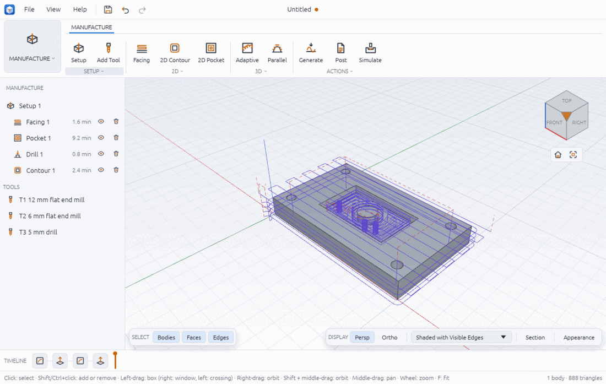
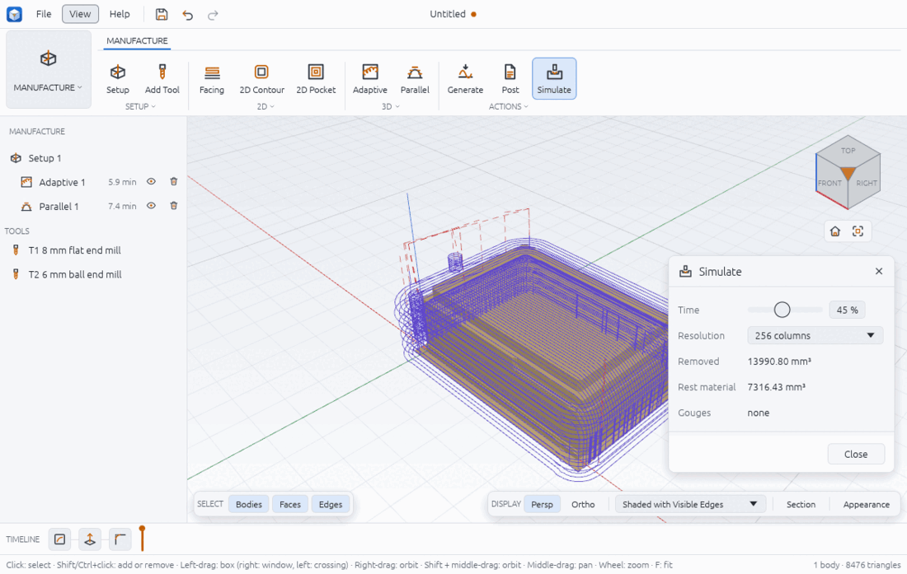

# Manufacture (CAM)

The MANUFACTURE workspace turns a solid into toolpaths for a 3-axis milling machine and writes them out as G-code. You make a **setup** (the stock and where part zero is), add **tools** to the design's tool library, add **operations** that use those tools on faces of the model, then **generate**, **simulate** and **post**. Operations refer to model faces by their persistent names (such as `4:top`), so when you change the model they are worked out again.

This page describes what is on the `dev` branch now. CAM is still being extended, so expect more operations and options later.

> **Safety first.** Chamfera's G-code has not been proven on your machine. Before you cut anything, open the posted file in a G-code simulator or viewer, check the work offset, tool numbers, lengths and the first moves, and run the program in the air (Z raised well above the stock, or no tool fitted) with your hand near the feed hold. You are responsible for what your machine does.



## Open the workspace

1. Build a solid first (see solid-modelling.md). The Manufacture tools stay greyed out until there is one, and their tooltips say why ("build a solid first", "add a tool first", "add an operation first").
2. Click the workspace button on the left of the ribbon and pick **MANUFACTURE**.

The left panel now shows the MANUFACTURE tree: each setup with its operations (each with its cycle time, an eye to suppress it and a bin to delete it), then **TOOLS**, the tool library. Toolpaths are drawn only while this workspace is open: blue lines are cutting moves, dashed red lines rapids.

## Make a setup and stock

1. Click **MANUFACTURE > SETUP > Setup**.
2. The status bar says "Added Setup 1".

The ribbon button uses the defaults: the stock is the model's bounding box grown by 2 mm on each side and 1 mm on top (0 below), part zero (the work origin, G54) is the **top corner of the stock** at its lowest X and Y, the clearance height is 10 mm above the stock and rapids are counted at 5000 mm/min for the cycle time. There is no setup dialog yet: to change the stock or origin, use `cam.setup` from a script (below), the search palette or the Assistant.

Worked example (`examples/cam-plate.json`): a 100 × 60 × 12 mm plate with `side 3, top 1` gives stock from (−3, −3, 0) to (103, 63, 13) and part zero at (−3, −3, 13), so in the G-code the plate's corner is at X3 Y3 and its top face at Z−1.

## Add tools

1. Click **MANUFACTURE > SETUP > Add Tool**. The Add Tool dialog opens with a 6 mm flat end mill.
2. Pick the **Kind**: flat end mill, ball end mill, drill or chamfer mill.
3. Type the **Diameter** (a length such as `6 mm` or `0.25 in`), **Feed mm/min** and **Spindle rpm**.
4. Click **OK**. The tool appears under TOOLS as `T1 6 mm flat end mill`; T numbers count up.

The plunge feed defaults to a third of the feed, flutes to 3 for mills and 2 for drills. A bull nose mill (with a corner radius), flute length, tip angle, plunge feed and your own T number can only be set with `cam.tool_add` for now.

## 2D operations

Each operation dialog starts with the last tool you added; pick another under **Tool**. Click **OK** and the status bar shows the operation's name and time, such as "Pocket 1 · 9.2 min", or why it failed.

### Facing

**MANUFACTURE > 2D > Facing** flattens the stock top down to the top of the model. Set **Stepover %** (of the tool diameter, default 50) and **Stepdown** (most depth per pass, default 1 mm). Passes run along X and are spaced evenly: 106 mm of stock with a 12 mm tool at 60 % needs 10 steps, so each is 6.6 mm rather than 7.2 mm.

### 2D Contour

**MANUFACTURE > 2D > 2D Contour** runs round an outline.

1. Under **Follow** pick **Face** and click a flat face in the viewport (its outline is followed), or pick **Edges** and click a closed chain of edges.
2. Pick **Side**: **Outside** (the tool stays outside the outline, the usual choice for cutting a part free) or **Inside**.
3. Set **Stepdown** (default 2 mm). The depth is down to the picked face.

Outside contours climb-mill and get tangent lead-in arcs of the tool's radius; inside contours plunge at the plunge feed. Lead radius, a cut below the boundary (`bottom_offset`, handy for cutting through) and conventional milling are script options.

### 2D Pocket

**MANUFACTURE > 2D > 2D Pocket** clears a flat-bottomed pocket.

1. Click the pocket's **floor** in the viewport (the dialog says "Click the pocket floor").
2. Set **Stepover %** (default 40), **Stepdown** (default 2 mm) and **Entry**: helix (default), ramp or plunge.

### Drill

**MANUFACTURE > 2D > Drill** (in the 2D group's list) drills **every vertical hole** of the model, top to bottom. Leave **Peck** empty for a plain drilling cycle (G81) or give a peck depth for a peck cycle (G83). The reply lists the holes it found with their diameters and depths. A tool that is not a drill, or a drill smaller than a hole (a 5 mm drill in a 6 mm hole comes out 5 mm), is drilled anyway but warned about: the reply's `warnings`, `cam.generate`'s `warnings` (each named after its operation) and the status bar say so. A drill bigger than a hole is refused. Choosing particular holes, the retract plane (default 2 mm above the stock) and a breakthrough below the hole are script options.

## 3D operations

3D operations work on the whole part as the tool sees it from above. They take flat, ball or bull nose mills; a drill or chamfer mill is refused ("a drill cannot cut a 3D operation").

- **MANUFACTURE > 3D > Adaptive** (Adaptive Clearing) roughs the stock down to the part, keeping the tool's engagement under a limit. Set **Stepdown**, **Engagement °** (default 60) and **Stock to leave** (default 0.3 mm, for a finishing pass to remove).
- **MANUFACTURE > 3D > Parallel** finishes curved surfaces in straight passes with the tool dropped onto the model. Set **Stepover %** (default 10) or a **Scallop** height instead (the cusp a ball end mill leaves; it overrides the stepover), the pass **Angle °** from +X, and **Stock to leave**.
- **MANUFACTURE > 3D > Waterline** (in the 3D group's list) finishes steep walls in level contours, one per **Stepdown** (default 1 mm).

The sampling tolerance (largest height error between samples, default 0.01 mm) is a script option.

## Generate and read the cycle time

Click **MANUFACTURE > ACTIONS > Generate**. Every toolpath is worked out again and drawn, and the status bar says "Toolpaths generated · cycle time 14.0 min", or "1 operation(s) could not be generated: see the tree". A failed operation shows **error** in red in the tree; hover it for the reason (for example "a 40 mm tool does not fit in this pocket", or "the face … is not horizontal").

The cycle time is the cutting length at the tool's feed, plunges at the plunge feed and rapids at the setup's rapid rate. For the facing pass above: 1386 mm at 900 mm/min, 2 mm at 300 mm/min and 20 mm of rapids at 5000 mm/min make 1.54 + 0.0067 + 0.004 = 1.55 min, the 1.6 min the tree shows. Real machines accelerate and decelerate, so treat it as a lower bound.

To edit an operation, click its name in the tree: the same dialog opens with its values. The eye suppresses it ("Skip this operation when generating and posting"); the bin deletes it.

## Simulate



1. Click **MANUFACTURE > ACTIONS > Simulate**. The stock appears and is cut along every toolpath of the first setup; the Simulate panel opens.
2. Drag **Time** to see the stock at that point of the cycle (0 to 100 % of the cycle time).
3. Pick a **Resolution** (128 to 1024 columns along the stock's longer side; 256 to start). Finer is slower.
4. Read **Removed** (volume cut away), **Rest material** (left above the part) and **Gouges** (columns cut more than 0.02 mm into the part, with the deepest). Gouges are drawn in red.
5. Click **Close** (or Simulate again) to take the stock away.

Example (`examples/cam-3d-simulate.json`): a 60 × 40 × 20 mm block with 8 mm fillets on its top edges, stock 66 × 46 × 22 mm. The stock is 66 792 mm³ and the part 45 449 mm³, so 21 343 mm³ must go. At 45 % the panel shows 13 990.8 removed and 7 316.4 left; at 100 % 20 729.7 removed and 578.1 left above the part: cusps between the finishing passes and the steep sides the parallel pass barely touches (a waterline pass would take more of that). Removed plus rest stays close to 21 343 at every time, which is a quick sanity check. Each column is 66 / 256 = 0.26 mm wide, so the stock is a grid of columns, so these volumes are approximate.

## Post G-code

1. Generate first, and check the simulation.
2. Pick the dialect: **MANUFACTURE > ACTIONS > Post** (LinuxCNC) or **Post GRBL** beside it, or **File > Post G-code (LinuxCNC)…** or **File > Post G-code (GRBL)…**.
3. Choose where to save (the name defaults to the design's name with `.nc`; `.ngc` and `.gcode` are offered too).
4. The status bar says "Posted 406 lines to …".

What the two dialects write:

- **LinuxCNC**: metric absolute (`G21 G90 G17`), one comment per operation, `T1 M6` tool changes, `S… M3`, canned drilling cycles (`G98 G83 … R2 Q3` and `G80`), `M5 M30` at the end.
- **GRBL**: the same moves, but no `M6` (each tool change is `M5` then `M0 (change to T2 6 mm flat end mill)`, a pause for you to change the tool and set its length) and no canned cycles (pecks are written out as moves).

Coordinates are relative to part zero, so set your work offset (G54) to the top corner of the stock that the setup used.

Only the first setup is posted. Suppressed operations are left out.

## From a script

```json
[
  { "command": "cam.setup", "params": { "stock": { "kind": "from_model", "side": 3, "top": 1, "bottom": 0 }, "origin": "stock_top_corner" } },
  { "command": "cam.tool_add", "params": { "kind": "flat_end_mill", "diameter": 6, "feed": 600 }, "as": "mill" },
  { "command": "cam.tool_add", "params": { "kind": "drill", "diameter": 5, "feed": 150, "plunge_feed": 100 }, "as": "drill" },
  { "command": "cam.op_add", "params": { "kind": "pocket", "tool": "$mill.tool", "face": "4:top", "stepover": 45, "stepdown": 2.5 } },
  { "command": "cam.op_add", "params": { "kind": "drill", "tool": "$drill.tool", "peck": 3, "breakthrough": 1 } },
  { "command": "cam.op_add", "params": { "kind": "contour", "tool": "$mill.tool", "face": "2:bottom", "side": "outside", "stepdown": 4, "bottom_offset": 0.5 } },
  { "command": "cam.generate" },
  { "command": "cam.simulate", "params": { "resolution": 256, "time": 1 } },
  { "command": "cam.post", "params": { "dialect": "grbl", "path": "plate.nc" } }
]
```

- `cam.setup` also takes `{"kind": "fixed", "x", "y", "z"}` stock, `origin` (`stock_top_corner`, `stock_top_centre`, `stock_bottom_corner`, `model_origin` or a point), `x_axis` (a straight edge along the work X axis), `clearance` and `rapid_rate`; with `setup` it edits an existing one.
- `cam.op_edit {operation, suppressed, …}`, `cam.op_delete {operation}`, `cam.list` and `cam.generate {operation?}` replies give each operation's moves, `feed_length`, `rapid_length` and `minutes`, or its `error`.
- `cam.post` without `path` replies with the program as `gcode`.
- `cam.simulate {"clear": true}` ends a simulation. Complete examples: `examples/cam-plate.json`, `examples/cam-3d-finish.json`, `examples/cam-3d-simulate.json`.

## Limits

- 3-axis milling only: no lathe, no 4th or 5th axis, no tool-length or cutter-radius compensation in the code, no coolant codes.
- One posted setup per file (the first); no setup dialog, no stock or origin picking in the UI yet.
- Drill finds every vertical hole; the UI cannot pick some of them. Drilling under a deep pocket starts its pecks at the stock's retract plane, so it pecks through air.
- There is no check that a tool is long enough or that the holder clears the part.
- The simulation is a grid of columns: volumes and gouge depths are approximate to about one cell, and it does not check the holder or rapids into the stock.
- Cycle times ignore acceleration and tool changes.
- 3D toolpaths are worked out again after every model change, which can take a few seconds on detailed parts (see troubleshooting.md).

Related: solid-modelling.md (building the part), file-formats.md (G-code files), troubleshooting.md.
