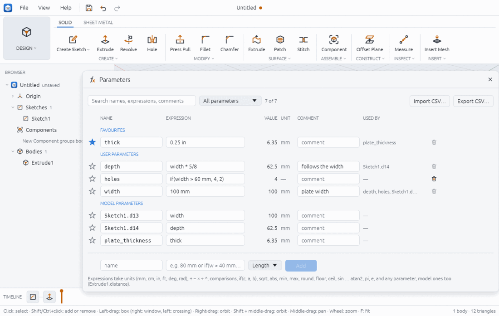
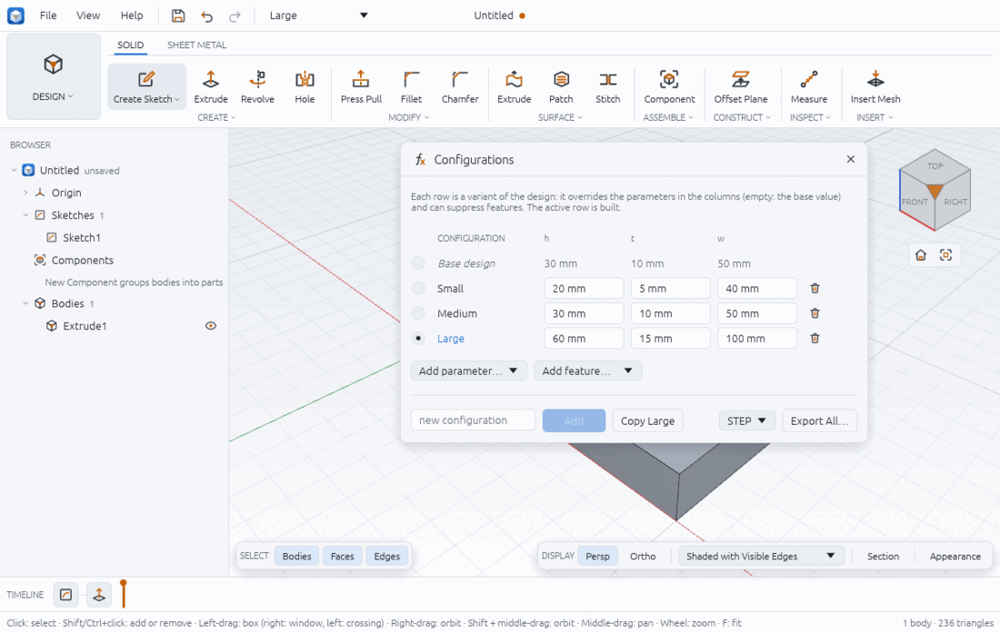

# Parameters and configurations

Parameters are named values that dimensions and features follow. Change `width` from 80 mm to 100 mm and every sketch dimension, extrude distance or other parameter that uses it is worked out again. **Configurations** are variants of one design (Small, Medium, Large) made from a table of parameter values and features switched on or off.

## User and model parameters

- **User parameters** are the ones you create: `width`, `thick`, `holes`.
- **Model parameters** are made for you: every feature value and sketch dimension is one, named after its owner, such as `Extrude1.distance` or `Sketch1.d13`. You can type an expression into them, rename them (`plate_thickness`), comment them and pin them, but you cannot delete them.

Each parameter has a unit kind: **Length**, **Angle** or **Unitless**.

## Expressions and units

An expression can use:

- numbers with units: `mm`, `cm`, `m`, `in`, `ft` for lengths (also `"` for inches), `deg` and `rad` for angles (also `°`);
- `+ − * / ^`, parentheses and comparisons `< <= > >= == !=` (they give 1 or 0);
- `if(condition, then, else)`, `sqrt`, `abs`, `min`, `max`, `round`, `floor`, `ceil`, `sin`, `cos`, `tan`, `asin`, `acos`, `atan`, `atan2`, and `pi` and `e`;
- any parameter, user or model: `width / 2`, `Extrude1.distance + 3 mm`.

Units are checked as the value is worked out: `10 mm + 5 deg` is an error, and so is giving an angle to a length ("width: the result is an angle, but a length (mm) is needed"). Mixed length units are fine: `10 mm + 0.25 in` is 16.35 mm. A number without a unit is read in the design's length unit (millimetres unless you changed it in Preferences > Units, see preferences.md), and as degrees for an angle.

Examples, checked in the app:

| Name | Expression | Value |
|---|---|---|
| `width` | `80 mm` | 80 mm |
| `depth` | `width * 5/8` | 50 mm |
| `thick` | `0.25 in` | 6.35 mm |
| `holes` (unitless) | `if(width > 60 mm, 4, 2)` | 4 |

## The Parameters window



Open it with **SOLID > MODIFY > Parameters** (in the MODIFY list), or type "parameters" in the search palette (Ctrl+Space, F). Click the button again or the × to close it.

The table has the columns **NAME**, **EXPRESSION**, **VALUE**, **UNIT**, **COMMENT** and **USED BY**, in three sections: **FAVOURITES**, **USER PARAMETERS** and **MODEL PARAMETERS**. The search box filters on names, expressions and comments; the list next to it shows **All parameters**, **User parameters**, **Model parameters**, **Favourites** or **With errors**.

### Add a user parameter

1. In the bottom row type a **name** (a letter or `_`, then letters, digits or `_`, at most 64 characters).
2. Type an expression, for example `80 mm` or `if(w > 40 mm, 2, 1)`.
3. Pick the unit kind: **Length**, **Angle** or **Unitless**.
4. Click **Add**.

### Change, rename, comment and pin

- **Change a value:** click its EXPRESSION cell, type, and press Enter or click elsewhere. The model rebuilds; VALUE shows the result in the design's units.
- **Rename:** edit the NAME cell. Every expression that used the old name follows ("width is now plate_width"). Renaming a model parameter gives it a name of your own.
- **Comment:** type in the COMMENT cell.
- **Favourite:** click the star to pin a parameter at the top, click again to unpin.
- **Delete:** the bin at the end of a user parameter's row. It is greyed while the parameter is in use ("width is in use: change its users first").

A refused edit is shown in red under its row with the reason, and nothing changes. Reasons you may see:

- `parameters refer to each other in a loop: depth → width → depth`
- `width: unknown name "nosuch"`
- `bad parameter name "2wide": use a letter or _ then letters, digits or _ (at most 64)`
- `sketch 1 cannot take the new dimensions: …` (for example a negative length)

Changing a parameter can still make a later feature fail (a fillet too large for a thinner plate); that feature is then marked in the timeline (see timeline.md).

### Import and export CSV

**Export CSV…** writes the user parameters to a CSV file with the columns `name, expression, unit, comment`:

```
name,expression,unit,comment
depth,width * 5/8,length,follows the width
holes,"if(width > 60 mm, 4, 2)",unitless,
thick,0.25 in,length,
width,100 mm,length,plate width
```

**Import CSV…** reads the same columns; each row creates or replaces a user parameter. Model parameters are not exported or imported. CSV import and export are in the desktop app only.

## Configurations



A configuration overrides some user parameters and can suppress features; the **Base design** is the design with no overrides. Only one is built at a time: the active one.

Open the window with **SOLID > MODIFY > Configurations**, or, once a design has configurations, from the configuration list in the top bar (**Edit Configurations…** at its bottom).

### Add and fill in configurations

1. Type a name in **new configuration** and click **Add**. To start from the active configuration's values instead, click **Copy Large** (the button names the active one).
2. Click **Add parameter…** and pick a user parameter: it becomes a column, filled with the base value in every row.
3. Type each configuration's value in its cell (an expression, such as `40 mm`). Empty means the base value, shown greyed as a hint.
4. Click **Add feature…** and pick a feature to get an **ON** column: untick it in a row to suppress that feature in that configuration.

Only user parameters can be columns. To vary a feature value, drive it from a user parameter (set `Extrude1.distance` to `t`) and put `t` in the table; `config.set` on a model parameter is refused with that advice.

### Activate a configuration

Click the round button at the start of its row, or pick it in the configuration list in the top bar. The design rebuilds with those values and the status bar says "Built Large". In the Parameters window, overridden values are shown in the accent colour with the note "Set by the active configuration", and the window's header says "Configuration: Large". Editing an overridden parameter changes the configuration's value, not the base one. Pick **Base design** to go back.

Example (`examples/configurations.json`): a w × h × t plate with a hole of diameter `if(w > 60 mm, 12 mm, 8 mm)`. Hand values: Small (40 × 20 × 5, hole 8) 4000 − 80π = 3748.67 mm³; Medium (50 × 30 × 10, hole 8) 14 497.35 mm³; Large (100 × 60 × 15, hole 12) 90 000 − 540π = 88 303.54 mm³. `config.activate` and Export All give exactly these.

### Delete a configuration

Click the bin at the end of its row.

### Export every configuration

1. Pick **STEP** or **STL** next to **Export All…**.
2. Click **Export All…** and choose a folder.
3. One file per configuration is written, named after it (`Small.step`, `Medium.step`, `Large.step`), and the status bar says "Wrote 3 files to …". The base design is not exported by this button.

## From a script

```json
[
  { "command": "param.set", "params": { "name": "width", "expression": "80 mm", "comment": "plate width" } },
  { "command": "param.set", "params": { "name": "holes", "expression": "if(width > 60 mm, 4, 2)", "unit": "unitless" } },
  { "command": "param.set", "params": { "name": "thick", "expression": "0.25 in", "favourite": true } },
  { "command": "solid.extrude", "params": { "sketch": 1, "profiles": [{ "x": 5, "y": 5 }], "distance": "thick" } },
  { "command": "param.rename", "params": { "name": "Extrude1.distance", "new_name": "plate_thickness" } },
  { "command": "param.annotate", "params": { "name": "width", "comment": "outer size", "favourite": true } },
  { "command": "param.export_csv", "params": { "path": "params.csv" } },
  { "command": "config.add", "params": { "name": "Small" } },
  { "command": "config.set", "params": { "config": "Small", "parameter": "width", "expression": "40 mm" } },
  { "command": "config.suppress", "params": { "config": "Small", "feature": 2, "suppressed": true } },
  { "command": "config.activate", "params": { "config": "Small" } },
  { "command": "config.export_all", "params": { "dir": "out", "format": "step" } }
]
```

Also: `param.list` (the whole table with `used_by` and `error`), `param.remove {name}`, `param.import_csv {path}`, `config.add {name, from}`, `config.list`, `config.delete {config}` and `config.activate {config: null}` for the base design. A sketch dimension follows a parameter with `sketch.dimension {constraint, expression}` (`examples/parametric-plate.json`). `chamfera --parameters` and `chamfera --configurations` open the windows at start.

## Limits

- Configurations override user parameters only, and suppress whole features; they cannot add features, change a sketch's shape other than through parameters, or hold different materials.
- Export All writes STEP or STL only, and not the base design.
- CSV holds user parameters only; there is no spreadsheet-style table of model parameters.
- A comparison gives 1 or 0 and is allowed once per expression level; `^` takes a plain-number exponent.
- Expressions are at most 1000 characters, comments 512.

Related: sketching.md (dimensions), timeline.md (failed features), preferences.md (design units).
