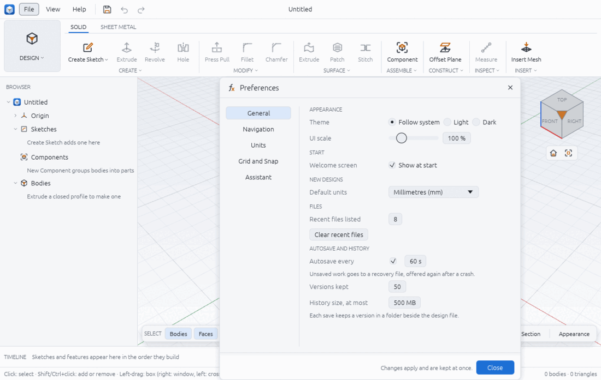
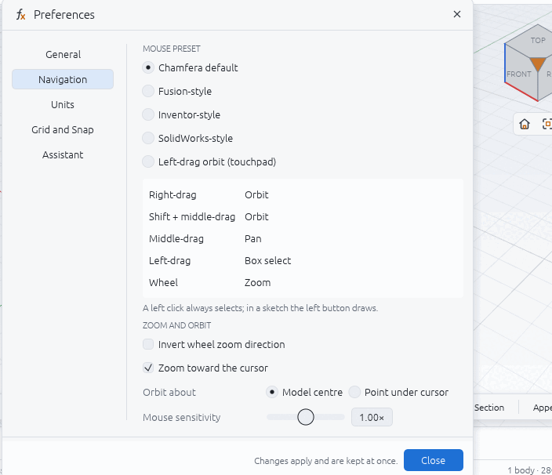
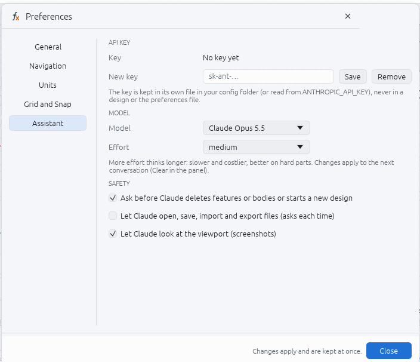

# Preferences

Preferences are your own settings for the app: theme, scale, mouse, grid, autosave and the Assistant. They belong to you, not to a design, with one exception: the **Units** page sets the open design's units and is saved with the design.

Open the window with **File > Preferences…** or **Ctrl+,** (press it again to close). Pick a page on the left. Every change applies and is kept at once ("Changes apply and are kept at once."); click **Close** when you are done. If the file cannot be written, the page says "Not saved: …" with the reason.

## Where the file lives

| System | Preferences file |
|---|---|
| Linux | `$XDG_CONFIG_HOME/chamfera/preferences.json`, else `~/.config/chamfera/preferences.json` |
| macOS | `~/Library/Application Support/Chamfera/preferences.json` |
| Windows | `%APPDATA%\Chamfera\preferences.json` |
| Browser | the browser's local storage for the page |

The Assistant's API key is in a separate file, `assistant-key`, in the same folder (see assistant.md). The file is plain JSON. A missing, broken or out-of-range value is replaced by its default when Chamfera starts, so a damaged file never stops the app. To reset everything, quit Chamfera and delete `preferences.json` (see troubleshooting.md).

## General

| Setting | What it does | Range, default |
|---|---|---|
| APPEARANCE > Theme | **Follow system**, **Light** or **Dark** | Follow system |
| APPEARANCE > UI scale | Size of the whole interface | 50 to 300 %, 100 % |
| START > Welcome screen: Show at start | Show the welcome screen when Chamfera starts with nothing to open (`show_welcome`) | on |
| NEW DESIGNS > Default units | The length unit new designs start with | mm, cm, m, in, ft; Millimetres (mm) |
| FILES > Recent files listed | How many designs File > Open Recent lists (0 hides it) | 0 to 30, 8 |
| FILES > Clear recent files | Empties the Open Recent list | |
| AUTOSAVE AND HISTORY > Autosave every | Unsaved work goes to a recovery file this often; untick to turn autosave off | 10 to 3600 s, 60 s |
| Versions kept | Versions each design's history keeps | 1 to 1000, 50 |
| History size, at most | Snapshot space each design's history keeps | 1 to 100 000 MB, 500 MB |

The newest version is always kept, whatever the limits. Autosave and versions are explained in version-history-and-recovery.md.

## Navigation

**MOUSE PRESET** picks what mouse drags do. The box under the list shows the chosen preset's gestures:

| Preset | Orbit | Pan | Box select |
|---|---|---|---|
| Chamfera default | Right-drag, or Shift + middle-drag | Middle-drag | Left-drag |
| Fusion-style | Shift + middle-drag | Middle-drag | Left-drag |
| Inventor-style | F4 + left-drag, or Shift + middle-drag | Middle-drag | Left-drag |
| SolidWorks-style | Middle-drag | Ctrl + middle-drag | Left-drag |
| Left-drag orbit (touchpad) | Left-drag | Ctrl + left-drag, right- or middle-drag | Shift + left-drag |

The wheel zooms in every preset (pinch too, with the touchpad preset). A left click always selects; in a sketch the left button draws. The preset names describe familiar mouse layouts; they are not affiliated with those products.

**ZOOM AND ORBIT:**

| Setting | Default |
|---|---|
| Invert wheel zoom direction | off |
| Zoom toward the cursor | on |
| Orbit about: **Model centre** or **Point under cursor** | Model centre |
| Mouse sensitivity | 0.25 to 4.00×, 1.00× |

## Units

This page sets the **open design's** units (THIS DESIGN) and is saved with the design, not in the preferences file.

| Setting | Range, default |
|---|---|
| Length unit | Millimetres, centimetres, metres, inches, feet; mm |
| Length decimals | 0 to 8, 2 (e.g. 12.35 mm) |
| Angle decimals | 0 to 8, 2 (e.g. 28.65°) |

Dimensions, dialogs, measurements and the status bar use these units, and a number typed without a unit is read in the length unit. Changing the unit keeps every size: internally Chamfera always works in millimetres and radians, and stored expressions without a unit get the old unit written in. For the unit new designs start with, see General > Default units.

## Grid and Snap

| Setting | Range, default |
|---|---|
| GRID > Automatic grid (follows the zoom) | on |
| Grid spacing (when automatic is off) | 0.001 to 100 000 mm, typed in the design's unit; 10 mm |
| SKETCH > Snap to grid while sketching | off |

With snap on, clicks on empty space land on the nearest grid point; clicks on a point still snap to the point. A spacing outside the range is not taken ("Type a length from 0.001 to 100000 mm.").

## Assistant

| Setting | Range, default |
|---|---|
| API KEY > New key, **Save**, **Remove** | 8 to 512 characters, no spaces |
| MODEL > Model | Claude Opus 5.5, Claude Sonnet 5.5, Claude Haiku 5.5; Opus |
| MODEL > Effort | low, medium, high, xhigh, max; medium |
| SAFETY > Ask before Claude deletes features or bodies or starts a new design | on |
| SAFETY > Let Claude open, save, import and export files (asks each time) | off |
| SAFETY > Let Claude look at the viewport (screenshots) | on |

Model and effort apply to the next conversation (Clear in the panel). See assistant.md for what each setting means.

## From a script

Preferences are not commands, so scripts and agents cannot change them. The design's units are: `design.units {"length": "in", "precision": 3, "angle_precision": 1}`, and the view grid is `view.grid {"spacing": 5}` (or `null` for automatic). `chamfera --preferences general|navigation|units|grid|assistant` opens the window on that page at start.

## Limits

- Keyboard shortcuts cannot be changed yet; Help > Keyboard Shortcuts lists them.
- There is no per-design theme or per-workspace setting; the preferences are one set per user.
- In the browser build the Assistant page only shows a note (the Assistant is desktop only) and preferences live in that browser.

Related: getting-started.md, assistant.md, version-history-and-recovery.md, troubleshooting.md.
