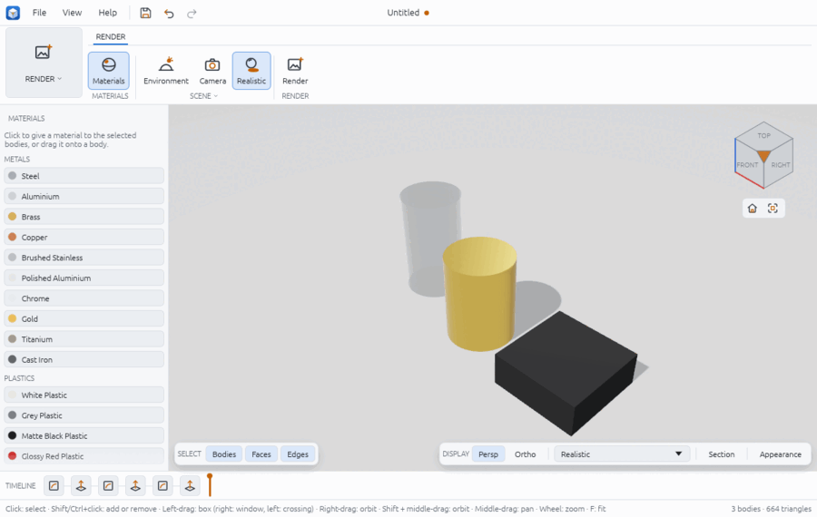
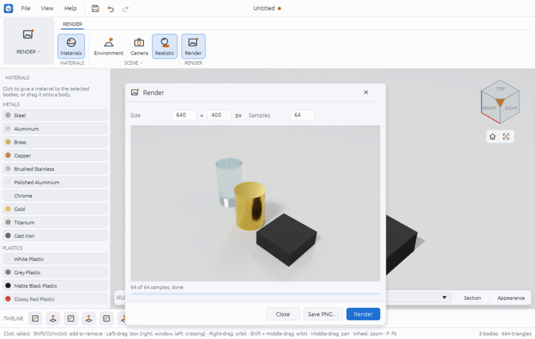
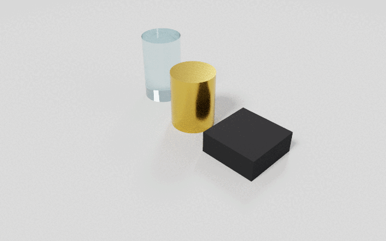

# Render

The Render workspace is for presentation pictures. You give bodies materials from a
library (metals, plastics, paint, glass, rubber, wood), choose the lighting, and either
look at the result live in the viewport's realistic style or path-trace a picture of the
current view and save it as a PNG.

Materials are saved with the design. The lighting is a view setting: it is not saved in the
design and starts as Studio each time.



## Open the Render workspace

1. Click the workspace switcher at the left of the ribbon (it reads **DESIGN**) and pick
   **Render**. (Finish any sketch first; the switcher is disabled while sketching.)
2. The ribbon shows the **RENDER** tab, the material library opens on the left, and the
   viewport switches to the **Realistic** visual style: materials, environment lights, a
   floor and soft shadows.
3. Leaving the workspace puts the viewport back in the style it had before.

## Give bodies materials

1. Select one or more bodies in the viewport or the Browser.
2. Click a material in the **MATERIALS** panel: it goes to every selected body. Hover a
   material to see how metallic and rough it is.
3. Or drag a material from the panel and drop it on a body in the viewport; it goes to the
   body under the pointer.

If nothing is selected, a click says "Select a body first, or drag the material onto one".
**RENDER > MATERIALS > Materials** shows or hides the panel.

A material is stored on the feature that made the body, so every body of that feature
gets it, and it comes back when the model rebuilds. For your own colour, opacity,
metalness or roughness, use the **Appearance** panel on the display bar (see inspect.md);
the library and the panel set the same appearance.

The library: Steel, Aluminium, Polished Aluminium, Brushed Stainless, Brass, Copper,
Chrome, Gold, Titanium, Cast Iron; White, Grey, Matte Black and Glossy Red Plastic; Painted
Red, Blue, Yellow, Black and White; Glass, Tinted Glass, Smoked Acrylic; Rubber, Grey
Rubber; Oak and Walnut. Wood is a flat colour: there are no textures.

## Lighting and camera

- **SCENE > Environment** opens a small window with three choices: **Studio** (soft key,
  fill and rim lights over a pale floor), **Outdoor** (blue sky and a small warm sun) and
  **Dark Studio** (a dark room with a strong key and rim light). The viewport changes at
  once.
- **SCENE > Camera**: renders use the current view, so orbit, pan and zoom as usual. The
  window also has **Iso**, **Front**, **Right** and **Top** buttons and a choice of
  **Perspective** or **Orthographic**.
- **SCENE > Realistic** turns the realistic style off and on. The same style is in the
  display bar's style list (**Realistic**) in every workspace.

## Render a picture

1. Set up the view you want in the viewport.
2. Click **RENDER > Render**. The Render window opens with a size taken from the shape of
   the viewport (1280 pixels wide) and 256 samples.
3. Change **Size** and **Samples** if you like, then click **Render**. The picture builds
   up in the window; below it, "N of M samples, rendering" and a progress bar.
   Click **Stop** to stop early.
4. Click **Save PNG…** and pick a file. You can save at any point once a first sample is
   done; the file has the samples done so far.



More samples give a cleaner picture: 64 is a quick preview, 512 a clean one. The render
runs on the processor, on every core, so the app stays usable but the computer is busy.
The camera is the one at the moment you clicked Render; moving the view afterwards does not
change a render in progress.

## From a script

`examples/render-studio.json` builds a brass cylinder, a rubber block and a glass
cylinder; run it with `chamfera --script examples/render-studio.json --render` to open in
the Render workspace. Its last steps:

```json
[
  { "command": "body.appearance", "params": { "body": "Extrude1", "preset": "brass" } },
  { "command": "body.appearance", "params": { "body": "Extrude2", "preset": "rubber" } },
  { "command": "body.appearance", "params": { "body": "Extrude3", "preset": "glass" } },
  { "command": "render.environment", "params": { "preset": "studio" } },
  { "command": "view.style", "params": { "style": "realistic" } },
  { "command": "render.image", "params": { "width": 640, "height": 400, "samples": 64, "path": "studio.png" } }
]
```

- `render.materials` lists the library: each material's `id` (the `preset` to give
  `body.appearance`), label, colour, metallic, roughness, transmission and index of
  refraction.
- `body.appearance {body, preset | colour, opacity, metallic, roughness, transmission, ior}`:
  a body by name or id; values given after a preset change only those values
  (`{"body": "Extrude1", "roughness": 0.6}` keeps the copper colour of an earlier preset).
- `render.environment {preset: studio | outdoor | dark}`.
- `render.image {width, height, samples, path, time_limit}` path-traces the current view
  into a PNG and replies with the samples done; with `time_limit` (seconds) it stops early.
  For example 4096 samples with `"time_limit": 2` replied `"samples": 993,
  "target_samples": 4096` on a small scene. `render.image_bytes` replies with the PNG as
  base64 instead.
- `render.start {width, height, samples}` starts the progressive render that the Render
  window shows, and `render.save {path}` writes it as far as it has got.



Run scripts that write files from a scratch folder; paths are relative to where you run
`chamfera-cli`.

## Limits

- Width and height are 1 to 4096 pixels, samples 1 to 4096; larger values are refused.
- The path tracer draws the display meshes (the same triangles as the viewport), so very
  coarse curved faces can show facets in close-ups.
- Materials have no textures or bump maps (wood is a plain colour), and there are three
  fixed environments: no custom lights, HDR images or backgrounds.
- The environment is not saved with the design.
- Only visible bodies are rendered; the Render button is disabled until there is one.
- In the browser build, rendering uses one thread and is much slower.

See also: inspect.md (visual styles and the Appearance panel), drawings.md (the parts
list shows each component's material), file-formats.md (a GLB export carries each body's
colour, but not its metalness or glass).
