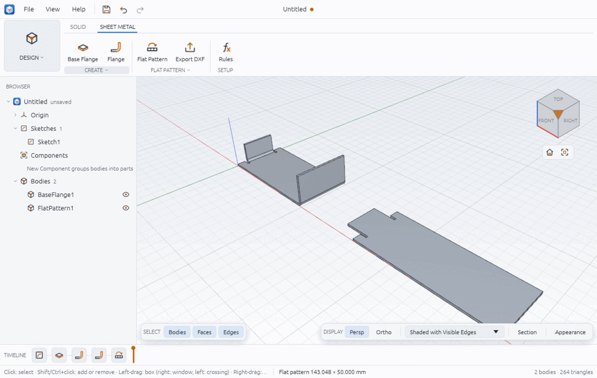

# Sheet metal

Sheet metal parts are made from one sheet of constant thickness, cut flat and then bent.
Chamfera models them that way: you draw the outline of a base plate, bend walls (flanges)
up from its straight edges, and ask for the flat pattern, the shape to cut before bending.
The flat pattern can be written as a DXF file for a laser, plasma or punch.

The tools are in the SHEET METAL tab of the DESIGN workspace, next to SOLID:

- CREATE: Base Flange and Flange;
- FLAT PATTERN: Flat Pattern and Export DXF (Export Flat Pattern (DXF)…);
- SETUP: Rules (Sheet Metal Rules).



## Sheet metal rules

A rule holds the values that every bend of a part shares: the sheet's thickness, the
inside bend radius, the K-factor and the bend relief. Set it up before the base flange, or
use the default rule: if a design has no rule, the first base flange makes one called
Default (2 mm thick, bend radius 2 mm, K-factor 0.44, rectangular reliefs 2 x 2 mm).

1. Click SHEET METAL > SETUP > Rules.
2. Pick a rule in the Rule list to edit it, or type a new Name to make a new rule.
3. Fill in Thickness, Bend radius, K-factor (0 to 1: where the neutral line sits in the
   thickness, 0 on the inside, 0.5 in the middle), Relief (Rectangular, Obround or Rip),
   Relief width and Relief depth. Lengths are in millimetres.
4. Click Apply. The status bar says "Sheet metal rule saved". Click Close when done.

Changing a rule rebuilds every part that uses it, flat pattern included: the bend
allowances follow the new thickness, radius and K-factor.

## Make the base flange

1. Draw a closed profile in a sketch and finish the sketch (sketching.md), for example a
   100 x 50 mm rectangle on the XY plane.
2. Click SHEET METAL > CREATE > Base Flange. The Base Flange dialog opens; pick the Rule
   if the design has more than one.
3. Click inside the profile in the viewport. The base flange is made at once (there is no
   OK button): the profile is thickened by the rule's thickness, away from the sketch
   plane along its normal.

The status bar names the new feature and the body's volume: "BaseFlange1 · volume
10000.00 mm³" for the rectangle above (100 x 50 x 2). The body is called BaseFlange1, and
later flanges add to this same body.

## Add a flange

1. Click SHEET METAL > CREATE > Flange. The status bar says "Click a straight edge of the
   sheet".
2. Move the pointer over the part: the edge under it is highlighted. Click a straight
   edge along the top or bottom of the sheet (or along the end of an earlier flange's
   wall). Its name appears in the Edge field.
3. Set the values:
   - Height (default 20 mm): measured from the outer virtual sharp, the corner where the
     outside faces of the sheet and the wall would meet without the bend, to the wall's end.
   - Angle (default 90 deg): the bend angle, above 0 and below 180 degrees.
   - Position: Inside (keep outline) puts the wall's outside face on the original edge, so
     the outline seen from above does not grow; Outside puts the wall outside the edge;
     Bend outside starts the bend at the edge.
   - Side: Toward the face (the wall rises on the side of the face the edge borders) or
     Flipped.
   - Start offset and End offset: stop the flange short of the edge's ends. Reliefs of the
     rule's shape are cut into the sheet there, so the bend can form.
4. Click OK, or press Enter in a field.

The height must be more than the bend's outside setback, (R + T) tan(θ / 2): 4 mm for a
2 mm sheet with a 2 mm radius at 90 degrees. A shorter flange is refused with that value.

Worked check: on the 100 x 50 x 2 base above, a 30 mm flange at 90 degrees on the 50 mm
end, Inside position, trims the base back by the setback of 4 mm, adds a quarter-ring bend
(π/4 x (4² - 2²) x 50 = 471.24 mm³) and a wall 30 - 4 = 26 mm high (2600 mm³):
9600 + 471.24 + 2600 = 12671.24 mm³, which is what the status bar reports.

## Unfold the flat pattern

1. Click SHEET METAL > FLAT PATTERN > Flat Pattern.
2. The flat pattern appears as a second body, FlatPattern1, laid out beside the part, and
   the status bar gives its size and the number of bends: "Flat pattern 143.048 × 50.000 mm
   · 2 bends" for the bracket in the picture.

Each bend becomes a flat strip as long as its bend allowance, BA = θ (R + K T). With
R = 2, T = 2, K = 0.44 and θ = 90 degrees, BA = π/2 x 2.88 = 4.524 mm. For the bracket
(the 30 mm flange above plus a 20 mm flange on the other 50 mm edge, stopped 10 mm short
of each end): 26 + 4.524 + 92 + 4.524 + 16 = 143.048 mm.

The flat pattern is a timeline feature like any other: it follows edits to the flanges
and to the rule. Clicking Flat Pattern again updates the same flat pattern rather than
making a second one.

## Export the flat pattern as DXF

1. Click SHEET METAL > FLAT PATTERN > Export DXF. The button is greyed out until there is a
   flat pattern ("make a flat pattern first").
2. Choose where to save the `.dxf` file.

The file holds the flat outline (reliefs included) as lines in millimetres, in DXF R12,
which laser and CAM software read. You can check it by inserting it into a sketch
(SKETCH > INSERT > Insert DXF…, see file-formats.md): the bracket's outline reads back as
one closed profile of 6797.91 mm², the flat pattern's area.

## Edit a sheet metal part

- Right-click a flange's icon in the timeline and choose Edit Feature: the Flange dialog
  opens with its values. Change them and click OK.
- Edit Feature on the base flange or the flat pattern opens the Rules dialog.
- To fillet or chamfer edges of a sheet part, switch to the SOLID tab: the SHEET METAL tab
  does not show SOLID's MODIFY group.

## From a script

`examples/sheet-bracket.json` builds the bracket in the picture. Run it with
`chamfera-cli run examples/sheet-bracket.json`, or open it in the app with
`chamfera --script examples/sheet-bracket.json`, which opens the SHEET METAL tab. Edge names
(`2:top 1`) come from `solid.edges`.

```json
[
  { "command": "sheet.rule", "params": { "name": "Steel 2 mm", "thickness": 2, "bend_radius": 2, "k_factor": 0.44, "relief": "rectangular", "relief_width": 2, "relief_depth": 2 } },
  { "command": "sketch.create", "params": { "plane": "xy" } },
  { "command": "sketch.rectangle", "params": { "x1": 0, "y1": 0, "x2": 100, "y2": 50 } },
  { "command": "sketch.finish" },
  { "command": "sheet.base", "params": { "sketch": 1, "profile": { "x": 50, "y": 25 }, "rule": "Steel 2 mm" } },
  { "command": "sheet.flange", "params": { "edge": "2:top 1", "height": 30 } },
  { "command": "sheet.flange", "params": { "edge": "2:top 3", "height": 20, "offset_start": 10, "offset_end": 10 } },
  { "command": "sheet.flat_pattern" },
  { "command": "sheet.export_flat", "params": { "path": "bracket-flat.dxf" } }
]
```

`sheet.flat_pattern` replies with `length` 143.048, `width` 50, `area` 6797.91 and each
bend's `allowance`; `sheet.export_flat` replies with the number of entities written (12
lines here). Other options:

- `sheet.base {..., "reversed": true}` thickens against the sketch plane's normal;
- `sheet.flange {edge, height, angle, position: "inside" | "outside" | "bend_outside", side: "same" | "opposite", offset_start, offset_end}`;
- `sheet.rule {name, remove: true}` deletes a rule (refused while a base flange uses it);
  `sheet.rules` lists them;
- `feature.edit {feature, height, angle, ...}` changes a flange, `{feature, rule, reversed}`
  a base flange.

## Limits

- Flanges go on straight edges only; there are no flanges on curved edges, no hems, jogs or
  contour flanges, and no lofted or rolled sheet parts.
- An obround relief close to a bend is refused (its cylinder would cross the bend's
  cylinder, which the kernel cannot intersect yet). The message names the smallest relief
  depth that works; or use a rectangular relief or a rip.
- The bend angle must be above 0 and below 180 degrees, and each flange taller than its
  outside setback.
- The base flange's sketch and its direction can only be changed from a script
  (`feature.edit`); in the app, Edit Feature on it opens the rules.
- Rule lengths are typed in millimetres. In the Rules dialog a value the dialog cannot
  read (with another unit, or a typo) is skipped without a warning, and the old value
  stays: check the values after Apply.
- The sizes in the status bar after Base Flange, Flange and Flat Pattern are always shown
  in millimetres, whatever the design's units (preferences.md).
- The flat pattern is the outline only: bend lines are not written to the DXF.
