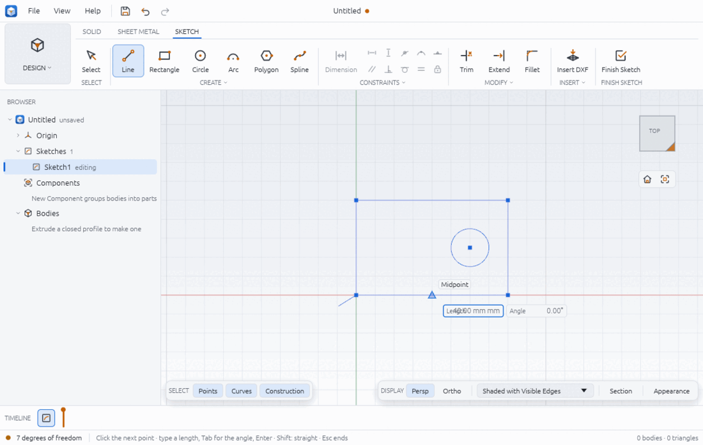
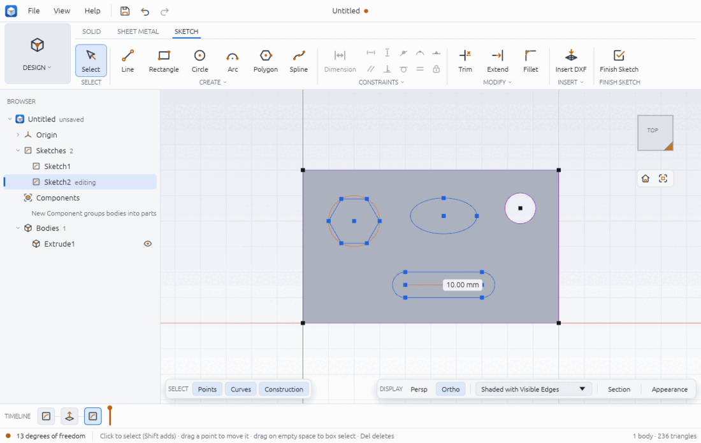
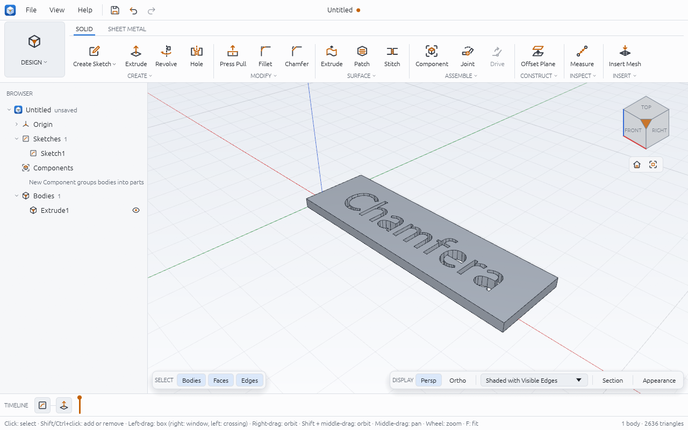
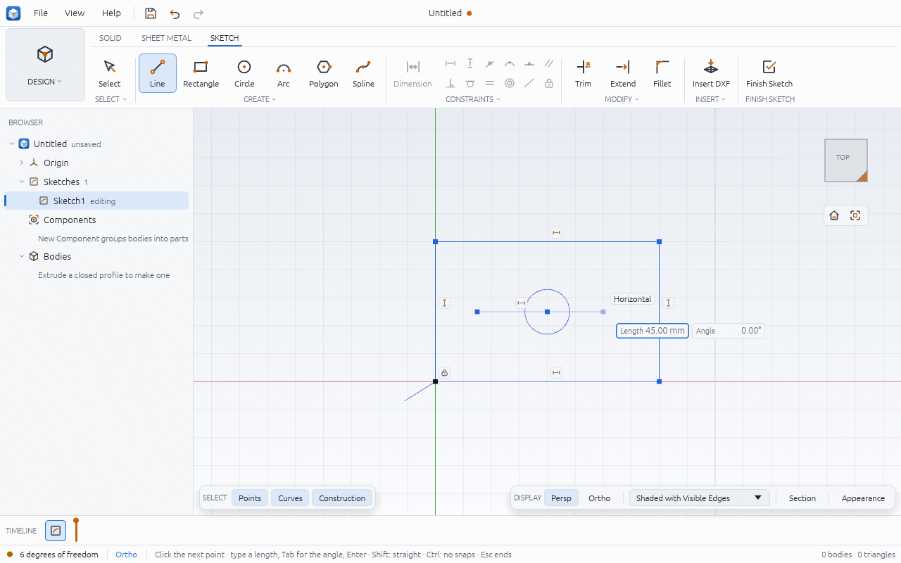
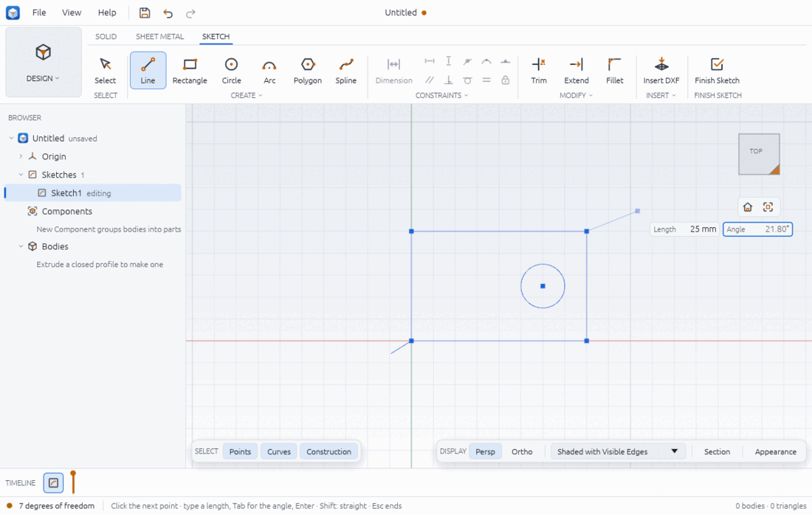
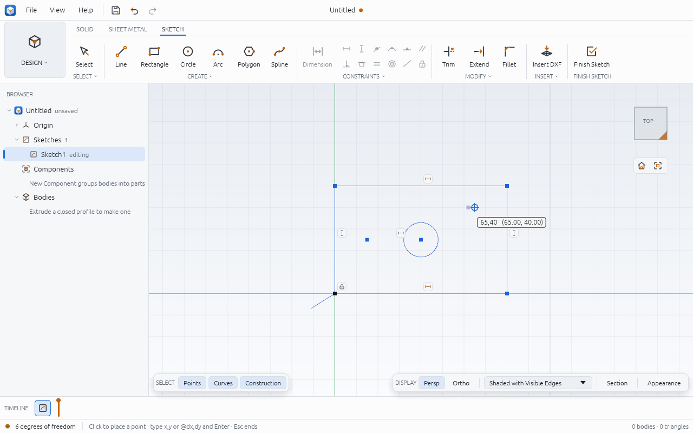
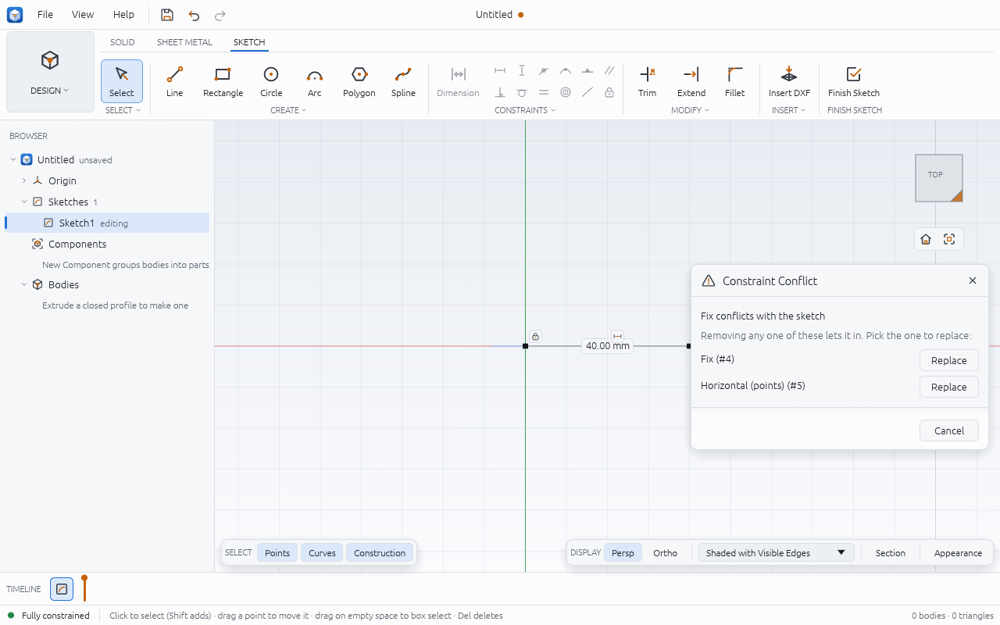
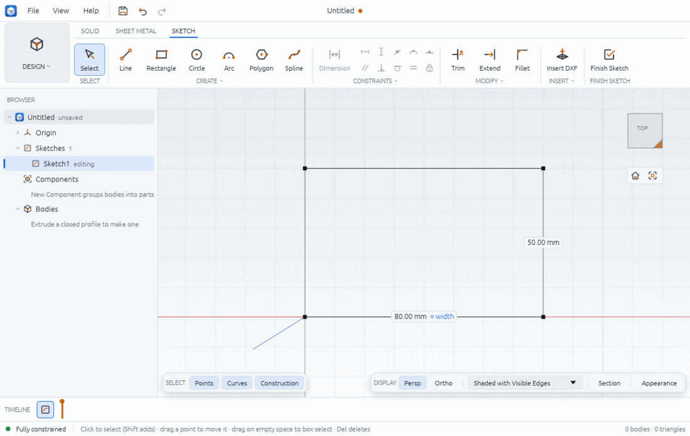
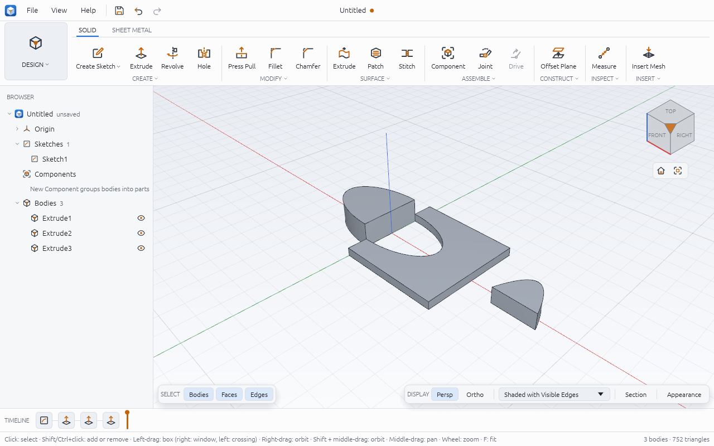

# Sketching

A sketch is a flat drawing on a plane: lines, arcs, circles, splines and other shapes, held
in place by constraints and dimensions. Closed regions of a sketch are **profiles**, which
the solid tools turn into bodies ([solid-modelling.md](solid-modelling.md)). Chamfera's
sketch solver is its own; it tells you at every moment how many **degrees of freedom**
(DOF) are left, so you know when a sketch is fully defined.

## Start a sketch

1. Click **SOLID > CREATE > Create Sketch**. A list opens under the button ("SKETCH ON"):
   - **Top plane (XY)**, **Front plane (XZ)** or **Right plane (YZ)**;
   - any construction plane you have made ([construction-geometry.md](construction-geometry.md));
   - **A flat face…** (greyed until there is a solid): then click a flat face of a body.
2. The view turns to look straight at the plane, the **SKETCH** tab opens and the Browser
   marks the sketch "editing".

Other ways in:

- The same choices are in the SOLID > CREATE caption dropdown ("Create Sketch on Top plane
  (XY)", ..., "Create Sketch on Face").
- Right-click a flat face and choose **Create Sketch on Face**.
- Double-click an origin plane in the Browser (unfold Origin first).
- To edit an existing sketch, double-click it in the Browser or its tile in the timeline.

A sketch on a face or on a construction plane follows it when the model rebuilds: change
the plate's thickness and a sketch on its top face moves with it.

## The SKETCH tab



| Group | Big buttons | Also in the dropdown |
|---|---|---|
| SELECT | Select | |
| CREATE | Line, Rectangle, Circle, Arc, Polygon, Spline | Centre Rectangle, 3-Point Arc, Tangent Arc, 3-Point Rectangle, 2-Point Circle, 3-Point Circle, Tangent Circle, Slot, Ellipse, Project, Offset, Mirror, Rectangular Pattern, Circular Pattern |
| CONSTRAINTS | Dimension, and the twelve constraints as small icons | |
| MODIFY | Trim, Extend, Fillet | Chamfer, Split, Split All Crossings, Move/Copy, Construction, Delete |
| INSERT | Insert DXF | Export Sketch as DXF… |
| FINISH SKETCH | Finish Sketch | |

The status bar always says what the current tool wants next ("Click the start of the
line"). **Esc** ends or cancels the tool.

## Drawing tools

| Tool | Key | How |
|---|---|---|
| Line | L | Click point after point. Click the first point again to close the shape. Esc ends the chain. |
| Rectangle | R | Two clicks: opposite corners. |
| Centre Rectangle | | Two clicks: the centre, then a corner. |
| Circle | C | Two clicks: the centre, then a point on the circle. |
| Arc | A | Three clicks: the centre, the start (sets the radius), then the end. The arc runs counter-clockwise from the start. |
| 3-Point Arc | | Three clicks: the start, the end, then a point the arc passes through. |
| Tangent Arc | | Click the free end of a line or arc, then where the arc ends; it leaves smoothly. |
| Polygon | | Click the centre, then a corner. The tool box (top left of the viewport) has **Sides** and a **Circumscribed (around the circle)** check box; circumscribed means the second click is the middle of a side. |
| Slot | | Click the centre of one end, then of the other end, then click to set the width. The tool box's **Points are the tips (overall length)** measures from tip to tip instead. |
| Ellipse | | Click the centre, the end of the first axis, then click to set the other axis. |
| 3-Point Rectangle | | Two clicks for one side, at any angle, then a click on the opposite side. |
| 2-Point Circle | | Two clicks: the ends of a diameter. |
| 3-Point Circle | | Three clicks: points the circle passes through. |
| Tangent Circle | | Click three lines, circles or arcs, near where the circle should touch them; or, with **Two and a radius** in the tool box, two of them. |
| Spline | | Click the points the curve passes through. Double-click or press Enter to finish; click the first point to close it. |
| Point | P | Click to place a point. It snaps like the other tools and keeps the snap's constraint (a point clicked on a line's middle stays there). Standalone points are where the Hole tool drills when it uses the sketch, and things to constrain and dimension to. |
| Text | | Opens the Text dialog: the words, the **Height** of the capitals, **Align** (left, centre or right of the start) and the start on the baseline. Each letter becomes closed profiles (lines and splines) to extrude or cut. The font is Lato Regular; `sketch.text {font}` takes another TrueType or OpenType file. |



The spline's points are ordinary sketch points: drag them with Select to reshape it, or
constrain them.



### Snaps

While you draw, a click near existing geometry snaps to it. A marker and its name appear
at the snapped place: **Endpoint**, **Centre**, **Origin**, **Midpoint**, **Intersection**,
**Quadrant**, **Perpendicular**, **Tangent** or **On curve**. Ends, centres and the origin
win over midpoints and crossings, which win over the others. The new geometry gets the
matching constraint, so a line started on an endpoint stays joined to it.

### Guides

When no snap is near, dashed guides line the cursor up:

- **Aligned**: the cursor shares the x or y of an existing point (or the origin); near both
  it lands on their corner.
- **Perpendicular** and **Tangent**: a line started on the end of a line is held at right
  angles to it, and one started on the end of an arc along its tangent. The new line gets
  that constraint, also when you type its length.
- **Polar** (off by default): the line is held on whole steps of an angle, 15 degrees
  unless you choose another.

Hold **Ctrl** while drawing to place a point exactly where you click: no snap, guide, grid
or automatic horizontal and vertical. Which snaps and guides are on, and how near the
cursor they reach, are in Preferences > Grid and Snap.

### Shift lock and Ortho

Hold **Shift** while drawing a line to keep it horizontal or vertical (the marker says
which). **Shift+Alt** steps the angle by 15 degrees.

**Ortho** (press **F8**, or SKETCH > SELECT > Ortho) keeps every line and arc point
horizontal or vertical from the last point without holding anything; the status bar shows
"Ortho" while it is on. Hold **Shift** to draw one segment freely. Point snaps (ends,
midpoints, centres, crossings) still win, so a segment can end on an existing point.



### Typed values

While a Line, Rectangle, Centre Rectangle or Circle waits for its second click, value
fields float beside the cursor:

- Line: **Length**, **Angle**;
- Rectangle and Centre Rectangle: **Width**, **Height**;
- Circle: **Diameter**.



1. Just start typing a number: it goes into the first field.
2. Press **Tab** to move to the next field (Angle, or Height).
3. Press **Enter** to place the geometry.

A plain number is in the design's length unit; `10 mm` or `2 in` say their own; an angle is
in degrees. Typed values become dimensions on the new geometry.

### Typed points

Every tool that places points (Point, Line, the rectangles, circles, arcs, Polygon, Slot,
Ellipse, Spline) also takes a typed point. Type it and press **Enter**:

| Type | Places the point |
|---|---|
| `30,40` | at x = 30, y = 40 in the sketch |
| `@15,-5` | 15 right of and 5 below the last point placed |
| `@25<30` | 25 from the last point, at 30 degrees from +X (counter-clockwise) |
| `#30,40` | at x = 30, y = 40, when the Length and Angle fields would take the digits |

A typed point starts with `@` or `#` at any time, or with a digit while no value field is
waiting (the first click of a line, every click of the Point tool). A box beside the cursor
shows what you typed and the coordinates it lands on; Backspace deletes, Esc drops it.
Lengths are in the design's unit and the comma separates the two numbers, so use a point
for decimals. A typed point is exact: it neither snaps nor gets a horizontal or vertical
constraint.



## Constraints

Constraints hold geometry in relationships. Select the geometry first with **Select**
(click, Shift+click to add, or drag a box on empty space), then click a constraint icon in
**SKETCH > CONSTRAINTS** (they are greyed until something is selected). The right-click
menu in a sketch lists the constraints that fit the selection.

| Constraint | Does |
|---|---|
| Horizontal | Levels a line, or lines up two points left to right |
| Vertical | Stands a line upright, or lines up two points top to bottom |
| Coincident | Joins two points into one place |
| Point on Curve | Keeps a point on a line, circle or arc |
| Midpoint | Keeps a point halfway along a line |
| Parallel | Keeps two lines pointing the same way |
| Perpendicular | Keeps two lines at a right angle |
| Tangent | Makes a line or curve touch a circle or arc smoothly |
| Equal | Gives two lines the same length, or two circles the same radius |
| Concentric | Gives two circles or arcs the same centre |
| Collinear | Puts two lines on one straight line |
| Fix | Pins a point where it is |

Each constraint shows a small marker (its icon) beside the geometry it holds: Horizontal
and Vertical at the middle of their line, Fix and Coincident at their point, Parallel,
Perpendicular, Equal and Tangent at both curves. Hover a marker to see its name; click it
to select it (it turns accent) and press **Del** to delete that constraint and keep the
geometry.

A constraint that would conflict with the others opens **Constraint Conflict**: it lists
the constraints whose removal, one at a time, would let the new one in. **Replace** deletes
that one and adds the new constraint in one step (one Undo); **Cancel** leaves the sketch as
it was. When no single removal helps, the dialog says so. A constraint that is already
implied is refused with a message.



## Dimensions

1. Select a line (its length), a circle (diameter), an arc (radius), two points (distance),
   a point and a line (distance) or two lines (angle).
2. Press **D** or click **SKETCH > CONSTRAINTS > Dimension**. The dimension is placed at
   the current size and its value box opens at once. For two points or a slanted line,
   where the cursor is when you press **D** chooses what it measures: above or below them
   the horizontal distance, to their left or right the vertical distance, anywhere else
   the true (aligned) distance.
3. Type the value and press **Enter** (Esc leaves it at the current size).

A dimension the other constraints already fix is added as a **driven** dimension: it
shows the size in brackets, `(58.31 mm)`, and follows the sketch without setting
anything. **Driven** in a dimension's value box makes any dimension driven; click a driven
label to make it set the size again.

To change a dimension later, click its label in the viewport ("Click to type a value, a
parameter or a formula"). In the box you can type:

- a number (`45`, `45 mm`, `2 in`): the dimension takes that value;
- a parameter name or a formula (`width`, `width / 2`, `thickness * 3 + 1 mm`): the
  dimension **follows** it and the label shows the value and the formula in the accent
  colour (`80.00 mm = width`). Change the parameter and the sketch updates. Parameters are
  described in [parameters-and-configurations.md](parameters-and-configurations.md).

## Degrees of freedom

The status bar shows how free the sketch still is:

- **amber dot and "N degrees of freedom"**: geometry can still move (free curves are
  drawn blue);
- **green dot and "Fully constrained"**: nothing can move (curves are drawn black);
- **red dot**: over-constrained.



For example, a rectangle drawn with the Rectangle tool has 4 DOF (its horizontal and
vertical sides are constrained already). Fixing one corner and dimensioning the width and
the height takes it to 0. A circle adds 3 (centre x and y, radius).

With **Select** you can drag a free point; the solver moves what the constraints allow.
**Del** deletes the selection and what depends on it.

## Modify tools

The tools that take a value show a small **tool box** at the top left of the viewport.

| Tool | Key | How |
|---|---|---|
| Trim | T | Click the piece of a curve to remove, between the curves that cross it. |
| Extend | | Click near the end of a line or arc to run it on to the next curve it meets. |
| Fillet | | Set **Radius** in the tool box, then click a corner where two lines meet. |
| Chamfer | | Set **Distance**, then click a corner where two lines meet. |
| Offset | O | Set **Distance** (and **Round outside corners** if you like), click a curve: its whole chain (or the circle) is offset; then click the side to offset toward. The offset keeps its distance dimension. |
| Mirror | | Select the geometry first, then click the line to mirror it in. The copy stays symmetric. |
| Rectangular Pattern | | Select the geometry, set **Columns**, **Spacing X**, **Rows**, **Spacing Y**, then **Apply**. |
| Circular Pattern | | Select the geometry, set **Count** and **Angle**, then click the centre. |
| Split | | Click a curve to split it where other curves cross it. |
| Split All Crossings | | Splits every curve at every crossing into separate curves, to trim or constrain the pieces. Overlapping shapes extrude without it: each region they make is already its own profile. |
| Move/Copy | | Select the geometry. In the tool box pick **Move**, **Rotate** or **Scale**, type the values and **Apply**; **Copy** keeps the original. For a move you can instead click a base point and where it goes; for a turn or scale a click sets the centre. |

For example, two 40 × 40 squares overlapping by 20 × 20 give three profiles of 1200, 400
and 1200 mm², with or without Split All Crossings.

## Construction geometry in a sketch

Select curves and press **X** (or **SKETCH > MODIFY > Construction**, or the right-click
menu) to turn them into **construction** curves, drawn in orange. Profiles ignore them, so
they are good for centre lines, a revolve axis or reference shapes. Press X again to turn
them back. The selection filter's **Construction** button controls whether clicks pick
them.

## Project model edges

**SKETCH > CREATE > Project**: click a model edge to copy it into the sketch, or a face to
copy all its edges. Projected curves are fixed and, with **Linked: follow the model**
ticked in the tool box (the default), follow the model when it rebuilds. They are drawn in
their own colour (the purple outline in the picture above).

## DXF in and out

- **SKETCH > INSERT > Insert DXF** (also File > Insert DXF into Sketch…, while a sketch is
  open): pick a 2D ASCII `.dxf` file. Its lines, arcs, circles and polylines are drawn into
  the sketch, ends that meet are joined, and the status bar reports what came in and what
  was skipped (text, for example). Before it is drawn the Insert DXF dialog asks for the
  units (from the file's `$INSUNITS`, millimetres when it has none; or millimetres or
  inches) and a scale.
- **Export Sketch as DXF…** (in the INSERT dropdown and the File menu) writes the sketch's
  curves to a DXF R12 file in millimetres.

More on formats in [file-formats.md](file-formats.md).

## Finish the sketch

Click **SKETCH > FINISH SKETCH > Finish Sketch** (or right-click > Finish Sketch). The
SOLID tab comes back and the sketch's closed regions are ready for Extrude, Revolve and the
other tools. Solid tools are greyed while a sketch is open ("finish the sketch first").

## From a script

Ids of points, curves and constraints share one counter per sketch: read them from each
reply (or name a step with `"as"` and use `"$name.curves.0"`) instead of guessing.

```json
[
  { "command": "param.set", "params": { "name": "width", "expression": "80 mm" } },
  { "command": "sketch.create", "params": { "plane": "xy" } },
  { "command": "sketch.rectangle", "params": { "x1": 0, "y1": 0, "x2": 80, "y2": 50 }, "as": "r" },
  { "command": "sketch.constrain", "params": { "constraint": { "kind": "fix", "point": "$r.points.0", "at": { "x": 0, "y": 0 } } } },
  { "command": "sketch.constrain", "params": { "constraint": { "kind": "length", "line": "$r.curves.0", "value": 80 } }, "as": "w" },
  { "command": "sketch.constrain", "params": { "constraint": { "kind": "length", "line": "$r.curves.1", "value": 50 } } },
  { "command": "sketch.dimension", "params": { "constraint": "$w.constraint", "expression": "width" } },
  { "command": "sketch.circle", "params": { "cx": 20, "cy": 25, "radius": 6 } },
  { "command": "sketch.get" },
  { "command": "sketch.finish" }
]
```

`sketch.get` replies with `dof` (3 here: the circle), `status` and each profile's `area`
(4000 − 36π = 3886.90 mm² for the plate with the hole).

| Task | Command |
|---|---|
| Start, finish, edit | `sketch.create {plane: xy/xz/yz or a construction plane id, offset?}`, `sketch.create_on_face {feature, face}`, `sketch.finish`, `sketch.edit {sketch}` |
| Draw | `sketch.line`, `sketch.rectangle`, `sketch.rectangle.centre`, `sketch.circle`, `sketch.arc`, `sketch.arc.three_point`, `sketch.arc.tangent`, `sketch.point`, `sketch.polygon {cx, cy, x, y, sides, mode}`, `sketch.slot {x1, y1, x2, y2, width, overall}`, `sketch.ellipse {cx, cy, x, y, minor}`, `sketch.ellipse.arc`, `sketch.spline {points, kind: fit/control, closed}`, `sketch.text {text, x, y, height, align, font, fix}` |
| Constrain | `sketch.constrain {constraint: {kind, ...}}` or `{constraints: [...]}`, with `replace: id` to remove one first; `sketch.constrain_selection {kind}`; `sketch.conflicts {kind or constraint}` (what stands in the way) |
| Dimension | `sketch.dimension_selection {x?, y?, direction?, arc_length?, driven?}`, `sketch.dimension {constraint, value or expression}`, `sketch.dimension.driven {constraint, driven}` |
| Modify | `sketch.trim {curve, x, y}`, `sketch.extend {curve, x, y}`, `sketch.split {curve?}`, `sketch.fillet {point, radius}`, `sketch.chamfer {point, distance}`, `sketch.offset {curves, distance, corners}`, `sketch.mirror {axis, curves}`, `sketch.pattern.rectangular {curves, columns, dx, rows, dy}`, `sketch.pattern.circular {curves, cx, cy, count, angle}`, `sketch.move {dx, dy, copy}`, `sketch.rotate {cx, cy, angle, copy}`, `sketch.scale {cx, cy, factor, copy}` |
| Other | `sketch.construction {curve, construction}`, `sketch.project {edges or faces, linked}`, `sketch.import_dxf {path, units, scale}`, `sketch.export_dxf {path}`, `sketch.remove` |

Examples: `examples/sketch-plate.json`, `examples/sketch-snaps.json`,
`examples/sketch-shapes.json`, `examples/spline-extrude.json`,
`examples/parametric-plate.json`, `examples/dxf-import.json`,
`examples/sketch-crossings.json` (an ellipse and a spline crossed by other curves, their
pieces extruded), `examples/sketch-input-v3.json`, `examples/sketch-conflict.json`,
`examples/sketch-text.json` (a name plate with the letters cut through).

## Overlapping curves

Closed regions are found where the curves cross, without trimming first: lines, arcs and
circles, and also ellipses, elliptical arcs and splines. An ellipse drawn over a
rectangle's edge gives its two halves and the rectangle outside it as three profiles, and
each extrudes with exact curved sides.



Split All Crossings (SKETCH > MODIFY) turns the pieces of lines, arcs and circles into
separate curves you can trim or constrain; ellipses and splines stay whole curves.

## Limits

- Only 2D ASCII DXF is read.
- Split All Crossings, Trim and Extend work on lines, arcs and circles; ellipses and
  splines are split for profiles only.
- Text is drawn as ordinary lines and splines with free points (one degree of freedom per
  coordinate; `fix: true` pins them). It cannot be edited as text afterwards, follow a
  path, or use kerning.
- Ellipses and splines can be extruded straight but not tapered, and splines cannot be
  revolved ([solid-modelling.md](solid-modelling.md)).
