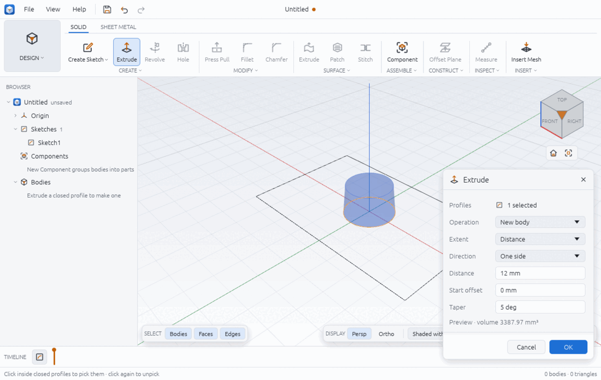
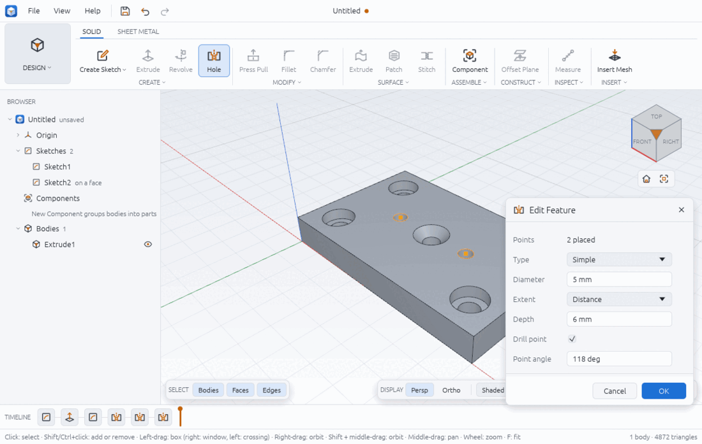
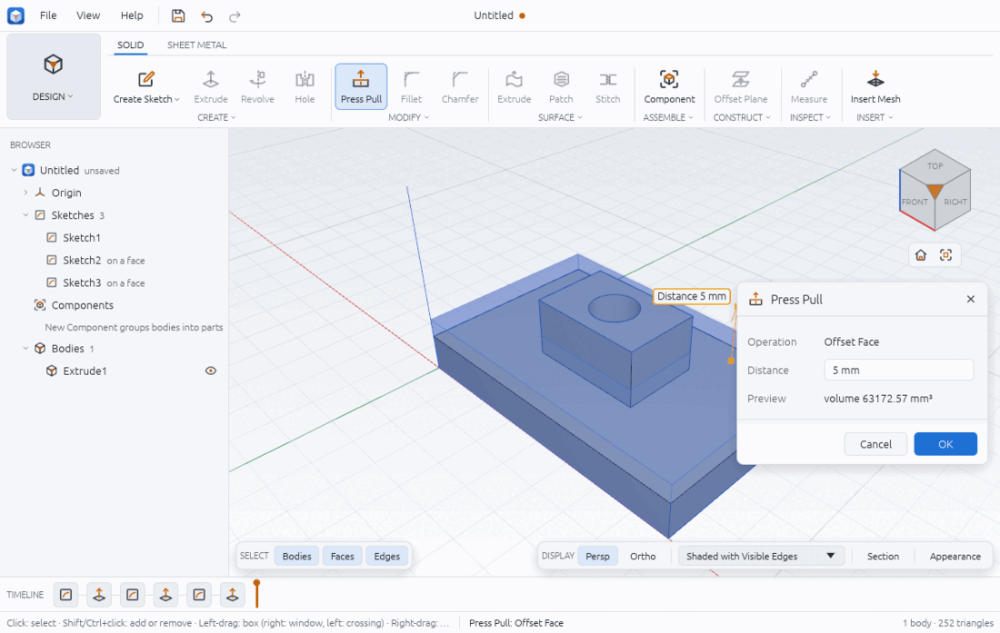
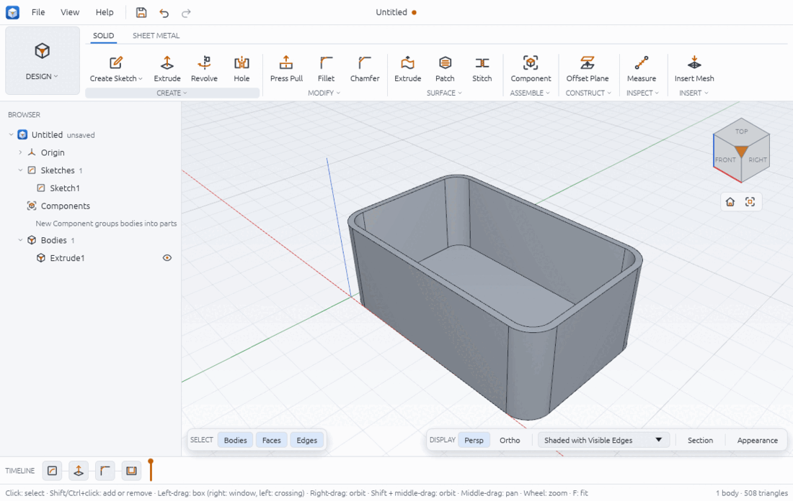

# Solid modelling

Solids in Chamfera are exact boundary models (planes, cylinders, cones, spheres, tori and
extruded splines), built by Chamfera's own kernel. Each tool on this page adds a
**feature** to the timeline ([timeline.md](timeline.md)); change a value later and
everything after it rebuilds. Volumes in the replies and the status bar are computed from
the exact geometry, not from the display mesh.

Most tools work the same way: click the tool, click what it acts on in the viewport (click
a picked item again to unpick it), fill in the dialog on the right of the viewport, and
press **OK** (or Enter). **Cancel** or **Esc** closes it without changing anything. While a
tool needs something, the status bar says what to click.

You need a closed profile first for Extrude, Revolve, Sweep and Loft
([sketching.md](sketching.md)), and a solid for Fillet, Chamfer and the other edit tools;
until then their buttons are greyed and their tooltip says why.

## Operations

Every tool that makes a shape asks what to do with it (**Operation**):

- **New body**: a separate body (the default for the first feature);
- **Join**: added to the bodies it touches;
- **Cut**: removed from them;
- **Intersect**: only the overlap is kept.

## Extrude

**SOLID > CREATE > Extrude** (key **E**). Pulls closed profiles straight out of their
sketch.

1. Click Extrude, then click inside each profile to use (all from one sketch). The
   profile is highlighted; click it again to unpick it.
2. Set the options. A translucent preview and its volume update as you type.
3. Press **OK**. The status bar says "Extrude1 · volume …".



| Field | Choices |
|---|---|
| Profiles | How many are picked |
| Operation | New body, Join, Cut, Intersect |
| Extent | **Distance**; **Through all** (past every body); **To object** (up to a flat face or plane parallel to the profile: click Up to, then click the face) |
| Direction | **One side** (along the sketch normal), **Flipped** (the other way), **Symmetric** (the distance is the total, half each way), **Two sides** (Side 1 and Side 2 distances) |
| Distance / Side 1, Side 2 | Lengths, parameters or formulas (`thickness * 2`) |
| Start offset | Start this far from the sketch plane, along its normal |
| Taper | Draft angle of the sides in degrees; positive narrows away from the start |

Checked by hand: a 40 × 20 rectangle extruded 10 symmetric is 8000 mm³ (5 each way);
two sides 10 and 4 is 40 × 20 × 14 = 11 200 mm³; tapered 10° it is
∫(40 − 2kz)(20 − 2kz)dz over 0..10 with k = tan 10°, 6983.49 mm³. A circle of radius 10
tapered 5° over 12 mm is a frustum of radii 10 and 8.95: 3387.97 mm³ (the picture).

```json
{ "command": "solid.extrude", "params": { "sketch": 1, "profiles": [{ "x": 5, "y": 5 }],
  "distance": "10 mm", "direction": "two_sides", "distance2": 4, "taper": 0,
  "operation": "new_body" } }
```

Other keys: `extent: "through_all" | "to_object"` with `to: {feature, face}` or
`{plane: {origin, normal}}`, `start_offset`. `solid.extrude_preview` shows the result
without changing the design.

## Revolve

**SOLID > CREATE > Revolve**. Turns closed profiles about a line of the same sketch.

1. Draw the profile and the axis line in one sketch. Make the axis a construction line
   (select it, press X) so it is not part of a profile.
2. Click Revolve, click inside the profiles, then choose the **Axis** in the dialog's list
   ("Construction line 17", "Line 9", ...).
3. Set **Angle** (360 deg by default) and **Operation**, then **OK**.

Checked by hand (`examples/revolved-parts.json`, on the Front plane): a 5 × 20 rectangle
from 10 to 15 mm off the axis gives a tube π(15² − 10²) · 20 = 7853.98 mm³, and a circle of
radius 5 at 30 mm gives a torus 2π² · 30 · 5² = 14 804.41 mm³.

```json
{ "command": "solid.revolve", "params": { "sketch": 1, "profiles": [{ "x": 12, "y": 10 }],
  "axis": 17, "angle": 360 } }
```

To revolve about a construction axis instead, a script passes `axis_feature` (see
[construction-geometry.md](construction-geometry.md)).

## Hole

**SOLID > CREATE > Hole**. Drills holes at points on a flat face.

1. Click Hole, then click points on a flat face; each click places a hole centre (click a
   placed point again to remove it).
2. Choose **Type**: Simple, Counterbore (adds **Counterbore Ø** and **Counterbore depth**)
   or Countersink (adds **Countersink Ø** and **Countersink angle**).
3. Set **Diameter** and **Extent**: Distance (with **Depth**) or Through all. A blind hole
   has a **Drill point** check box and **Point angle** (118 deg); the depth is the
   cylindrical part, the point comes on top of it.
4. **OK**.



Checked by hand (`examples/hole-plate.json`, an 80 × 50 × 10 plate, 40 000 mm³): four
counterbored 6.6 mm holes (11.22 × 4 counterbores) remove 2403.05 mm³; a 6 mm countersunk
hole (12 mm at 90°) 395.84 mm³; two 5 mm holes 6 deep with a 118° point 255.28 mm³; the
plate ends at 36 945.83 mm³.

```json
{ "command": "solid.hole", "params": { "face": "2:top", "points": [{ "x": 25, "y": 25 }],
  "kind": "counterbore", "diameter": 6.6, "through_all": true,
  "cb_diameter": 11.22, "cb_depth": 4 } }
```

`sketch` instead of (or with) `points` drills at that sketch's standalone points; `depth`
instead of `through_all`; `tip_angle: "flat"` for a flat bottom.

## Sweep

**SOLID > CREATE > Sweep** (in the CREATE dropdown). Moves a closed profile along a path.

1. Draw the profile in one sketch and the path in another, starting on the profile's
   plane. The path must be lines and arcs that meet smoothly (tangent), without corners.
2. Click Sweep, click the profile, then click a line or arc of the path: the whole joined
   chain is taken.
3. Choose the **Operation** and press **OK**.

Checked by hand (`examples/swept-pipe-and-loft.json`): a ring of radii 6 and 4 along 40 mm,
a quarter arc of radius 30 and 40 mm: 20π × (80 + 15π) = 7987.43 mm³ (Pappus).

```json
{ "command": "solid.sweep", "params": { "sketch": 1, "profiles": [{ "x": 5, "y": 0 }],
  "path_sketch": 2, "path_curves": [3, 7, 10] } }
```

## Loft

**SOLID > CREATE > Loft** (in the dropdown). Joins closed profiles on parallel planes.

1. Make each profile in its own sketch on a parallel plane (an offset construction plane,
   or a script's `sketch.create {plane: "xy", offset: 30}`).
2. Click Loft, then click the profiles **in order**; the dialog counts them (2 or more).
3. **OK**.

Checked by hand: squares of 40, 20 and 30 mm at heights 0, 30 and 50 give
30/6 (1600 + 4·900 + 400) + 20/6 (400 + 4·625 + 900) = 40 666.67 mm³; circles of radius
15 and 8, 25 apart, a cone frustum of 10 707.59 mm³.

```json
{ "command": "solid.loft", "params": { "sections": [
  { "sketch": 4, "x": -60, "y": 0 }, { "sketch": 5, "x": -60, "y": 0 } ] } }
```

## Patterns and Mirror

All three are in the SOLID > CREATE dropdown.

- **Rectangular Pattern**: choose the **Feature** to repeat, the **Direction** (X, Y or Z
  axis), **Count** (copies including the original) and **Spacing**. It repeats in one
  direction only.
- **Circular Pattern**: choose the **Feature**, the **Axis** (X, Y or Z through the origin),
  **Count** and **Angle** (360 deg spreads them evenly).
- **Mirror**: click the bodies, choose the **Plane** (YZ, XZ or XY origin plane) and
  **Operation** (New body or Join).

Checked by hand (`examples/patterned-flange.json`): a flange π(40² − 15²) · 8 =
34 557.52 mm³ with a 7 mm hole repeated 6 times about Z: 34 557.52 − 6 · 98π = 32 710.26
mm³. `examples/mirrored-bracket.json` mirrors a 12 658.41 mm³ bracket in YZ and joins it:
25 316.81 mm³.

```json
{ "command": "solid.pattern_circular", "params": { "feature": 4, "count": "bolts",
  "origin": { "x": 0, "y": 0, "z": 0 }, "axis": { "x": 0, "y": 0, "z": 1 } } }
{ "command": "solid.pattern_linear", "params": { "feature": 4, "count": 3,
  "direction": { "x": 1, "y": 0, "z": 0 }, "spacing": 20 } }
{ "command": "solid.mirror", "params": { "bodies": ["Extrude1"], "plane": "yz", "operation": "join" } }
```

From a script a circular pattern can also turn about a construction axis
(`axis_feature`), and a mirror can use a flat face (`{feature, face}`) or any plane
(`{origin, normal}`).

## Thicken

**SOLID > CREATE > Thicken**. Gives flat or cylindrical faces a thickness. Click the
faces, set **Thickness** (negative goes inward), **Direction** (One side, Symmetric, Both
sides) and **Operation**, then **OK**.

```json
{ "command": "solid.thicken", "params": { "faces": ["2:top"], "thickness": 2, "sides": "one_side" } }
```

## Press Pull

**SOLID > MODIFY > Press Pull** (key **Q**). One tool that does what you point at:

- a **profile**: extrudes it;
- a **face**: offsets it (Offset Face);
- an **edge**: fillets it (or changes an existing fillet's radius).

Click the item, then drag the arrow or type the **Distance** (or **Radius**). The dialog
shows the **Operation** it chose and a **Preview** with the volume, or the reason it cannot
be built.



Checked by hand: the plate-and-boss part (`examples/boss-on-plate.json`) is
40 000 + 9000 − 2827.43 = 46 172.57 mm³; offsetting the plate's top face (80 × 50 less the
30 × 20 boss) by 5 adds 17 000: 63 172.57 mm³, as the preview says.

```json
{ "command": "solid.press_pull", "params": { "face": "2:top", "distance": 5 } }
```

## Fillet and Chamfer

**SOLID > MODIFY > Fillet** rounds edges with a constant **Radius**; **Chamfer** bevels
them by an equal **Distance**.

1. Click the tool (or right-click an edge and choose Fillet or Chamfer).
2. Click the edges; the dialog counts them.
3. Type the radius or distance and press **OK**.

Checked by hand (`examples/filleted-block.json`): a 60 × 40 × 15 block with a 16 mm hole is
36 000 − 960π = 32 984.07 mm³; filleting the four vertical edges with radius 8 removes
4 · 64 (1 − π/4) · 15 = 824.07: 32 160.00 mm³; a 1.5 mm chamfer on the hole's top rim
removes 2π · 8.5 · 1.125 = 60.08: 32 099.92 mm³.

```json
{ "command": "solid.fillet", "params": { "edges": ["2:sweep 0", "2:sweep 1"], "radius": 8 } }
{ "command": "solid.chamfer", "params": { "edges": ["2:hole 0 top 0"], "distance": 1.5 } }
```

Edge names come from `solid.edges` (or `solid.edge_at {x, y, width, height}` for a pixel).

## Shell

**SOLID > MODIFY > Shell**. Hollows a solid to walls of a **Thickness**. Click the faces
to remove (**Open faces**); with none you get a closed hollow solid. A negative thickness
grows the walls outward.



Checked by hand (`examples/shelled-enclosure.json`): the rounded box is
120 000 − 4 · 64 (1 − π/4) · 30 = 118 351.86 mm³; its 2 mm inside offset (76 × 46 × 28,
corner radius 6) is 97 022.73; the shell is 21 329.13 mm³.

```json
{ "command": "solid.shell", "params": { "faces": ["2:top"], "thickness": "wall" } }
```

## Offset Face and Delete Face

- **SOLID > MODIFY > Offset Face**: click faces, type the **Distance** (positive adds
  material); the faces around them follow. Checked: offsetting the top of a 40 × 20 × 10
  block with a 10 mm-radius hole by 5 gives 12 000 − 1500π = 7287.61 mm³.
- **Delete Face**: click fillet, chamfer or hole faces to remove them; the solid is healed
  as if they had never been made.

```json
{ "command": "solid.offset_face", "params": { "faces": ["2:top"], "distance": 5 } }
{ "command": "solid.delete_face", "params": { "faces": ["5:fillet of 2:sweep 0"] } }
```

`solid.move_face` (from a script) moves or turns planar faces.

## Body tools: Combine, Split, Remove, Move

All in the SOLID > MODIFY dropdown.

- **Combine**: click the **Target** body, then the **Tools**; choose the **Operation**
  (Join, Cut, Intersect) and **Keep tools** if the tool bodies should stay.
- **Split Body**: click the bodies and choose the **Splitting plane** (an origin plane or a
  construction plane). A 50 × 30 × 10 block split by a plane at x = 20 gives 6000 and
  9000 mm³ (`examples/split-body.json`).
- **Split Face**: click flat faces and choose the splitting plane; the shape stays the
  same, the face is divided (for draft or CAM).
- **Remove**: select bodies first, then click Remove: they are taken out of the model from
  this point of the timeline on.
- **Move**: click the bodies; **Type** Translate (X, Y, Z distance) or Rotate (Axis X, Y or
  Z through the origin, and Angle); **Copy: Keep the original** makes moved copies.

```json
{ "command": "solid.combine", "params": { "target": "Extrude1", "tools": ["Extrude2"], "operation": "cut" } }
{ "command": "solid.split_body", "params": { "bodies": ["Extrude1"], "plane": 3 } }
{ "command": "solid.split_face", "params": { "faces": ["2:top"], "plane": 3 } }
{ "command": "solid.remove", "params": { "bodies": ["SplitBody1"] } }
{ "command": "solid.move", "params": { "bodies": ["SplitBody1"], "dx": 12 } }
```

From a script, `solid.move` also takes `from`/`to` points and a rotation `origin`, and
Split Face can cut along a sketch line (`sketch`, `line`).

## Components

Bodies can be grouped into components: **SOLID > ASSEMBLE > New Component** groups the
selected body into a component of its own (with nothing selected it starts an empty one
that new features go into). Joints, motion and exploded views are on
[assemblies-and-motion.md](assemblies-and-motion.md).

## Limits

These are refused with a message that names the reason; the design is left unchanged.

- **Taper**: splines and ellipses cannot be tapered (extrude them straight, or use lines
  and arcs). Tapers that make an edge vanish or the profile overlap itself are refused.
- **Splines**: cannot be revolved, nor extruded off the sketch normal; fillets and
  chamfers on bodies with spline faces are refused; booleans of spline sides with cones,
  spheres, tori or cylinders across them are refused.
- **Booleans**: some curved face pairs are not supported yet, for example crossing
  cylinders of unequal radius.
- **Fillet and Chamfer**: constant radius or equal distance only; straight edges between
  flat faces and circular rims between a flat face and a cylinder. Corners where more than
  three edges meet, or with curved neighbours, are refused; a radius too large for the
  neighbouring faces is refused ("the fillet is too large").
- **Shell**: not on spheres, tori or elliptical edges.
- **Thicken** of a face that has been split (by Split Face, for example) thickens only one
  piece when you give the whole name (`2:top`); click each piece, or name them `2:top#1`,
  `2:top#2`.
- **Sweep**: the path must be tangent-continuous lines and arcs; corners, closed and
  branching paths, and paths that might make the solid cross itself are refused.
- **Loft**: profiles must be on parallel planes with the same number of edges, and match
  as parallel lines or coaxial arcs; skewed lines (a twisted loft) are refused. Profiles
  with holes need the same number of holes in each section.
- **Patterns**: the Rectangular Pattern has one direction; a pattern of a pattern is
  refused, so a grid of holes needs sketch points and a Hole. Hole points are plain
  numbers, they cannot follow a parameter.
- **In the dialogs** (the commands can do more): Revolve only offers lines of the profile's
  sketch, not construction axes; Circular Pattern and Move only turn about X, Y or Z through
  the origin; Mirror only offers the three origin planes; Split Face only a plane.
- `solid.combine` replies with an empty `solids` list; check the result with
  `inspect.mass` ([inspect.md](inspect.md)).
- After a Join or Cut the body keeps the first feature's name (`Extrude1`), while the
  timeline shows the new feature (`Extrude2`).
