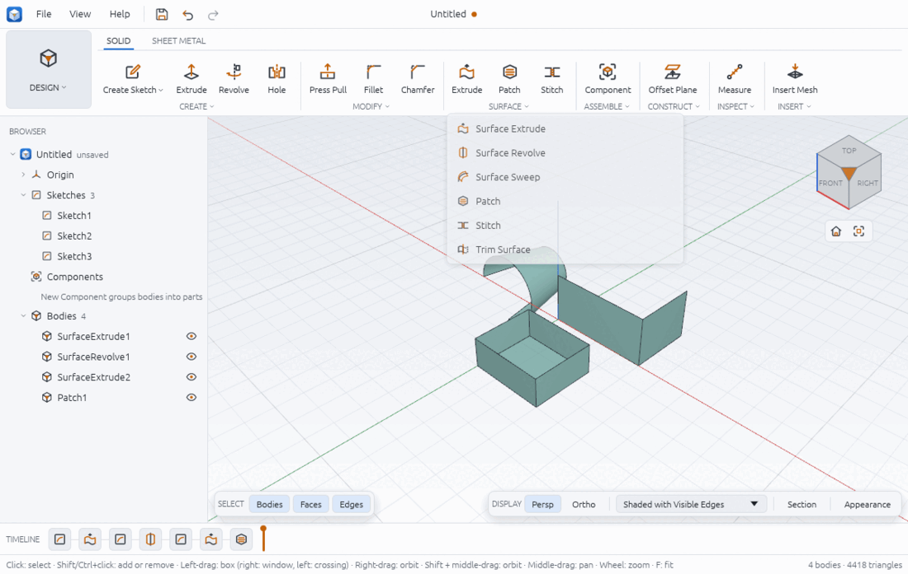
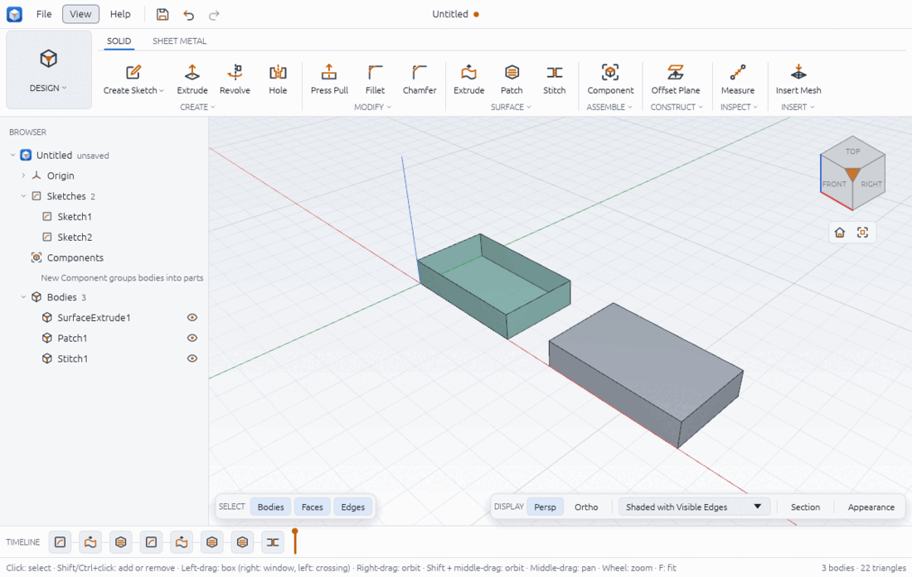

# Surfaces

A surface body is a skin with no inside: a set of faces that does not close up, so it has
an area but no volume. Surfaces are useful when the shape is easier to describe by its
skin than by a solid profile: an open wall, a curved panel, a lid you will cap later. When
the skin is complete you can stitch it into a solid, or give a face a thickness to turn it
into a solid plate or shell.

The surface tools are in the SOLID tab, in the SURFACE group: Surface Extrude, Surface
Revolve, Surface Sweep, Patch, Stitch and Trim Surface. The big buttons show Extrude, Patch
and Stitch; the arrow under the group name lists all six. Thicken, which turns a surface
into a solid, is in SOLID > CREATE.



Before you start, draw the curves in a sketch and finish it (see sketching.md). The
surface tools are greyed out while a sketch is being edited ("finish the sketch first"),
and the extrude, revolve and sweep tools say "draw a sketch first" when no sketch has any
curves.

## How surface bodies look and what they report

- Surface bodies are drawn in a teal tint and from both sides, so you can see into an open
  shape. Solids keep the usual grey. When Stitch closes a set of surfaces, the result
  turns grey because it is now a solid.
- They are listed under Bodies in the Browser with the solids, named after the feature
  that made them (SurfaceExtrude1, SurfaceRevolve1, Patch1, Stitch1).
- Each surface tool reports the new body's area in the status bar. A surface has no
  volume: replies from scripts give `"surface": true` and `"volume": null`.
- SOLID > INSPECT > Mass Properties refuses a surface with "the body is a surface (an open
  shell with boundary edges), so it encloses no volume; stitch it closed or thicken it
  first".



## Extrude a surface

1. Click SOLID > SURFACE > Extrude (Surface Extrude in the list).
2. In the viewport, click what to extrude:
   - inside a closed profile: its sides are swept, without top or bottom caps;
   - or an open curve, such as a single line or an L of two lines: curves that join end to
     end are extruded into a bent wall.
   Click again to add more profiles or curves of the same sketch; click a picked one to
   drop it. The Profiles field counts what you picked.
3. Type the Distance (default 10 mm). A negative distance goes against the sketch plane's
   normal. Tick Symmetric ("Half each way") to centre the wall on the sketch plane.
4. Click OK, or press Enter in the Distance field.

A 50 x 30 mm rectangle extruded by 10 mm gives a four-sided open box of area
2 x (50 + 30) x 10 = 1600 mm², with eight rim edges: four at the top and four at the bottom.

## Revolve a surface

1. Click SOLID > SURFACE > Surface Revolve (from the group's list).
2. Click the profiles or open curves to turn.
3. Click the Axis field ("Pick a sketch line"), then click a straight line of the same
   sketch. Until you click the Axis field, clicks keep adding curves to revolve, so a
   click on the axis line would pick it as a curve instead.
4. Set the Angle (default 360 deg) and click OK.

A line 20 mm long, parallel to the axis and 10 mm from it, revolved a full turn gives an
open cylinder of area 2π x 10 x 20 = 1256.64 mm²; at 180 deg it is half that.

## Sweep a surface

The path goes in a second sketch, usually on a plane at right angles to the profile's
sketch.

1. Click SOLID > SURFACE > Surface Sweep.
2. Click the profiles or open curves to sweep (in the profile's sketch).
3. Click the Path field ("Pick the path"), then click a curve of the path. The whole chain
   of lines and arcs joined to it becomes the path.
4. Click OK.

A half circle of radius 10 mm swept along a straight 40 mm path gives a half pipe of area
π x 10 x 40 = 1256.64 mm².

## Patch an opening

Patch fills a closed, flat boundary with one flat face.

1. Click SOLID > SURFACE > Patch.
2. Either click inside a closed sketch profile, or click the model edges that go round a
   flat opening, one by one (for example the four top rim edges of the open box above).
   All the edges must belong to one body and form one closed, flat loop. The Boundary
   field shows what you picked.
3. Click OK.

The patch is a new surface body (Patch1). It does not join the body whose edges it
follows until you stitch them.

## Stitch surfaces together

1. Select the surfaces first, or click SOLID > SURFACE > Stitch and then click each
   surface in the viewport (click one again to drop it). The Surfaces field counts them.
2. Click OK.

Stitch joins the bodies along the edges they share and replaces them with one body,
Stitch1. If the result closes up it becomes a solid, drawn grey, with a volume: the open
box above with patches on both ends stitches into a 50 x 30 x 10 solid of 15000 mm³. If it
still has an opening it stays a surface.

## Trim a surface

1. Select the surface, or click SOLID > SURFACE > Trim Surface and click it.
2. Pick what to **Trim with**: the XY, XZ or YZ origin plane, one of your construction
   planes (see construction-geometry.md), or another body. A body must be a closed solid or
   a flat surface of one face.
3. Pick what to Keep: "Behind the plane" or "In front of the plane". In front is the side
   the plane's normal points to: +Z for XY, +X for YZ and -Y for XZ (the side towards you
   in the Front view). Trimming with a solid, keep "Outside" or "Inside" it.
4. Click OK.

The trimmed body keeps its name; the timeline gets a Trim feature. The open cylinder above
trimmed by the XZ plane keeps half its area, 628.32 mm².

## Thicken a surface into a solid

1. Click SOLID > CREATE > Thicken (from the CREATE group's list).
2. Click the flat or cylindrical faces to thicken.
3. Type the Thickness. Pick the Direction: One side (along the face's normal; a negative
   thickness goes the other way), Symmetric or Both sides. Pick the Operation: new body,
   join, cut or intersect.
4. Click OK.

A 50 x 30 mm patch thickened by 2 mm becomes a 3000 mm³ plate, and the patch is used up.
The open cylinder of radius 10 mm and height 20 mm thickened by 2 mm becomes a tube of
π (12² - 10²) x 20 = 2764.60 mm³.

## Changing a surface feature

Right-click the surface, or its icon in the timeline, and choose Edit Feature. For a
surface extrude you change the distance there, for a surface revolve the angle. A sweep,
patch, stitch or trim opens its own tool again with what it was made from picked: click to
change the profiles, curves, path, edges, bodies or the trimming plane or body, and OK
changes the feature (one undo step). A sweep keeps its sketches, and a patch keeps being
made from profiles or from edges, as it was. See timeline.md.

## From a script

Run with `chamfera-cli run surfaces.json`, or open in the app with
`chamfera --script surfaces.json`. Sketch and curve ids come from the replies (`"as"` names
a reply). This builds the open box, patches both ends and stitches it into a solid of
15000 mm³:

```json
[
  {"command": "sketch.create", "params": {"plane": "xy"}, "as": "s"},
  {"command": "sketch.rectangle", "params": {"x1": 0, "y1": 0, "x2": 50, "y2": 30}},
  {"command": "sketch.finish", "params": {}},
  {"command": "surface.extrude", "params": {"sketch": "$s.sketch", "profiles": [{"x": 25, "y": 15}], "distance": 10}},
  {"command": "surface.patch", "params": {"edges": ["2:bottom 0", "2:bottom 1", "2:bottom 2", "2:bottom 3"]}},
  {"command": "surface.patch", "params": {"edges": ["2:top 0", "2:top 1", "2:top 2", "2:top 3"]}},
  {"command": "surface.stitch", "params": {"bodies": ["SurfaceExtrude1", "Patch1", "Patch2"]}},
  {"command": "inspect.mass", "params": {"body": "Stitch1"}}
]
```

Edge names such as `2:top 0` come from `solid.edges`. The other commands:

- `surface.revolve {sketch, curves: [id] or profiles: [{x, y}], axis: line id, angle}`
  (or `axis_feature` for a construction axis in the sketch plane);
- `surface.sweep {sketch, curves or profiles, path_sketch, path_curves: [ids]}`;
- `surface.patch {sketch, profiles: [{x, y}]}` to fill a sketch profile;
- `surface.trim {body, plane: "xy" | "xz" | "yz" | plane id | {feature, face}, keep: "below" | "above"}`,
  or `{body, tool: "Extrude1", keep}` to trim with a closed solid (below keeps what is
  outside it, above what is inside) or a flat one-face surface;
- `solid.thicken {faces: ["5:patch"], thickness: 2, sides: "one_side" | "symmetric" | "both_sides", operation}`.

`examples/surface-basics.json` builds an open wall, a part-revolved cone and a patched
tray.

## Limits

- Surfaces have no volume, so Mass Properties needs a stitched or thickened solid.
- Trimming with a model face as the plane is available from scripts (`{feature, face}`);
  Edit Feature keeps such a face until you pick another plane or body.
- A revolve's axis must be a line of the same sketch in the interface; a construction axis
  (`axis_feature`) is script only.
- Sweep paths are lines and arcs that meet end to end.
- Patch fills flat boundaries only; there is no curved (blended) patch yet.
- Thicken takes flat and cylindrical faces only.
- Only a surface extrude's distance can be changed in Edit Feature (see above).
- `body.list` and the MCP summary give mesh-based values. For a surface they include a
  `volume` number that means nothing (an open shell encloses nothing); use the `area` in
  the surface tool's reply instead.
