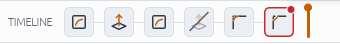
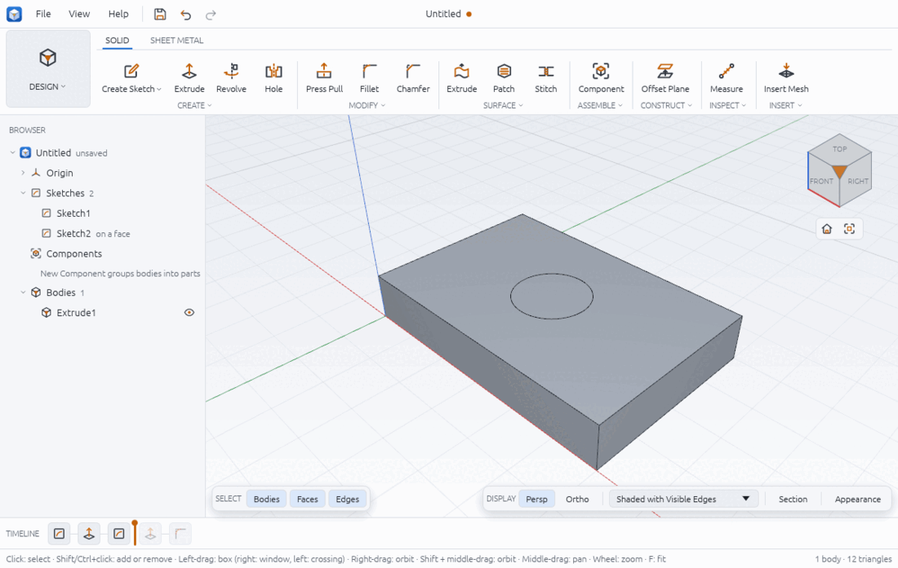

# The timeline

The timeline along the bottom of the window is the design's history: one tile per sketch and feature, in the order they are built. Chamfera rebuilds the model from it every time something changes, so you can go back to any step, change it, and everything after it follows. The workflow will feel familiar to Fusion users.

## Read the tiles



- Each tile shows its tool's icon (sketch, extrude, fillet, ...). Hover a tile for its name, what it does ("Extrude 10 mm · from Sketch1") and its state.
- A **suppressed** feature is faded with a slash across it ("Suppressed: kept, but not built").
- A **failed** feature has a red border and a red dot; one that built but cannot be shown has an amber dot.
- The orange **marker** stands after the last built item. Items after it are greyed and not built.
- Grouped items sit under a group tile; click it to fold or unfold the group.

In the picture above, the hole cut (fourth tile) is suppressed, so the chamfer on its edge (last tile) fails: its edge is no longer there.

## Roll back with the marker



1. Drag the orange marker to the left, between two tiles. While you drag, a line shows where it will land.
2. Release. The design is rebuilt up to the marker: here the plate shows its hole sketch but no hole and no fillets.
3. Anything you add now goes in at the marker, before the greyed items.
4. Drag the marker back to the end to build everything again.

You can also right-click a tile and choose **Move Marker After This**. The marker cannot move while a sketch is being edited ("finish the sketch before changing the timeline").

## Edit a sketch or feature

- **Double-click** a tile, or right-click it and choose **Edit…**.
- A sketch opens for editing (finish the active sketch first, if there is one).
- A feature opens its own dialog: extrudes, holes and sheet metal features their full tool; most others the **Edit Feature** dialog with the value that defines them (distance, angle, count, size, thickness) and **Build this feature**.
- Click **OK**. The model rebuilds; an edit the kernel cannot build is refused with the reason and nothing changes (for example "the fillet is too large: it would consume 2:top 3; use a smaller size").

## Rename

Select a tile and press **F2**, or right-click and choose **Rename Sketch** or **Rename Feature**. Type the name and press Enter.

## Suppress and unsuppress

Right-click a feature tile and choose **Suppress** (or **Unsuppress**). A suppressed feature stays in the timeline but is not built; features after it that need it then fail until you unsuppress it. Untick **Build this feature** in the Edit Feature dialog does the same.

## Delete

Right-click a feature and choose **Delete Feature**, or a sketch and choose **Delete Sketch**. A feature that others use is not deleted: the reply says what uses it ("Extrude1 is used by Sketch2, Fillet1; delete or change them first"). Delete or change those first.

## Reorder

Drag a tile left or right and drop it in a gap. A move that would put a feature before something it needs is refused ("Fillet1 uses Extrude1, so it cannot come before it") and nothing changes. A group moves as a whole.

## Group

Click a tile, Ctrl- or Shift-click more adjacent tiles, then right-click one of them and choose **Group 2 Items**. Rename a group from its tile's menu, or ungroup it with **Ungroup**.

## Failed features and their errors

When a change upstream breaks a feature, the change is still made and the feature is marked as failed. Everything before it is built as usual.

1. Hover the red tile to read the error, and the broken reference if there is one.
2. Or right-click it and choose **Show Error**: the window names the feature ("Chamfer1 failed"), the error ("chamfer: the edge "4:bottom 0" is no longer there") and the **Broken reference** ("edge "4:bottom 0" of Extrude2").
3. Fix it by editing that feature (pick another edge, a smaller size), editing or unsuppressing the feature it refers to, or undoing the change.

Common causes: a fillet or chamfer whose edge disappeared, a sketch on a face that is gone, a value that no longer fits (a shell thicker than the wall). Kernel refusals ("not supported yet: …") are explained in troubleshooting.md.

## Undo and redo

- **Ctrl+Z** undoes, **Ctrl+Y** or **Ctrl+Shift+Z** redoes; the arrows in the top bar do the same.
- Every command is one step: adding, editing, moving, suppressing, rolling the marker. Up to 200 steps are kept.
- Undo works across the timeline and the rest of the design (parameters, configurations, CAM operations).

## From a script

```json
[
  { "command": "timeline.list" },
  { "command": "timeline.roll_to", "params": { "position": 2 } },
  { "command": "timeline.roll_to_end" },
  { "command": "timeline.move", "params": { "item": 5, "to": 2 } },
  { "command": "feature.edit", "params": { "feature": 4, "suppressed": true } },
  { "command": "feature.edit", "params": { "feature": 2, "distance": 20 } },
  { "command": "timeline.rename", "params": { "item": 2, "name": "Plate" } },
  { "command": "timeline.group", "params": { "items": [3, 4], "name": "Hole" } },
  { "command": "feature.delete", "params": { "feature": 5 } },
  { "command": "edit.undo" },
  { "command": "edit.redo" }
]
```

`position` is how many items stay built (0 to the number of items); `to` is the new index from 0. `timeline.list` replies with each item's `built`, `suppressed`, `error` and `broken_reference`, and the `marker`. Checked on a 60 × 40 × 10 mm plate with a 16 mm hole and 5 mm corner fillets (21 774.78 mm³ = 24 000 − 640π − 4 × 10 × (25 − 25π/4)): rolled back to 2 items it is the bare 24 000 mm³ plate.

## Limits

- There is one timeline per design; components do not have timelines of their own.
- The whole timeline after a change is rebuilt; caches make most edits fast, but a long sweep or many curved faces can still take a second (see troubleshooting.md).
- Moving or deleting is refused rather than repaired: Chamfera does not reattach features to other edges for you.
- Undo history is lost when you open another design or quit.

Related: solid-modelling.md, parameters-and-configurations.md, version-history-and-recovery.md.
