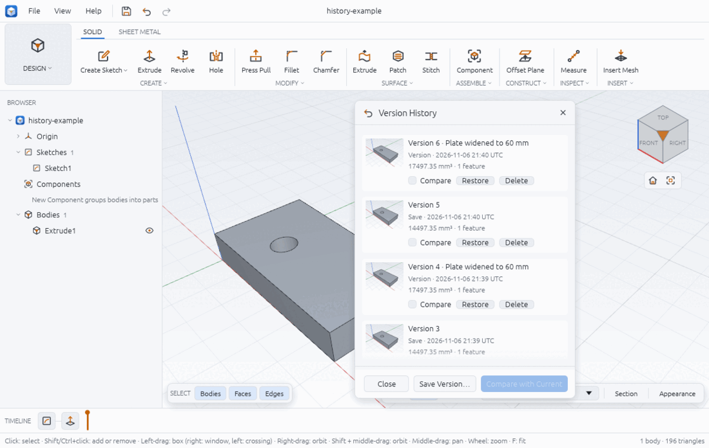
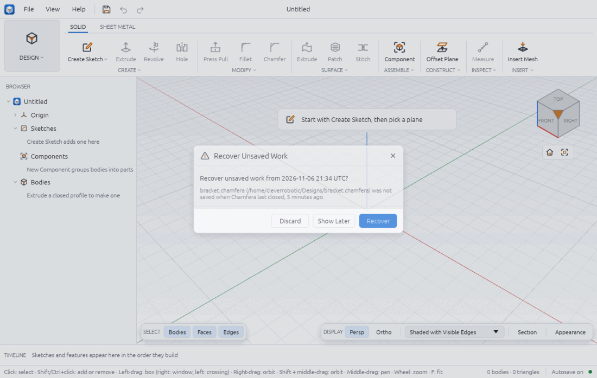

# Version history and recovery

Chamfera keeps your work safe in three ways: every save writes the design file atomically (a crash never leaves half a file) and keeps a **version** beside it; you can save a **version with a note** at any time; and while you have unsaved changes, **autosave** writes them to a recovery file that is offered again after a crash.

## Save a design

- **File > Save** (Ctrl+S) writes to the design's file. The first time, it asks where; the name ends in `.chamfera`.
- **File > Save As…** (Ctrl+Shift+S) always asks.
- **File > Open Recent** lists the designs you opened or saved last (how many: Preferences > General, see preferences.md).

The window title shows the file name, with a dot (•) while there are unsaved changes. New, Open and Quit ask first when there are unsaved changes: **Save**, **Don't Save** or **Cancel**.

## Versions kept beside the file

Each save also keeps a version in a folder next to the design: `plate.chamfera` keeps its versions in `plate.chamfera.history/`. A save that changes nothing since the last version adds no new one. By default the 50 newest versions and at most 500 MB of them are kept (Preferences > General > Versions kept and History size); the oldest go first, and the newest is always kept. If the history cannot be written, the save still happens and the status bar says "Saved …; no version kept: …".

Copy or move the `.history` folder with the design if you want its history to come along.

## Save Version with a note

1. Press **Ctrl+Alt+S**, or choose **File > Save Version…**, or click **Save Version…** in the History panel.
2. Type what changed in **What changed in this version?** (up to 500 characters).
3. Click **Save**. The design is saved and a version with that note is kept ("Saved version 2"). A version with a note is always kept, even if nothing changed.

A design that was never saved asks where to save first.

## The History panel



Open it with **File > Version History…**. A design that was never saved shows "Save the design to a file first: each save keeps a version beside it."

Each row shows the version number and note, whether it was a **Save** or a noted **Version**, the time (UTC), the volume and feature count, and a small picture of the model (drawn after the save, on a machine with a GPU).

### Restore a version

1. Click **Restore** on its row.
2. Confirm: "Replace the open design with version 1? Undo brings back the design as it is now; the file changes only when you save."
3. The design is replaced ("Restored version 1 (Ctrl+Z undoes it)"). Save to make it the file's content; Ctrl+Z goes back.

### Compare two versions

1. Tick **Compare** on one row to compare it with the current design (the button reads **Compare with Current**), or on two rows to compare them with each other (**Compare**).
2. Click the button. The **COMPARISON** section lists the parameters changed ("Parameter w: 50 mm to 60 mm"), the timeline items added, removed and changed, and the volume change (B minus A). In the viewport, A is shaded and B drawn see-through over it.
3. Click **Clear Comparison**, or close the panel, to take it out of the viewport.

Checked with `examples/version-history.json`: a 50 × 30 × 10 mm plate with an 8 mm hole (15 000 − 160π = 14 497.35 mm³), widened to 60 mm (17 497.35 mm³): the comparison reports `w` 50 mm to 60 mm, Sketch1 changed and a volume change of +3000 mm³ (10 mm × 30 mm × 10 mm).

### Delete a version

Click **Delete** on its row and confirm ("This cannot be undone"). Version numbers are never reused.

## Autosave and the recovery question

While the design has unsaved changes, it is written every 60 seconds (Preferences > General > Autosave every, 10 to 3600 s, or off) to a recovery file in your data folder:

| System | Recovery folder |
|---|---|
| Linux | `$XDG_DATA_HOME/chamfera/recovery`, else `~/.local/share/chamfera/recovery` |
| macOS | `~/Library/Application Support/Chamfera/Recovery` |
| Windows | `%LOCALAPPDATA%\Chamfera\Recovery` |

The status bar shows the state at its right: **Autosave on**, **Autosave pending**, **Autosaved**, **Autosave off** or **Autosave failed** (hover for details). Saving the design, or quitting cleanly (after Save or Don't Save), removes the recovery file. A crash leaves it.



At the next start Chamfera asks **Recover unsaved work from <time>?**, naming the design and its file (or "never saved"):

- **Recover** opens that work. It counts as unsaved changes to its file, so Save writes it there.
- **Show Later** keeps the recovery file and asks again at the next start.
- **Discard** deletes the recovery file.

If several designs had unsaved work, the question says "1 of 3 designs with unsaved work" and asks about each in turn. Work you saved after its recovery file was written, and files of a Chamfera that is still running, are not offered.

## From a script

```json
[
  { "command": "design.save", "params": { "path": "plate.chamfera" }, "as": "v1" },
  { "command": "param.set", "params": { "name": "w", "expression": "60 mm" } },
  { "command": "version.save", "params": { "note": "Plate widened to 60 mm" }, "as": "v2" },
  { "command": "version.list" },
  { "command": "version.compare", "params": { "a": "$v1.version", "b": "current" } },
  { "command": "version.compare", "params": { "clear": true } },
  { "command": "version.restore", "params": { "id": 1 } },
  { "command": "version.delete", "params": { "id": 1 } }
]
```

`design.save` replies with `version` and `version_unchanged`; `version.save` with the new version; `version.list` with each version's id, time, note, kind and summary. `design.recover {path, design_path}` opens a recovery file. `chamfera --history` opens the panel at start. The `version.*` commands work on the open design's own history, so save it to a file first.

## Limits

- The history lives in a folder beside the file: if you copy only the `.chamfera` file, its history stays behind. There is no branching or merging of versions.
- The comparison lists what changed by parameter and timeline item, not a face-by-face difference.
- Autosave keeps one recovery file per running window, not a series; versions are only made by saving.
- In the browser build the design is kept in the browser's local storage instead, and there is no Save As, version history or recovery file.
- Comparing versions in the viewport crashed the desktop app in our tests on this build (a graphics validation error); the comparison list in the panel and `version.compare` from scripts work. Until it is fixed, save your work before comparing.

Related: timeline.md (undo), file-formats.md, preferences.md, troubleshooting.md.
